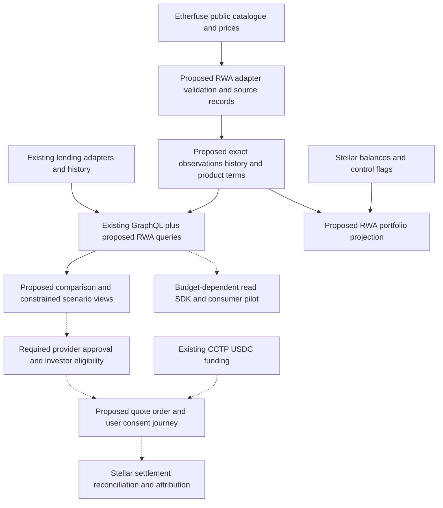

# Lendwise — SCF #46 Integration Track

Prepared for review on 6 November 2026 (Asia/Dubai). Sections 1 and 2 are the application narrative; sections 3–5 record review findings, sources and remaining submission decisions. No RWA integration has been implemented. Repository assessment baseline: `65072b13db1792eecf3ae5330cf4dbc8ec1cb4bd` on `main`.

## 1. Products & Services

### Lendwise: From DeFi Lending to RWA Intelligence

We build Lendwise, a multichain lending intelligence platform that helps users discover markets, compare supply and borrowing rates, examine historical data, monitor positions and explore allocation scenarios. Our public catalogue endpoint returned 962 lending markets across 27 standardized chains when checked on 6 November 2026. These are product-coverage figures, rather than counts of users or transactions. The platform brings Aave, Morpho, Compound and Stellar’s Blend into a common interface. <https://lendwise.fi/> <https://lendwise.fi/api/stats>

Our previous SCF-funded development brought Stellar lending into the infrastructure already used for the EVM protocols, including Blend v2.1 data, Stellar wallet connectivity, portfolio monitoring and a native-USDC funding route through Circle CCTP. We are now proposing the next extension: yield-bearing tokenized real-world assets, beginning with Etherfuse Stablebonds issued on Stellar. This extends an existing product rather than introducing a new financial primitive. Our RWA adapter, comparison views and RWA portfolio projection are proposed development; they are not live features. <https://lendwise.fi/docs/guide/what-is-lendwise> <https://github.com/lendwise-fi/lendwise/blob/65072b13db1792eecf3ae5330cf4dbc8ec1cb4bd/src/config/protocols-server.ts>

### The RWA Opportunity and Market Fragmentation

Stellar already supports a material tokenized-asset market. RWA.xyz’s Stellar page displayed approximately $4.49 billion in distributed asset value and 84 RWAs when reviewed on 6 November 2026; it separately reported represented asset value and stablecoins. These are provider-defined ecosystem measurements, not Lendwise assets or an estimate of the capital we can acquire. Distributed assets can still have eligibility and whitelist controls. Issuers including Etherfuse, Spiko, Ondo, Franklin Templeton and WisdomTree demonstrate the breadth of the opportunity. <https://app.rwa.xyz/networks/stellar> <https://stellar.org/solutions/real-world-assets>

The problem is not that RWA information is absent. Existing services already aggregate products, prices and yields. The difficulty is making different financial conventions and investment conditions usable together. A variable lending APY, a bond’s yield to maturity, a money-market fund’s seven-day yield and a fund’s NAV-based return answer different questions. Issuers also differ in publication schedules, currency, fees, minimum investment, maturity, liquidity, redemption terms and investor restrictions. A larger displayed percentage can be inappropriate for someone who needs their money sooner or cannot access the product.

Developers face the same problem when combining an RWA exposure with DeFi debt. Turbolong publicly describes leveraged Blend strategies and displays an Etherfuse-named USDC pool. That branding does not establish Stablebond exposure. The Stablebond-plus-borrowing use case discussed with our team is proposed and requires exact asset, pool and strategy validation. Such applications need compatible asset identities, current borrowing information, source timestamps and product terms—not simply two headline rates. An indicated asset return less a borrowing APY does not establish strategy profit: leverage, variable debt, fees, FX, collateral factors, liquidation and the ability to unwind all affect the result. <https://turbolong.com/>

### Our Proposed Integration: How It Works

Etherfuse is the primary integration and the center of the requested development. The current official SCF list includes Etherfuse; its indicative integration estimate is 1–2 weeks for the partner connection, not the complete financial-data, portfolio and transaction-reconciliation product described here. The costed scope must distinguish that connection from the supporting work and allocate most funding to eligible integration delivery. <https://stellar.gitbook.io/scf-handbook/scf-awards/build-award/integration-track/integration-list>

We propose starting with USTRY in USD and CETES in MXN. Etherfuse’s public catalogue currently identifies both on Stellar, alongside GILTS, KTB, EUROB and TESOURO. We will bind each representation to its network, asset code and approved issuer account, rather than matching a symbol alone. The observed issuer for these catalogue entries is `GCRYUGD5NVARGXT56XEZI5CIFCQETYHAPQQTHO2O3IQZTHDH4LATMYWC`; this is a checked observation, not permission to accept a changed issuer automatically. <https://api.etherfuse.com/lookup/stablebonds> <https://docs.etherfuse.com/guides/chains/stellar>

The new read adapter will reuse the isolation and orchestration patterns of our existing protocol adapters while writing a separate RWA model. Public lookup responses provide catalogue information, indicative basis-point rates, fiat/USD price marks, FX inputs and timestamps. They do not establish a complete historical archive, investor maturity date or effective APY convention. We will preserve the issuer’s original metric and source evidence, confirm compounding, day count and fee treatment, and leave unsupported derived values unknown. An issuer price will not be relabeled official NAV without confirmation. History will begin prospectively; retrospective performance will be included only where a legitimate source supports it. <https://docs.etherfuse.com/price-feeds> <https://api.etherfuse.com/lookup/tokens/cost>

In the dashboard, users will evaluate return information alongside investment conditions. For example, a USD lending opportunity and USTRY can be examined over the same intended holding period only when the relevant rate and fee assumptions are justified; comparing CETES to USD lending additionally requires an explicit currency scenario. A user with a short liquidity deadline should see why a restricted or delayed redemption may rule out an asset. Historical performance, indicative rates and modeled outcomes will remain visibly different. Unknown eligibility or liquidity will not become an affirmative access claim.

We will extend portfolio monitoring to identified Stellar RWA balances and indicative price marks, retaining exact quantities, valuation dates and transfer-control information. This requires a new read projection: the legacy wallet view converts balances to floating-point numbers and does not retain all liabilities or control flags. Holdings plus traceable marks are the initial scope; cost basis, realized profit and complete income reporting require additional evidence. A Classic balance and its Stellar Asset Contract view represent the same economic holding and must not be counted twice. Distributions, accruing value, maturity and redemption claims require share-class-specific treatment. Pending subscriptions/redemptions must not count both a token balance and the same outstanding claim. Observing tokens proves a ledger balance; it does not prove unconditional legal ownership, eligibility or redemption rights. <https://developers.stellar.org/docs/tokens/stellar-asset-contract>

Our existing optimizer provides lending allocation scenarios. The initial RWA extension will add condition-aware screening and scenario inputs for horizon, currency, liquidity, fees, minimum investment, maturity and issuer exposure. It will exclude incompatible candidates and treat unknown eligibility or cash-out timing as insufficient evidence for a feasible allocation. Source facts and user-specified scenario calculations are the intended funded boundary; personalized recommendations or advice are excluded pending confirmation of the applicable award terms. A broader RWA allocation solver is later work: our current optimizer interface does not establish support for these new constraints, which require separate implementation and acceptance. Informational scenarios will remain separate from any executable investment instruction. <https://lendwise.fi/docs/guide/optimization>

Additive GraphQL queries will expose product metadata, original metric types, historical observations, source times and quality, while preserving current lending queries. A lightweight `@lendwise/sdk` is proposed as a budget-dependent extension, not a prerequisite for the Etherfuse release. Its reusable read interface would combine RWA observations with Blend supply/borrow data and freshness/error information, without embedding Turbolong’s strategy logic, signing authority or private customer records. Our team has received expressed interest from Turbolong in integrating Lendwise data; this is a potential consumer, not a finalized partnership or completed integration. <https://github.com/lendwise-fi/lendwise/blob/65072b13db1792eecf3ae5330cf4dbc8ec1cb4bd/src/lib/graphql/schema.ts> <https://turbolong.com/>

For the grant’s on-chain outcome, the intended scope needs one provider-approved Etherfuse investment journey, beyond analytics. The documented Stellar ramp/swap architecture provides a feasible starting point: approved customer onboarding and wallet registration, discovery of the customer’s supported asset pair, an expiring quote, order creation, explicit user consent/signature where required, and reconciliation of the provider order with the exact ledger asset, recipient and received amount. The particular USDC/Stablebond pair, production entitlement, countries, fees, settlement mechanics and attribution rights must be confirmed before that route becomes a committed deliverable. For execution we will discover the chain-specific identifiers through the authenticated asset API and check them against the approved product map. A Stellar token swap would fit a CCTP-funded journey only if the pair is approved; the separately documented Mexico/MXN fiat onramp has a different funding and claimable-balance lifecycle. Public API access alone does not resolve these conditions. <https://docs.etherfuse.com/overview> <https://docs.etherfuse.com/guides/onboarding> <https://docs.etherfuse.com/guides/chains/stellar>

Additional issuers are an extensibility roadmap; none is committed to the recommended funded MVP. Spiko is the strongest next data candidate because its official public API covers share classes, NAV history and yields, and it publishes Stellar token addresses. Ondo confirms Stellar USDY, with primary access restricted to eligible non-US investors, and Franklin Templeton publishes a Stellar BENJI issuer; reusable historical feeds, access rights and product-specific servicing still need verification. WisdomTree confirms tokenized funds on Stellar, including treasury and money-market products in its fund range, but a specific share-class/address/feed integration must be established. Centrifuge has announced Stellar deJTRSY/deJAAA; its exact deployed identities and applicable data interfaces require validation before commitment. Each issuer will have an isolated adapter; none is assumed to share Etherfuse’s economics or investment access. <https://docs.spiko.io/developers/public_api/getting_started/> <https://docs.spiko.io/documentation/tokenization/addresses/> <https://ondo.finance/blog/usdy-is-now-live-on-stellar> <https://digitalassets.franklintempleton.com/benji/benji-contracts/> <https://www.wisdomtree.com/onchain/insights/blog/rwa-story-stellar> <https://www.wisdomtree.com/onchain/tokenized-funds> <https://centrifuge.io/blog/derwa-on-stellar-with-20m-allocation>

### Competitive Differentiation

We are not claiming to be the first or only RWA intelligence service. VenaLabs currently displays Stellar RWA, vault and liquidity-pool opportunities, including Etherfuse, with comparison and alerts; it also offers a lending filter, which alone does not prove active lending coverage. Its product detail pages already discuss source times, history gaps, eligibility, redemption and valuation risks. RWA.xyz provides broad asset/network analytics, financial and product information, NAV/yield methodology, fee/income treatment and APIs. DeFiLlama offers Stellar RWA analytics and a separate established yield dataset. SwanBluechip also compares tokenized Treasury and DeFi yields, with historical readings, holding-period comparisons and position-oriented tools. Stellar Expert supplies complementary ledger and asset inspection. These existing capabilities rule out a credible differentiation claim based merely on displaying yields, conditions or an API. <https://venalabs.com/en/v3/yields> <https://docs.rwa.xyz/home> <https://defillama.com/rwa/chain/stellar> <https://defillama.com/yields> <https://swanbluechip.com/yields/> <https://stellar.expert/explorer/public> <https://venalabs.com/en/v3/yields/b330940b-b0f5-378c-8f3b-1856c59113d4> <https://docs.rwa.xyz/methodology/nav-and-yield.md>

Our proposed distinction is a coherent workflow built into an existing multichain lending product: preserve financial meaning, test investment conditions against the user’s horizon, view relevant lending and RWA holdings together, feed compatible observations into constrained allocation scenarios, distribute the same evidence through reusable APIs, and connect an approved Etherfuse journey to independently reconciled settlement. For users, that means understanding why a product may or may not fit their needs. For applications, it means fewer issuer-specific mappings and more traceable inputs when combining Stellar assets with lending. This is a delivery proposition to prove through working comparisons, reconciled positions and consumer tests; it is not a claim that competitors lack these capabilities or cannot reproduce them.

### Go-to-Market and Commercial Model

We will first introduce Etherfuse products to people already using Lendwise to compare lending markets, then validate the experience with Stellar RWA users and eligible investors. Discovery should explain conditions before offering a transaction. Award-funded outreach and user-testing materials must follow the program’s content restrictions; yield promotion and incentives tied to deposits or volume are outside the proposed outreach scope. An initial developer pilot with Turbolong, if agreed, can test the usefulness of combined issuer and Blend data; further protocols and institutional users are potential audiences rather than committed customers. Adoption work should establish whether users return, monitor holdings and complete supported journeys, not rely on paid transaction incentives.

Public market discovery currently has a free entry point. The repository contains billing-related interface code, but that is not evidence of paid adoption or a validated pricing model. Our initial commercial hypothesis is paid higher-volume data access and integration support for application developers, while essential discovery remains accessible. A jointly agreed consumer pilot would test data usefulness, service requirements, licensing and willingness to pay before commercialization. Professional analytics, licensed historical datasets and enterprise integrations are later options. Data redistribution rights and demonstrated willingness to pay must precede commercialization. We make no revenue, paid-customer or pricing claims. <https://lendwise.fi/> <https://github.com/lendwise-fi/lendwise/blob/65072b13db1792eecf3ae5330cf4dbc8ec1cb4bd/src/components/landing/CTASection.tsx>

Existing CCTP functionality can help users bring native USDC from configured EVM sources to Stellar; it is reused infrastructure, not a new grant deliverable. It does not buy an RWA or satisfy issuer eligibility. Our code configures Ethereum, Base, Arbitrum and Optimism on mainnet, with published evidence for a Base-to-Stellar transfer. XLM reserve/fees, trustlines and the subsequent issuer action remain separate requirements. <https://developers.circle.com/cctp> <https://github.com/lendwise-fi/lendwise/blob/65072b13db1792eecf3ae5330cf4dbc8ec1cb4bd/src/lib/execution/cctp/config.ts>

Privy and Mercuryo are eligible listed integrations but remain optional and budget-dependent. Privy documents native Stellar wallet creation and Tier 2 transaction signing; our exact ownership, recovery, SEP-10 and Soroban authorization flows still need testing. Mercuryo documents native Stellar USDC and XLM delivery in an existing partner offering, but Lendwise merchant enablement, supported countries, asset identity, limits and payment/refund handling are unverified. We will not reuse an expired promotion as a price promise. Existing external Stellar wallets and CCTP remain available without either integration. Issuer execution must check actual spendable Circle-USDC funds, liabilities and fee capacity; an unresolved bridge amount or a `completed` label alone cannot trigger an investment. <https://docs.privy.io/wallets/overview/chains> <https://docs.privy.io/wallets/wallets/create/create-a-wallet> <https://docs.privy.io/recipes/tier-2-wallet-integration> <https://mercuryo.io/explore/announcements/buy-usdc-xlm-mercuryo-tangem-zero-fees>

### Why Stellar and Ecosystem Impact

Stellar brings tokenized financial assets, native stablecoins, Blend lending, Soroban programmability and financial settlement into the same ecosystem. Lendwise can connect those capabilities to an audience already comparing opportunities across chains. The intended path is concrete: discover a Stellar asset, understand its conditions, connect or fund a Stellar wallet, pass the issuer’s requirements, accept a supported quote, authorize the specific transaction and verify settlement. The issuer journey is new proposed work; the bridge and lending data are existing foundations.

We will measure this path in separate layers. Product analytics can track discovery, return visits, holdings monitoring and API/SDK use. Wallet onboarding and completed CCTP transfers are distinct chain events. Actual RWA activity requires an attributable issuer transaction; API queries, a funding transfer, a redirect or a visible balance cannot substitute for that evidence.

For the Integration Track, we propose measuring cumulative value of settled Etherfuse investment transactions attributable to the new journey, subject to SCF acceptance of that metric and footprint. Private records would join the customer/order to the payment and receiving legs. For swaps, `sendTransactionHash` proves payment while `receiveTransactionHash` identifies delivery; only reconciled receiving evidence counts. We would verify network, success, exact asset, recipient and net quantity, deduplicate each operation/event, and apply a documented reporting-currency valuation. Claimable-balance delivery remains distinct from a claimed holding until SCF agrees its treatment. Public reports expose consented aggregates and ledger evidence, not private customer/KYC identifiers. Failed orders, duplicate events, bridge funding, self-generated/wash activity and unrelated holder transfers would be excluded. Shared issuer accounts alone cannot identify our contribution. We must agree a credible numerical threshold, measurement window and registerable footprint before submission; none is invented here. Customer/order correlation must be accepted as part of that attribution design, not assumed to replace the registered footprint. The final tranche depends on the ratified outcome, not launch alone. <https://stellar.gitbook.io/scf-handbook/scf-awards/build-award/submission-criteria> <https://stellar.gitbook.io/scf-handbook/scf-awards/build-award/integration-track>

Our long-term ambition is a comprehensive financial intelligence platform for DeFi lending and tokenized RWAs, comparable in scope of ambition to Bloomberg’s information role in traditional markets. The practical contribution starts smaller: make Stellar-issued assets easier to understand within a multichain financial view, help developers use reliable inputs, and support verified activity where the asset’s permissions and transaction interfaces allow it. We are not forecasting material XLM fee demand from analytics usage.

## 2. Traction Evidence

### Stellar RWA Opportunity and Ecosystem Demand

Stellar’s existing issuer ecosystem and RWA.xyz’s approximately $4.49 billion distributed-asset snapshot show a meaningful market to serve. They do not demonstrate Lendwise market share, accessible liquidity or user demand for our particular product. Government-bond exposures, tokenized funds and lending already coexist; the opportunity is to help users and developers evaluate them with their different financial and access conditions intact. <https://app.rwa.xyz/networks/stellar> <https://stellar.org/solutions/real-world-assets>

The developer use case is specific. Turbolong publicly describes leveraged Blend strategies. Its expressed interest in our data and the proposed Stablebond/borrowing use case are team-reported discussions, not independently verified product deployment. That interest motivates a consumer pilot and a jointly tested interface; it is not a signed agreement or completed integration. Our existing Blend data and Stellar funding route provide an adoption pathway, while Etherfuse data and a supported investor journey remain to be built. Competitors’ existing RWA services demonstrate an established category, not validated demand for Lendwise’s proposed extension. <https://turbolong.com/>

### Proven Product and Team Execution

We have delivered a working multichain lending platform. Its public catalogue response, checked on 6 November 2026, reports 962 markets, 27 standardized chains and 169 assets; the response generation time is `2026-11-05T22:36:30.941Z`. The chain count is configuration-derived and the market count comes from the catalogue; neither proves that every source was fresh at the instant of this review. These figures support product breadth, not user growth. We make no unverified active-user, recurring-user, API-consumer or revenue claims, and do not infer adoption from coverage. <https://lendwise.fi/api/stats> <https://github.com/lendwise-fi/lendwise/blob/65072b13db1792eecf3ae5330cf4dbc8ec1cb4bd/src/app/api/stats/route.ts>

The public repository registers Aave, Morpho, Compound and Blend v2.1 through isolated adapters. It implements spot collection, hourly/daily history, a PostgreSQL model, GraphQL readers, portfolio routing, wallet authentication and the optimizer client/proxy. Blend v2.1 uses the v2 contract-generation SDK against a distinct deployment; it is not an invented new contract interface. Lending history also includes Hubble-based reconstruction of contract state. This is concrete reusable engineering, rather than evidence that RWA accounting or execution is already solved. <https://github.com/lendwise-fi/lendwise/blob/65072b13db1792eecf3ae5330cf4dbc8ec1cb4bd/src/config/protocols-server.ts> <https://github.com/lendwise-fi/lendwise/blob/65072b13db1792eecf3ae5330cf4dbc8ec1cb4bd/src/lib/protocols/blend/v2_1/index.ts> <https://github.com/lendwise-fi/lendwise/blob/65072b13db1792eecf3ae5330cf4dbc8ec1cb4bd/src/lib/protocols/stellar/hubble-history.ts>

We completed and validated our previous SCF #45 work, with the completion and review records already held by SDF/SCF. The public award record confirms an awarded submission, and our repository documents the delivered product and supporting evidence. This track record establishes experience bringing Stellar into an operational multichain application; it does not constitute an endorsement of the proposed RWA integration. <https://communityfund.stellar.org/submissions/recmK8tdxCKvSU3GS> <https://github.com/lendwise-fi/lendwise/blob/65072b13db1792eecf3ae5330cf4dbc8ec1cb4bd/README.md>

Public mainnet ledger evidence independently confirms a successful Stellar mint associated with our documented CCTP flow. The explorer record and Horizon response support that settlement; they do not establish broad bridge adoption or prove every configured source route has been exercised. Existing tests, fixtures and CI provide further engineering evidence, while deployment configuration and a green badge alone are insufficient to establish production correctness. <https://stellar.expert/explorer/public/tx/64717907a20683eca1b62b8852252a02cb43caadbbdb71a73613e5e692266d50> <https://horizon.stellar.org/transactions/64717907a20683eca1b62b8852252a02cb43caadbbdb71a73613e5e692266d50>

### Etherfuse Integration Readiness and Development Plan

We have not started implementing RWA integrations. Our preparation consists of architecture work, examination of public Etherfuse interfaces and team-reported contact about data access and methodology. Those discussions identify a concrete need for one trustworthy issuer-and-lending interface; they are not a signed agreement, production entitlement or confirmed data license. A potential consumer would have to verify exact product/pool identities, timestamps, fee conventions, partial-error behavior and source traceability in its own integration before the pilot counts as validation. Public catalogue and price responses make a current-data adapter technically plausible; economic conventions, history rights and the exact investor journey still require answers. <https://api.etherfuse.com/lookup/stablebonds> <https://api.etherfuse.com/lookup/tokens/cost> <https://docs.etherfuse.com/overview>

The existing adapter contract, ingestion jobs, database, GraphQL API and portfolio loader reduce infrastructure work. We will reuse their isolation, routing and failure-reporting patterns. We will add separate issuer/product/share-class records, exact chain representations, immutable source observations, revisions and source-aware publication calendars. Hubble can reconstruct supported ledger state, but cannot manufacture an off-chain NAV or historical yield methodology. Existing neighboring-observation repair for lending must not become invented issuer history. <https://github.com/lendwise-fi/lendwise/blob/65072b13db1792eecf3ae5330cf4dbc8ec1cb4bd/src/lib/protocols/core/types.ts> <https://github.com/lendwise-fi/lendwise/blob/65072b13db1792eecf3ae5330cf4dbc8ec1cb4bd/src/lib/reconcile/index.ts> <https://github.com/lendwise-fi/lendwise/blob/65072b13db1792eecf3ae5330cf4dbc8ec1cb4bd/src/lib/db/schema.ts> <https://github.com/lendwise-fi/lendwise/blob/65072b13db1792eecf3ae5330cf4dbc8ec1cb4bd/src/lib/portfolio/load.ts>

For USTRY and CETES, each comparison field needs a source and acceptance status. Catalogue identity/currency and current price/rate fields are observed; generic onboarding and transaction steps are documented. Original rate convention, price classification, recurring fees, minimums, product maturity semantics, dealing/redemption calendars and redistribution rights require approved issuer terms or provider confirmation. Investor-specific access comes from authorized servicing data, never a public balance. We will store the source URL/document version, effective date and verification status for those terms; missing conditions remain unknown and exclude claims of feasible investment.

The proposed runtime has separate public-data and permissioned transaction paths. These are new RWA components attached to existing infrastructure:

We plan implementation in verifiable stages. First, implement the USTRY/CETES adapter and additive schema with pinned fixtures, exact asset checks, original metric retention and unknown-value handling. Next, add signed collection jobs, bounded retries, idempotent writes, revision-aware history, freshness reports and comparison views. Portfolio acceptance requires exact balances, no Classic/SAC duplication, traceable marks and explicit restrictions. API acceptance requires backward-compatible lending queries, bounded history and data-quality outputs. Comparison acceptance will preserve lending source APR, supply/borrow direction, compounding, reward and fee conventions too. Blend’s stored daily-compounded APY is a reporting convention, not evidence of realized daily reinvestment. Outputs must be comparable, informational only or not comparable, with reasons. The initial optimizer work is screening and user-directed scenarios within the confirmed award-use boundary; an independent SDK, advanced allocation and other issuers enter only if cost and partner evidence justify them. <https://github.com/lendwise-fi/lendwise/blob/65072b13db1792eecf3ae5330cf4dbc8ec1cb4bd/src/app/api/yield/apy/spot/route.ts> <https://github.com/lendwise-fi/lendwise/blob/65072b13db1792eecf3ae5330cf4dbc8ec1cb4bd/src/lib/graphql/schema.ts> <https://github.com/lendwise-fi/lendwise/blob/65072b13db1792eecf3ae5330cf4dbc8ec1cb4bd/src/app/api/optimizer/route.ts>

For the transaction component, acceptance requires written provider access, the supported pair and customer rules, entry and exit terms, sandbox proof, validated intent/expiry/signature behavior, idempotent recovery, authenticated callbacks with replay/out-of-order handling, and independently reconciled mainnet settlement for permitted users. A new issuer-specific validator must bind source, network, allowed operations, exact assets, destination/memo, amount, fees and expiry. The existing CCTP validator is specific to its forwarder and cannot authorize arbitrary issuer XDRs; renewed or changed payloads require revalidation and appropriate consent. A provider-hosted journey can be used only if its settlement correlation is sufficient; a referral click is not completion evidence. We will not bypass restrictions or hold custody as a shortcut. Before submission, we must establish that this deliverable is feasible within the costed budget and can support the agreed final-tranche metric.

Financial-data tests must cover yield-type interpretation, fees already embedded in NAV or net quotes, distribution treatment, FX direction, missing history, stale source times, corrected observations and exact decimals. Quote destination amounts already include applicable transaction fees; recurring fund costs remain separate. Price/rate/FX input times must be tracked independently, and an FX update is not a new bond-price publication. USD denomination must not erase USDC issuer/depeg exposure. Unknown exit timing must prevent a scenario from being presented as feasible. Signing tests must bind the owner, network, issuer, destination, amount and intended operation; simulation must precede Soroban submission. Issuer revocation/clawback and private investor eligibility remain distinct risks. CCTP transfer tracking is reused, with explicit reconciliation of receipt amount and warnings rather than assuming a `completed` label proves the financial outcome. New privileged routes must fail closed even though the current public limiter favors availability. Transaction expiry and recovery must be observable rather than described as automatic refunds. Threat modeling and a monitoring plan belong in tranche 2 before controlled mainnet release. <https://github.com/lendwise-fi/lendwise/blob/65072b13db1792eecf3ae5330cf4dbc8ec1cb4bd/src/lib/execution/cctp/service.ts> <https://github.com/lendwise-fi/lendwise/blob/65072b13db1792eecf3ae5330cf4dbc8ec1cb4bd/src/lib/execution/cctp/mint.ts> <https://github.com/lendwise-fi/lendwise/blob/65072b13db1792eecf3ae5330cf4dbc8ec1cb4bd/src/lib/auth/session-guard.ts>

This is a credible extension because the existing product already performs the lending collection, comparison, history, wallet and portfolio work on which the RWA integration depends. The new work has defined boundaries and testable outputs. Delivery confidence comes from that foundation and our previous execution; submission readiness additionally requires provider permissions, a defensible budget and a measurable, attributable on-chain outcome.

## 3. Independent Reviewer Audit

Four separate reviewer runs examined the same frozen draft before consolidation, each identifying five material findings. The frozen draft’s SHA-256 was `8bab982962633a29be43865dffabedf18cdd646f9e3bfa4c91b0a49004153549`. The final narrative incorporates the corrections below. These reviews assess this application and available evidence; they are not SCF panel decisions, a production security audit or issuer permission.

### Reviewer A — Senior SCF Integration Track Evaluator

1. **Final metric — blocking:** No numerical threshold, window or accepted registerable footprint has been supplied. The narrative now defines a candidate receiving-leg metric and exclusions; the actual commitment remains a pre-submission decision.
2. **Award-use restrictions — blocking:** Factual data, user-directed calculations and investment recommendations need distinct treatment. The funded proposal excludes advice and financial promotion pending confirmation of the applicable restrictions; calling an output informational does not establish permission.
3. **Cost and repeat funding — blocking:** Scope is not a budget. The SDK, extra issuers and onboarding are deferred unless costed; existing CCTP is reuse. Available follow-on headroom must be established from SDF’s existing records.
4. **Provider entitlement — blocking:** A documented API is not an approved investor route. Production pair/customer permissions, identifiers, exit terms and settlement correlation are now explicit entry gates.
5. **Traction quality — high:** Coverage and a mint prove capability, not recurring demand. Public Turbolong claims have been narrowed; discussions and SDF-held acceptance records remain separately attributed.

Etherfuse, Privy and Mercuryo are on the current eligible list, but listing is not approval of the whole proposal. Most funding must support the eligible integration, and a standalone developer-library proposal is not the intended track fit. <https://stellar.gitbook.io/scf-handbook/scf-awards/build-award/integration-track> <https://stellar.gitbook.io/scf-handbook/scf-awards/build-award/integration-track/integration-list>

The costed roadmap must fit the current six-month guideline and three deliverable tranches, with four payments of 10%/20%/30%/40%. It must include tranche-2 threat modeling/monitoring and the final mainnet outcome. Audit costs, legal fees, general operations and past work are excluded; any narrow user-testing allocation in tranches 2/3 is separately justified and capped at one-third, not an automatic allowance. <https://stellar.gitbook.io/scf-handbook/scf-awards/build-award/budget-and-deliverable-guidelines> <https://stellar.gitbook.io/scf-handbook/scf-awards/build-award/submission-criteria>

The handbook’s general follow-on ceiling is $150,000 cumulatively, subject to its exceptions; this is not a fresh allowance after #45. The distinct legacy “Previously Funded Project” provision concerns awards before #41, so its case-specific higher cap must not be assumed for this team. Actual headroom depends on SDF’s funding and payment-valuation records. <https://stellar.gitbook.io/scf-handbook>

Official award terms restrict investment advice involving Stellar assets, while the track also restricts financial framing in funded content. Factual comparison/scenario functions and any proposed user-testing material need scope confirmation before commitment; no blanket exemption or automatic product ineligibility is inferred. Jurisdiction, investor access and other SDF funding restrictions remain applicable. <https://stellar.gitbook.io/scf-handbook/scf-awards/official-rules-for-submissions>

### Reviewer B — Senior DeFi and RWA Financial Architect

1. **Executable entry and exit — blocking:** Current marks do not establish achievable investment proceeds or redemption. The narrative now requires a confirmed investor route and entry/exit terms before its transaction outcome can be promised.
2. **Turbolong exposure — high:** A pool named Etherfuse does not prove Stablebond collateral. Stablebond strategy interest is now team-reported and conditional on exact asset/pool mechanics.
3. **Lending conventions — high:** Blend’s daily-compounded display and reward/fee treatment require disclosure too. Comparable, informational-only and not-comparable outcomes replace an assumed universal APY ranking; historical quoted-rate averages are not investor returns.
4. **Net quotes and clocks — high:** Fees already included in destination amounts must not be deducted again. Independent price/rate/FX times, FX direction and USD-versus-USDC exposure are now acceptance requirements. <https://docs.etherfuse.com/fees>
5. **Portfolio and scenario limits — medium:** Initial portfolio scope is exact holdings and traceable indicative marks. Pending claims cannot duplicate tokens; unknown eligibility or exit timing blocks feasible-allocation claims. Leveraged consumers still need their own current risk/oracle/unwind state.

### Reviewer C — Stellar/Soroban Technical Architect and Security Auditor

1. **Route selection — blocking:** A token swap, MXN fiat ramp and claimable-balance delivery are different workflows. The proposed CCTP-funded swap remains subject to an actual approved pair; geography and investor eligibility cannot be inferred from catalogue coverage.
2. **Payment versus delivery — blocking:** A source payment or signed callback is insufficient. The design now reconciles the receiving transaction and exact quantity, handles reordered/replayed callbacks, and separates unclaimed delivery from a confirmed holding. <https://docs.etherfuse.com/webhooks>
3. **Funding reconciliation — high:** CCTP can report completion with missing amount evidence or a mismatch warning. Subsequent issuer execution requires reconciled spendable funds and fee/liability checks; expired-message recovery is not universally automatic.
4. **Issuer-specific consent — high:** SEP-10 proves owner control and the CCTP validator authorizes only its own mint. A new issuer-intent validator, refreshed-XDR checks and distinct Soroban authorization/simulation tests are included in acceptance.
5. **New position/data projection — high:** Legacy floating-point holdings cannot supply exact RWA accounting. The revised scope retains ledger/network/issuer identity, decimals, liabilities and controls, prevents Classic/SAC duplication, and distinguishes chain-specific mint fields from approved Stellar identity.

### Reviewer D — RWA Market and Evidence Specialist

1. **Addressable investor cohort — blocking:** Ecosystem asset value is not executable opportunity for every Lendwise user. Initial geography/customer category, supported rail, pair and production entitlement remain provider decisions; optional features cannot precede costing that route.
2. **Competitive overlap — high:** VenaLabs already covers important RWA conditions/history, RWA.xyz financial methodology/APIs, and SwanBluechip holding-period tools. Claims now identify these overlaps and present the combined Lendwise workflow as an advantage to demonstrate.
3. **Consumer interest — high:** The public Turbolong site does not verify a Stablebond integration. Interest remains team-reported, with no invented partnership, pilot agreement or usage commitment.
4. **Condition-field provenance — high:** Current prices do not supply a complete terms dataset. USTRY/CETES acceptance now identifies observed, documented and provider-confirmation fields; missing restrictions/calendars remain unknown. Distributed asset value can still include access controls.
5. **Demand, ownership and monetization — high:** Market coverage is not adoption. The narrative uses a concrete potential-consumer problem and test criteria, selects developer data access/support as a commercial hypothesis, and leaves named delivery ownership and verified usage for confirmation.

### Consolidated scope, verification and readiness

The strongest evidence is existing multichain engineering, public Blend/CCTP implementation, checked provider interfaces and a specific need for combined issuer/lending inputs. Shared concerns rank as follows: first, permission and attributable settlement; second, the numerical commitment and costed scope; third, award-use treatment; then demand validation, condition-data completeness and optional-feature risk. No public-source finding requires replacing Etherfuse as the primary integration.

The recommended funded MVP, after those entry gates are resolved, is USTRY/CETES data with truthful financial types and source-native history, a condition-aware comparison workflow, bounded RWA holdings/valuation, additive GraphQL, limited user-directed scenario inputs, and one approved Etherfuse transaction journey with independent settlement attribution. The existing optimizer is reused with a constrained extension; a broad allocator, packaged SDK, other issuers, Privy and Mercuryo require separate cost justification or move to later work. This is an integration of existing building blocks into a working product, not an independently funded new protocol or library project.

The reviews corrected the narrative directly rather than leaving disputed claims in place. All 74 distinct cited URLs were checked: 72 returned HTTP 200 directly; two WisdomTree URLs returned direct HTTP 403 but their published content was readable through the research browser. This access limitation is not treated as proof of a missing product. All 25 immutable repository file references resolve at the assessed commit. Structural, source and diagram checks accompany this document. A focused local run passed 117 existing tests in seven files covering Hubble/history/listing, SEP-10 and CCTP message/mint logic. That run does not establish a complete application test pass, external provider certification or security of unimplemented RWA code. No wallet transaction, issuer order or application submission was performed. Other available local lending prototypes were inspected for context but are not presented as deployed Lendwise traction or independently established team achievements.

**Final verdict: researched and internally reviewed; not yet ready to submit.** The remaining blockers are an approved transaction/data-access scope, a costed plan with funding headroom and named owners, the team’s numerical threshold/window and accepted attribution footprint, and resolution of applicable award-use restrictions. The first two sections are consolidated application prose, but an analytics-only fallback does not independently satisfy the unresolved on-chain commitment. SDF already holds the prior completion records; no renewed request for the team to share them is required.

## 4. Evidence & References

Sources were checked on 6 November 2026. Public pages and responses support their stated observations, not contracts, private approvals or future service guarantees. Repository links use the assessed immutable `main` commit. Team-reported conversations and SDF-held acceptance records are distinguished from publicly verifiable evidence.

1. Product and current coverage: <https://lendwise.fi/> and <https://lendwise.fi/api/stats>. The endpoint returned 962 markets, 27 standardized chains and 169 assets; its generation time is recorded in section 2. <https://lendwise.fi/docs/guide/what-is-lendwise>, <https://lendwise.fi/docs/guide/methodology>, <https://lendwise.fi/docs/guide/optimization> and <https://lendwise.fi/docs/guide/getting-started> explain the public product; they are not independent usage analytics.
2. Public repository: <https://github.com/lendwise-fi/lendwise>. Adapter registration and interface: <https://github.com/lendwise-fi/lendwise/blob/65072b13db1792eecf3ae5330cf4dbc8ec1cb4bd/src/config/protocols-server.ts> and <https://github.com/lendwise-fi/lendwise/blob/65072b13db1792eecf3ae5330cf4dbc8ec1cb4bd/src/lib/protocols/core/types.ts>.
3. Blend v2.1 deployment and state-derived history: <https://github.com/lendwise-fi/lendwise/blob/65072b13db1792eecf3ae5330cf4dbc8ec1cb4bd/src/lib/protocols/blend/v2_1/index.ts>, <https://github.com/lendwise-fi/lendwise/blob/65072b13db1792eecf3ae5330cf4dbc8ec1cb4bd/src/lib/protocols/blend/common/deployments.ts> and <https://github.com/lendwise-fi/lendwise/blob/65072b13db1792eecf3ae5330cf4dbc8ec1cb4bd/src/lib/protocols/stellar/hubble-history.ts>.
4. Collection, reconciliation and persistence: <https://github.com/lendwise-fi/lendwise/blob/65072b13db1792eecf3ae5330cf4dbc8ec1cb4bd/src/app/api/yield/apy/spot/route.ts>, <https://github.com/lendwise-fi/lendwise/blob/65072b13db1792eecf3ae5330cf4dbc8ec1cb4bd/src/lib/reconcile/index.ts> and <https://github.com/lendwise-fi/lendwise/blob/65072b13db1792eecf3ae5330cf4dbc8ec1cb4bd/src/lib/db/schema.ts>.
5. Public API, portfolio and optimizer boundaries: <https://github.com/lendwise-fi/lendwise/blob/65072b13db1792eecf3ae5330cf4dbc8ec1cb4bd/src/lib/graphql/schema.ts>, <https://github.com/lendwise-fi/lendwise/blob/65072b13db1792eecf3ae5330cf4dbc8ec1cb4bd/src/lib/portfolio/load.ts> and <https://github.com/lendwise-fi/lendwise/blob/65072b13db1792eecf3ae5330cf4dbc8ec1cb4bd/src/app/api/optimizer/route.ts>. Blend’s reporting conversion: <https://github.com/lendwise-fi/lendwise/blob/65072b13db1792eecf3ae5330cf4dbc8ec1cb4bd/src/lib/protocols/blend/v2/apy-spot.ts>. The external solver implementation and a separate MCP server were not available for inspection; references to MCP in comments do not establish a shipped MCP integration.
6. Stellar owner authentication and signing checks: <https://github.com/lendwise-fi/lendwise/blob/65072b13db1792eecf3ae5330cf4dbc8ec1cb4bd/src/contexts/StellarWalletContext.tsx>, <https://github.com/lendwise-fi/lendwise/blob/65072b13db1792eecf3ae5330cf4dbc8ec1cb4bd/src/lib/auth/stellar-sep10.ts> and <https://github.com/lendwise-fi/lendwise/blob/65072b13db1792eecf3ae5330cf4dbc8ec1cb4bd/src/lib/auth/session-guard.ts>.
7. CCTP implementation and route configuration: <https://github.com/lendwise-fi/lendwise/blob/65072b13db1792eecf3ae5330cf4dbc8ec1cb4bd/src/lib/execution/cctp/service.ts>, <https://github.com/lendwise-fi/lendwise/blob/65072b13db1792eecf3ae5330cf4dbc8ec1cb4bd/src/lib/execution/cctp/message.ts>, <https://github.com/lendwise-fi/lendwise/blob/65072b13db1792eecf3ae5330cf4dbc8ec1cb4bd/src/lib/execution/cctp/mint.ts> and <https://github.com/lendwise-fi/lendwise/blob/65072b13db1792eecf3ae5330cf4dbc8ec1cb4bd/src/lib/execution/cctp/config.ts>. Protocol documentation: <https://developers.circle.com/cctp>.
8. Prior-award public record: <https://communityfund.stellar.org/submissions/recmK8tdxCKvSU3GS>. Direct HTTP retrieval confirms `Awarded` for SCF #45, not final-tranche approval. Delivery evidence is indexed in <https://github.com/lendwise-fi/lendwise/blob/65072b13db1792eecf3ae5330cf4dbc8ec1cb4bd/README.md>. The team confirms completion/validation records are already held by SDF; private feedback is not reproduced or independently authenticated here.
9. Published Stellar mint evidence: <https://stellar.expert/explorer/public/tx/64717907a20683eca1b62b8852252a02cb43caadbbdb71a73613e5e692266d50> and <https://horizon.stellar.org/transactions/64717907a20683eca1b62b8852252a02cb43caadbbdb71a73613e5e692266d50>. These establish a particular ledger outcome, not adoption counts or issuer investment.
10. Development checks and deployment evidence limits: <https://github.com/lendwise-fi/lendwise/blob/65072b13db1792eecf3ae5330cf4dbc8ec1cb4bd/.github/workflows/ci.yml> and <https://github.com/lendwise-fi/lendwise/blob/65072b13db1792eecf3ae5330cf4dbc8ec1cb4bd/docs/scf-45-milestone-3.md>. CI skips codegen/tests/typecheck when its Graph key is absent; workflow existence is not evidence every test ran. Staging fixtures and network configurations must not be mistaken for mainnet usage.
11. Track and partner eligibility: <https://stellar.gitbook.io/scf-handbook/scf-awards/build-award/integration-track> and <https://stellar.gitbook.io/scf-handbook/scf-awards/build-award/integration-track/integration-list>. Etherfuse, Privy and Mercuryo are listed; inclusion does not provide access or endorsement.
12. Review, outcome and budget rules: <https://stellar.gitbook.io/scf-handbook/scf-awards/build-award/submission-criteria> and <https://stellar.gitbook.io/scf-handbook/scf-awards/build-award/budget-and-deliverable-guidelines>. Follow-on/cumulative rules and official terms: <https://stellar.gitbook.io/scf-handbook> and <https://stellar.gitbook.io/scf-handbook/scf-awards/official-rules-for-submissions>. No new award amount or official adoption threshold is proposed without team confirmation.
13. Ecosystem measurements: <https://app.rwa.xyz/networks/stellar> and <https://stellar.org/solutions/real-world-assets>. The RWA.xyz snapshot separates distributed/represented assets and stablecoins. <https://defillama.com/rwa/chain/stellar> uses its own AUM definitions; its figures are not merged with RWA.xyz or treated as independently matching totals. Classification and access distinctions: <https://docs.rwa.xyz/frameworks/tokenization-type>.
14. Etherfuse public observations: <https://api.etherfuse.com/lookup/stablebonds> and <https://api.etherfuse.com/lookup/tokens/cost>. The first establishes observed Stellar representations; the second includes chain-specific mint fields, so it must be joined through an approved product map rather than treating a Solana mint as a Stellar identity. Price-feed interpretation: <https://docs.etherfuse.com/price-feeds>. Quoted net-amount and fee treatment: <https://docs.etherfuse.com/fees>.
15. Etherfuse Stellar and customer/order flow: <https://docs.etherfuse.com/guides/chains/stellar>, <https://docs.etherfuse.com/overview> and <https://docs.etherfuse.com/guides/onboarding>. They document available building blocks, not Lendwise’s production entitlement or a confirmed executable pair. Callback and receiving-leg evidence: <https://docs.etherfuse.com/webhooks>.
16. Spiko’s public data and Stellar representations: <https://docs.spiko.io/developers/public_api/getting_started/> and <https://docs.spiko.io/documentation/tokenization/addresses/>. Read access does not establish investor/distributor permissions.
17. Ondo and Franklin product existence: <https://ondo.finance/blog/usdy-is-now-live-on-stellar> and <https://digitalassets.franklintempleton.com/benji/benji-contracts/>. These do not verify a complete Lendwise history or subscription interface.
18. WisdomTree and Centrifuge: <https://www.wisdomtree.com/onchain/insights/blog/rwa-story-stellar>, <https://www.wisdomtree.com/onchain/tokenized-funds> and <https://centrifuge.io/blog/derwa-on-stellar-with-20m-allocation>. Product/deployment announcements need exact token/interface validation before a new adapter commitment.
19. Potential consumer: <https://turbolong.com/> supports the public strategy use case; interest in Lendwise data is team-reported, not established by that website or represented as a contract.
20. Competitor primary sources: <https://venalabs.com/en/v3/yields>, <https://docs.rwa.xyz/home>, <https://defillama.com/rwa/chain/stellar>, <https://defillama.com/yields>, <https://swanbluechip.com/yields/> and <https://stellar.expert/explorer/public>. Public capabilities were inspected; paid tiers, private workflows and exhaustive competitive parity were not tested. Financial-method overlap: <https://docs.rwa.xyz/methodology/nav-and-yield.md>. VenaLabs condition/history detail: <https://venalabs.com/en/v3/yields/b330940b-b0f5-378c-8f3b-1856c59113d4>.
21. Optional Privy feasibility: <https://docs.privy.io/wallets/overview/chains>, <https://docs.privy.io/wallets/wallets/create/create-a-wallet> and <https://docs.privy.io/recipes/tier-2-wallet-integration>. Native Stellar support is documented; the exact Lendwise signing/recovery flow is untested.
22. Optional Mercuryo feasibility: <https://mercuryo.io/explore/announcements/buy-usdc-xlm-mercuryo-tangem-zero-fees>. An existing partner offered native Stellar XLM/USDC; its expired promotional terms do not apply to Lendwise.
23. Asset and claim accounting: <https://developers.stellar.org/docs/tokens/stellar-asset-contract>. Exact account/trustline and contract-held states remain distinct; SAC representation is not a second asset. Legacy reader limitations: <https://github.com/lendwise-fi/lendwise/blob/65072b13db1792eecf3ae5330cf4dbc8ec1cb4bd/src/lib/stellar/wallet-holdings.ts>.

## 5. Open Questions

1. Which production Etherfuse Stablebond pair and hosted/native journey will Lendwise be authorized to offer, to which investors and countries, with what fees, redemption terms and settlement/order correlation? Confirm data redistribution/archive rights and the original rate/price methodology at the same time.
2. What numerical on-chain threshold, measurement window, valuation convention and registerable Lendwise footprint will the team commit to and the panel accept? Can attribution work with the approved provider journey without counting a shared issuer’s unrelated activity? If not, the analytics-only scope is not ready for an Integration Track submission.
3. What is the costed Etherfuse-centered budget and three-tranche schedule, within the applicable cumulative funding headroom? Confirm treatment of factual comparison, user-directed scenarios and execution under the official restrictions on award-funded investment advice and financial promotional content; labels alone do not establish permission. Use the prior-award records already held by SDF to establish applicable funding/participant restrictions; do not assume a new $150,000 allowance.
4. Which current team members own issuer/data delivery, financial methodology, transaction/security and operating acceptance, and which portfolio/scenario features fit the costed core? Include the SDK, Turbolong pilot, other issuers, Privy or Mercuryo only with explicit scope and acceptance evidence; otherwise defer them.
5. What substantiated existing-user/return-usage evidence will accompany the invited application, and what are the actual form’s word/character limits? The reviewed handbook pages do not establish those field limits. The panel needs a self-contained submission rather than relying on external links for its essential claims.
