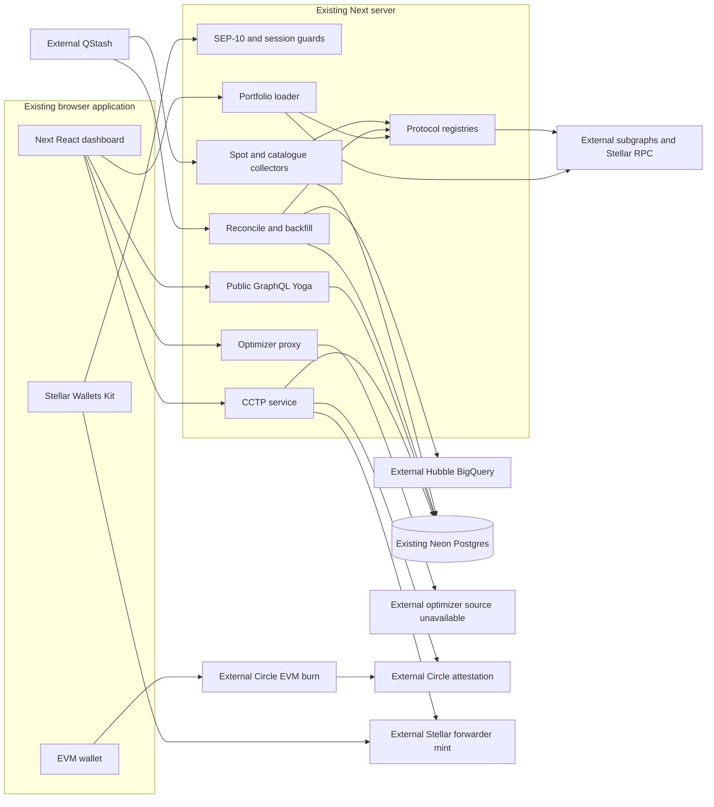

# Existing system assessment

Assessed and branched from `main` at `65072b13db1792eecf3ae5330cf4dbc8ec1cb4bd`, as explicitly requested by the user. Also fetched default `testnet` at `4e779a1b62ccd9b555d2d0f64276f55603b11907` and `mainnet` at `2f73b282971a04765d1128cb09a60600b23f978e`; `git diff --name-only cedric/main cedric/testnet` was empty. Their commit histories differ even though those trees match. Original local `main` was older. No application behavior was inferred solely from a branch name.

## Evidence classifications

- **Existing — verified in production**: independent runtime evidence, limited to the stated observation/date.
- **Existing — verified in code, production status unknown**: implementation inspected; no direct deployment validation.
- **Existing — requires extension**: usable code with a concrete RWA gap, not a claim of deployed RWA functionality.
- **New — proposed**: absent implementation to be built.
- **Externally dependent**: a separate service/provider controls the behavior.
- **Unverified or blocked**: insufficient evidence or unavailable source/access.

## Component inventory and interfaces

All paths below are relative links to the assessed repository tree. This is a single Next.js application, not evidence of an independently deployed microservice for every conceptual module.

| Component                             | Status                                                 | Interfaces and implementation evidence                                                                                                                                                                                                                                                                     | RWA implication / limit                                                                                                                                   |
| ------------------------------------- | ------------------------------------------------------ | ---------------------------------------------------------------------------------------------------------------------------------------------------------------------------------------------------------------------------------------------------------------------------------------------------------- | --------------------------------------------------------------------------------------------------------------------------------------------------------- |
| Web/backend runtime                   | Existing — verified in code, production status unknown | [package.json](../../package.json): Next 16, React 19, TypeScript; [app routes](../../src/app/api/route.ts); [server actions](../../src/app/actions/index.ts)                                                                                                                                              | Add RWA server modules in the app; no new service required initially                                                                                      |
| Public platform inventory             | Existing — verified in production                      | [stats route](../../src/app/api/stats/route.ts), [live response](evidence/lendwise-stats.json)                                                                                                                                                                                                             | Response: 960 active lending products, 27 standardized chains, 16 execution chains, 169 assets; `generatedAt` Nov 1, so freshness caveat applies          |
| Protocol registry                     | Existing — requires extension                          | [registry](../../src/config/protocols-server.ts): `YIELD_ADAPTERS`, `APP_ADAPTERS`, `stellarPositionAdapters()`; [types](../../src/lib/protocols/core/types.ts): `YieldAdapter`, `AppAdapter`, `StellarPositionsAdapter`; [author guide](../../src/lib/protocols/README.md)                                | Reuse isolated module/loaders and settled fanout; introduce separate RWA capability registry                                                              |
| Lending collectors                    | Existing — requires extension                          | [spot route](../../src/app/api/yield/apy/spot/route.ts): signed QStash POST; [collectApySpot](../../src/app/actions/apy-snapshots.actions.ts); [catalogue sync](../../src/app/api/yield/products/route.ts)                                                                                                 | Spot every 10 minutes, catalogue hourly per code/comments; actual QStash schedule config not exported here                                                |
| Yield math                            | Existing — requires extension                          | [utilities](../../src/lib/utils.ts): `aprToApyDaily`, `aprToApyPerSecond`; [Blend spot](../../src/lib/protocols/blend/v2/apy-spot.ts)                                                                                                                                                                      | Blend daily-compounded display, other adapters sometimes per-second; preserve conventions and raw APR rather than assuming one universal accrual          |
| Historical storage                    | Existing — requires extension                          | [Drizzle schema](../../src/lib/db/schema.ts): `products`, `apyHourly`, `apyDaily`; [repository](../../src/lib/db/repositories/apy.ts): `upsertHourlySlot`, `upsertHourlySlots`, `aggregateDaily`, `queryApy`; [migrations](../../drizzle/meta/_journal.json)                                               | Doubles and mandatory APY fields are unsuitable for immutable RWA NAV/cash-flow semantics                                                                 |
| Reconciliation                        | Existing — requires extension                          | [runReconcile](../../src/lib/reconcile/index.ts), [route](../../src/app/api/yield/apy/reconcile/route.ts), [gaps](../../src/lib/db/repositories/gaps.ts), [donors](../../src/lib/heal/donors.ts)                                                                                                           | Detect → repair/refetch or neighbor → aggregate → prune; 7-day default. Never apply neighbor-derived yields to RWA truth                                  |
| Backfill and Stellar historical state | Existing — requires extension                          | [backfill CLI](../../scripts/backfill-history.ts), [stellar CLI](../../scripts/stellar-history.ts), [Hubble reconstruction](../../src/lib/protocols/stellar/hubble-history.ts): `fetchStellarHubbleHistory`, `StellarHistoryDecoder`; [Blend decoder](../../src/lib/protocols/blend/common/apy-history.ts) | Hubble reconstructs contract state, not off-chain issuer NAV. GCP credentials and query budget required                                                   |
| Historical artifacts                  | Existing — verified in code, production status unknown | [published CSVs](../data/stellar-history/README.md), [reconciler](../../src/lib/reconcile/index.ts)                                                                                                                                                                                                        | Dated checked-in evidence supports prior runs; report is repository-supplied, not fresh DB inspection                                                     |
| Blend v2.1                            | Existing — requires extension                          | [adapter](../../src/lib/protocols/blend/v2_1/index.ts), [deployment](../../src/lib/protocols/blend/common/deployments.ts), [positions](../../src/lib/protocols/blend/v2_1/positions.ts): `positionsAdapter`                                                                                                | v2 pool generation with a distinct v2.1 backstop/factory; not a new interest-rate ABI. Mainnet position readers excluded on testnet                       |
| Portfolio aggregation                 | Existing — requires extension                          | [load](../../src/lib/portfolio/load.ts): `PortfolioDeps`, per-source timeout, settled failures; [types](../../src/lib/portfolio/types.ts): `UserPortfolioResult`, `WalletHolding`; [action](../../src/app/actions/user-portfolio.actions.ts)                                                               | Keep EVM/Stellar positions and partial-failure behavior; add a distinct RWA projection                                                                    |
| Stellar liquid holdings               | Existing — requires extension                          | [wallet holdings](../../src/lib/stellar/wallet-holdings.ts): `fetchHorizonBalances`, `holdingsFromBalances`, `getStellarWalletHoldings`                                                                                                                                                                    | Reads XLM and Classic trustlines; prices only XLM and network-specific Circle USDC. Converts balances to number and drops authorization metadata          |
| EVM holdings                          | Existing — verified in code, production status unknown | [holdings](../../src/lib/evm/wallet-holdings.ts), [cache](../../src/lib/evm/holdings-cache.ts), [catalogue](../../src/lib/evm/holdings-catalog.ts)                                                                                                                                                         | Preserve independent EVM holdings; no RWA-specific issuer knowledge demonstrated                                                                          |
| Risk engine                           | Existing — requires extension                          | [risk types](../../src/lib/risk/types.ts), [compute](../../src/lib/risk/compute.ts), [health factor](../../src/lib/risk/health-factor.ts)                                                                                                                                                                  | Lending collateral risk is not sovereign/fund/currency risk; reuse only compatible computations                                                           |
| Optimizer client and proxy            | Externally dependent                                   | [client](../../src/lib/api/optimizer.ts), [generated OpenAPI types](../../src/lib/api/optimizer.generated.ts), [proxy](../../src/app/api/optimizer/route.ts)                                                                                                                                               | Whitelisted optimize/breakpoint endpoints and bounded arrays. Solver implementation is external; no verified support for eligibility/maturity constraints |
| Ranking/UI optimizer                  | Existing — requires extension                          | [rankProducts](../../src/lib/products/ranking.ts), [supplying optimizer](../../src/components/optimizer/SupplyingOptimizerButton.tsx), [borrowing optimizer](../../src/components/optimizer/BorrowingOptimizerButton.tsx)                                                                                  | Ranks finite APYs; RWA metrics cannot enter this sorter without comparability checks                                                                      |
| GraphQL                               | Existing — requires extension                          | [route](../../src/app/api/graphql/route.ts): Yoga + Armor; [SDL](../../src/lib/graphql/schema.ts); [resolvers](../../src/lib/graphql/resolvers.ts)                                                                                                                                                         | Public read-only, introspectable, IP limiter, depth/alias/token/cost limits; separate RWA queries avoid changing lending enums                            |
| Stellar Wallets Kit                   | Existing — requires extension                          | [context](../../src/contexts/StellarWalletContext.tsx): `connectStellar`, `signTransaction`; [picker](../../src/components/wallet/StellarWalletPicker.tsx); [wallet state](../../src/lib/wallet/stellar-wallets.ts)                                                                                        | Existing-wallet path remains default. New embedded signing provider can implement the same user-facing signer boundary                                    |
| SEP-10 and sessions                   | Existing — verified in code, production status unknown | [challenge/signature validation](../../src/lib/auth/stellar-sep10.ts), [challenge store](../../src/lib/auth/stellar-challenge-store.ts), [session guard](../../src/lib/auth/session-guard.ts), [same-origin](../../src/lib/auth/same-origin.ts), [routes](../../src/app/api/auth/stellar/verify/route.ts)  | Domain/network-bound challenge, atomic GETDEL, expiring/revocable sessions and same-origin checks; identity proof establishes no issuer eligibility       |
| CCTP construction and validation      | Existing — requires extension                          | [config](../../src/lib/execution/cctp/config.ts), [burn](../../src/lib/execution/cctp/burn.ts), [message](../../src/lib/execution/cctp/message.ts), [mint](../../src/lib/execution/cctp/mint.ts), [trustline](../../src/lib/execution/cctp/trustline.ts)                                                   | Ethereum, Base, Arbitrum **and Optimism mainnet** configured; first three testnets. Domain 27, forwarder hook, simulation, exact signed-XDR checks        |
| CCTP orchestration                    | Existing — requires extension                          | [createBridgeService](../../src/lib/execution/cctp/service.ts), [actions](../../src/app/actions/bridge.actions.ts), [repository](../../src/lib/db/repositories/bridge-transfers.ts), [UI flow](../../src/components/bridge/useBridgeFlow.ts)                                                               | Persistent transitions, owner binding, receipt checks, attestation and uncertain-submission recovery; reuse without new issuer purchase semantics         |
| CCTP mainnet settlement               | Existing — verified in production                      | [independent Horizon recheck](evidence/cctp-mainnet-mint.json)                                                                                                                                                                                                                                             | One successful mint in ledger 65033079 on Oct 19 independently rechecked; no new end-to-end transfer performed                                            |
| Dashboard                             | Existing — requires extension                          | [supply page](<../../src/app/(dashboard)/supply/page.tsx>), [portfolio](../../src/components/portfolio/Portfolio.tsx), [product detail](../../src/components/products/ProductDetailDrawer.tsx), [bridge](<../../src/app/(dashboard)/bridge/stellar/page.tsx>)                                              | Reuse navigation, filters, source-failure presentation; new RWA rows require distinct metric and access labels                                            |
| SDK/package organization              | New — proposed                                         | [workspace](../../pnpm-workspace.yaml) contains only `.`; [package](../../package.json) is application package; [codegen](../../codegen.ts)                                                                                                                                                                | No `@lendwise/sdk` implementation/publication verified. Add a small package only in implementation phase                                                  |
| CI/test coverage                      | Existing — requires extension                          | [CI](../../.github/workflows/ci.yml), [Vitest](../../vitest.config.ts), [adapter harness](../../scripts/adapter-test.ts), [security tests](../../src/lib/execution/cctp/service.test.ts)                                                                                                                   | Format/lint; codegen/tests/typecheck skipped if Graph key absent. Proposed pure RWA/SDK checks must run without external secrets                          |
| Deployment                            | Externally dependent                                   | [branch convention](../../CONTRIBUTING.md), [Next config](../../next.config.ts), [Neon driver](../../src/lib/db/postgres.ts), [fork guard](../../.github/workflows/fork-branch-guard.yml)                                                                                                                  | Vercel + Neon + branch-scoped deployments indicated; consoles, actual env settings and promotion results not inspected                                    |
| Monitoring/logging                    | Existing — requires extension                          | [reports](../../src/lib/db/repositories/reports.ts), [quality status](../../src/app/actions/status-quality.actions.ts), [PostHog](../../src/lib/posthog-server.ts), [limiter](../../src/lib/ratelimit.ts), [instrumentation](../../src/instrumentation.ts)                                                 | Console/report logs and analytics exist; startup instrumentation is a stub, no proved full tracing/alerting stack                                         |
| Etherfuse and other RWA adapters      | New — proposed                                         | No registered issuer adapters in assessed registry; token icons alone are not integration evidence                                                                                                                                                                                                         | Scope is new issuer data semantics on reused infrastructure                                                                                               |

## Verified current architecture

Every box is code-confirmed; external boxes are dependencies, not deployment attestations.

## Corrections to proposal assumptions

1. “More than 900 markets / 25 chains” has dated runtime support, but market count means active product rows (supply/borrow may be separate). It is not an independently reconciled count of economically unique markets.
2. “Hourly ingestion” is an hourly aggregate from six nominal 10-minute slots, plus hourly catalogue sync; RWA publication cadence must be modeled separately.
3. Blend v2.1 reuses v2 SDK classes and decoders. A separate incompatible v2.1 contract client is unnecessary.
4. CCTP mainnet configuration also includes Optimism. This review independently rechecks a Base→Stellar mint, not successful operation of every configured route.
5. A Classic RWA balance can already appear unpriced in wallet holdings; this is not RWA valuation, regulated-position monitoring or redemption support.
6. The optimizer is not fully inspectable in this repository, and its input has no verified maturity/eligibility vocabulary.
7. The public docs site is a separate VitePress/Vercel project proxied by `next.config.ts`. Do not assume editing this package automatically publishes it at `/docs`.
8. Public GraphQL currently exposes market analytics, not authenticated private fund-account data. Keep those trust boundaries separate.
