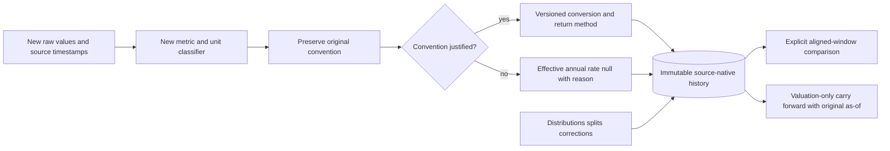
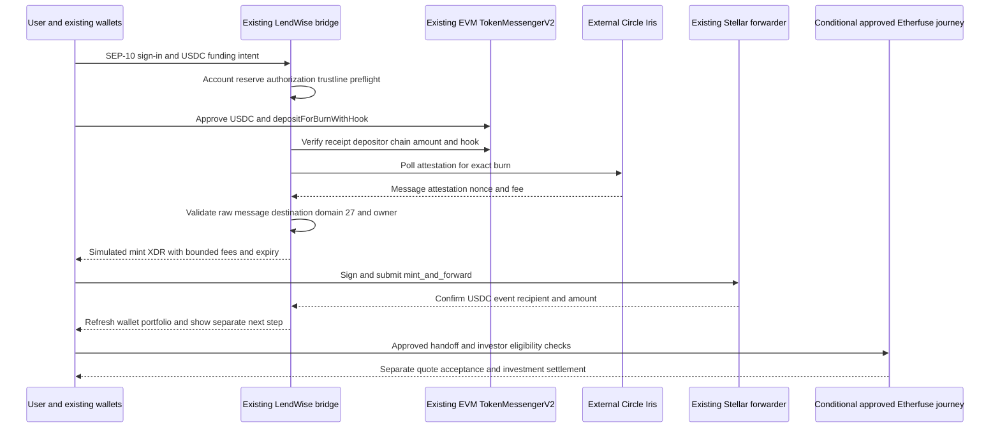

# Issuer, ingestion, portfolio and funding specifications

All new interfaces are proposed; existing code anchors are in [assessment](EXISTING_SYSTEM_ASSESSMENT.md). The [feasibility matrix](TECHNICAL_FEASIBILITY_MATRIX.md) determines allowed operations. Do not commit native execution until the relevant entitlement and security gates pass.

## Adapter contracts and external contributors

Use the functional `RwaAdapter` contract in [examples/contracts.ts](examples/contracts.ts): required `discovery.list` and `observations.fetch`; optional `history`, `positions`, `eligibility`, `handoff`. Missing capabilities produce `UNSUPPORTED_CAPABILITY` at the LendWise API boundary, which describes the adapter, not a blanket provider-support claim. Keep subscription/redemption in separate `IssuerExecution` services with owner/session guards and provider credentials.

This mirrors the existing `defineYieldAdapter` style, explicit server-only loaders and `Promise.allSettled` aggregation. The issuer adapter is DB-blind: repository writers and job state are orchestration dependencies. Adapters return independent failures by product and preserve partial success. Their client-safe metadata imports no HTTP secrets or server SDKs.

Representative pseudocode (helper names denote new dependencies, not existing functions):

```text
collect(adapter, dueProducts, context):
  rawBatch = adapter.observations.fetch(dueProducts, context)
  for each independent observation:
    verify network and approved asset mapping
    validate source unit, timestamp, currency and price type
    archive public raw payload hash and source provenance
    normalize units; derive effective yield only with a known convention
    append immutable observation/revision by logical key
  report accepted, duplicate, missing and quarantined counts separately
  advance source cursor only after durable successful writes
```

External developers add one issuer folder, metadata fragment and explicit loader; provide source schema fixtures, product/asset allowlist evidence, per-capability tests, exact financial conventions and a README covering errors, freshness, auth and redistribution rights. Extend the existing adapter-test pattern into an RWA conformance harness; do not run RWA payloads through lending APY validators. Required conformance: stable IDs, pagination/target filtering, timeout/cancellation, deterministic source time, missing values, no secret-bearing errors, duplicate/revision handling and declared capability omissions. Production loading requires code review; users cannot supply arbitrary adapter URLs or code.

## Etherfuse mapping

First products: **USTRY (USD)** for same-currency lending comparison, and **CETES (MXN)** to demonstrate explicit FX treatment. Runtime lookup also returned TESOURO/BRL, GILTS/GBP, EUROB/EUR and KTB/KRW with Stellar representations. These are expansion candidates after product-specific review, not six committed MVP integrations. MEX had a zero-rate/constant-price entry and must not be automatically classified as yield-bearing just because it appears in a stablebonds catalogue.

Observed issuer for those Stellar entries: `GCRYUGD5NVARGXT56XEZI5CIFCQETYHAPQQTHO2O3IQZTHDH4LATMYWC`; decimals 7. This is dated evidence in [products](evidence/etherfuse-products.json), not a permanent trusted constant. Public lookup uses `CODE-ISSUER`, while ramp quote identifiers use `CODE:ISSUER`. Parse via endpoint-specific schema and checksum validation; do not blindly replace punctuation in untrusted strings. Confirm actual routable identifiers from authenticated `/ramp/assets?blockchain=stellar` before quoting. Detect issuer changes and quarantine pending an approved registry update; do not silently trust a new issuer merely because the provider returned it.

| Requirement             | Source and mapping                                                  | Rule                                                                                                                              |
| ----------------------- | ------------------------------------------------------------------- | --------------------------------------------------------------------------------------------------------------------------------- |
| Discovery               | Public `GET https://api.etherfuse.com/lookup/stablebonds`           | Select `blockchains[].blockchain=stellar`; capture symbol/currency, code+issuer, decimals, `calculatedAt`; reject missing mapping |
| Current issuer price    | Public `GET /lookup/tokens/cost` + catalogue price                  | `token_cost_in_fiat` and `token_cost_in_usd`; classify as issuer token price until accounting/NAV methodology confirmed           |
| Indicative rate         | `current_basis_points`                                              | Decimal conversion only; original metric preserved; compounding/net-fee/maturity unresolved                                       |
| FX                      | `fiat_exchange_rate_with_usd`, per-provider `sources`               | Currency units explicitly USD-to-local; source-specific `updated_at`; validate inversion and deviation                            |
| Maturity, fees, limits  | Product terms and partner response                                  | Null/unknown until authoritative source; don't infer maturity from underlying tenor or hardcode promotional fees                  |
| Public positions        | Horizon account trustlines, SAC only when needed                    | Exact network/code/issuer; record ledger/control flags; duplicate account/SAC view counts once                                    |
| Historical NAV          | Prospective public snapshots; authorized export if confirmed        | No currently verified public full history endpoint; Solana price account does not prove past Stellar investor returns             |
| Subscription/redemption | E3/E5 documented Stellar ramp/swap, conditional partner entitlement | Prefer approved hosted handoff for MVP; user-controlled signature and issuer approval remain external                             |

API v1 and v2 beta differ. Pin v1 for the initial read adapter where verified, snapshot OpenAPI and fixtures, and isolate version transport. Never send a v1 order body to a v2 path or mix webhook event names. Partner may recommend stable v2 before implementation; adopting it requires a recorded contract update and integration tests, not a silent version change.

## Other issuer specifications

| Issuer     | Identity / interface rule                                                                                                                                | History / position boundary                                                                                                                                       |
| ---------- | -------------------------------------------------------------------------------------------------------------------------------------------------------- | ----------------------------------------------------------------------------------------------------------------------------------------------------------------- |
| Spiko      | Source official Stellar contract addresses, published source and Public API share-class metadata (S1/S2); Soroban token reads, not assumed trustlines    | Public NAV/yield histories documented; verify calendars, revisions and pagination. Private beneficial positions require investor OAuth; distributor access manual |
| Ondo       | Official Stellar USDY product confirmed; retrieve full production identifier from official product deployment links and verify on ledger before enabling | Yield-bearing note; data source/retention and rate convention unresolved. Public token position does not establish primary purchase/redemption eligibility        |
| Franklin   | BENJI Stellar issuer published: `GBHNGLLIE3KWGKCHIKMHJ5HVZHYIK7WTBE4QF5PLAKL4CJGSEU7HZIW5` (F1). Asset code and share class require TOML/ledger match    | Do not merge gBENJI/sgBENJI with BENJI; income distributions and official servicing data may be necessary for total return                                        |
| WisdomTree | Verify specific Prime product/share class/network; do not apply EVM-only Connect API claims to Stellar                                                   | No production adapter until exact asset and data entitlement established; WUSD/other dollar tokens are not automatically yield funds                              |
| Centrifuge | Obtain production contract IDs, share/vault interfaces and signed deployment evidence for announced deRWA products                                       | No deployed Stellar availability claim from an announcement; JAAA credit exposure must remain distinct from treasury exposure                                     |

## Collection and historical pipeline


Reuse signed QStash verification, report repositories and timeout/concurrency patterns, with a new endpoint and RWA reporting type. Do not register RWA observations in the old nightly APY reconcile loop. The scheduler can wake frequently but writes only changed source observations; poll frequency never changes economic publication frequency.

Initial proposed policies, to be calibrated with issuer SLAs: Etherfuse current price/rate poll every 10 minutes (source lookup caches about five minutes); stale warning after 30 minutes without a new valid source time; rate unchanged is legitimate if source timestamp progresses. A daily fund is collected after its scheduled publication, accounting for timezone/weekends/holidays, with warning one scheduled publication late. Never demand 24 observations/day from a daily publisher. NAV-versus-indicative-rate freshness policies are separate.

Expected financial observations = scheduled publications during the product's valid listing period, not number of HTTP polls. A failed poll is a collection failure, not a zero yield or zero balance. A response whose `calculatedAt` advances while economic publication is unknown is a current provider calculation; do not mislabel it official daily NAV publication.



Backfill procedure: enumerate exact product/share-class and requested date range; inspect source coverage/permissions; dry-run count/range/source checksum; fetch bounded pages into staging; validate unit/currency/calendar/revision; idempotently append; recompute only affected derived returns; report covered intervals and missing reasons. Use Hubble only for genuinely ledger-contained state/contract events with supported decoder, bounded queries and cost caps. A Classic issuance/payment event does not reconstruct price/NAV. If no archive exists, expose `historyStart=firstCollectedAt` and retain gaps.

Revised source data: create a new revision and lineage, record publication/availability time, invalidate affected caches/derived returns and preserve prior versions for audit/backtests. Corporate actions use separate effective-dated events with ex/record/pay timestamps; a split is not a NAV crash, distribution is not always yield. Never use another issuer or neighboring hour to heal truth. Carried-forward display points refer to the original observation and are never stored as new reported data.

Retry policy: source-specific circuit breaker, 5-second connect/15-second total request budget initially, 3 exponential attempts with jitter and Retry-After for 429/503, no blind retry of 400/401/403. A 403 is access/configuration failure, not “provider unsupported.” Keep whole scheduled run below server budget and checkpoint before rescheduling. Persist run lease/idempotency key; overlapping deliveries cannot duplicate observations. Do not advance cursor past a failed page without a recorded gap. Mutation retries require issuer-defined idempotency rules and reconciliation; they do not share the GET retry policy.

Proposed measurable data gates: 100% accepted observations have source/hash/method/time/currency; 100% enabled assets exact verified mapping; zero fabricated hourly observations; >=99% scheduled collections complete within configured source grace over 14 days, with business-calendar publication completeness reported separately; all duplicates and revised fixtures deterministic; faults in one issuer leave lending and other issuers available. Alerts cover timeout/error rate, source clock age, identity/flag change, cross-source price disagreement, quarantines, missing publication, revision churn and job lag. Financial anomaly thresholds are product-specific and require review; no universal “APY must be positive” rule.

## Portfolio extension

Extend the existing family routing and partial-failure loader by adding a separate RWA reader/projection. Read public ledger balances without pretending a watch-only address owns a session. Private servicing/order history requires owner-scoped authenticated consent. Preserve decimal strings to prevent `Number` precision loss present in the legacy wallet projection; do not change legacy behavior in this documentation task.

Classic positions read balances, liabilities, limit and flags; SAC/contract tokens use validated token balance interfaces and record ledger. Match direct versus wrapped versus contract-held claim. Do not sum a vault's treasury and each user's receipt as if both belonged to the investor. Aggregate holdings and RWA views using a stable economic-claim key; show one value with multiple presentations. Valuation falls back to unknown/stale rather than 1:1 par. Fund freezing, allowance, issuer authorization and eligibility are distinct constraints.

## Existing CCTP and the RWA journey



Existing mainnet source chains: Ethereum 1/domain 0, Base 8453/domain 6, Arbitrum 42161/domain 3, Optimism 10/domain 2. Testnet config has Ethereum/Base/Arbitrum Sepolia only. Native source USDC and exact TokenMessenger addresses come from [config](../../src/lib/execution/cctp/config.ts). No arbitrary bridged USDC or ticker-based selection. User pays EVM approval/burn gas, Circle fee and Stellar transaction fees; no one-fee assumption.

Existing persistent states: `planned → burn_submitted → burn_confirmed → attested → mint_submitted → completed`, with explicit failed/recoverable paths in [service](../../src/lib/execution/cctp/service.ts). [message](../../src/lib/execution/cctp/message.ts) binds version, source/destination, token, amount, max fee, depositor and recipient hook. Amount invariant in atomic units: `minted_stellar = (burn_evm - executed_fee_evm) * 10` (6→7 decimals). MessageTransmitter nonce consumption is the replay authority; DB uniqueness prevents duplicate per-owner imports but is not the cryptographic replay control.

Recovery: reload resumes stored transfer, pending receipt/attestation stays pending, uncertain RPC mint submission checks known hash and nonce before fresh signing, expired signed envelope requires fresh sequence/simulation, expired CCTP message needs supported re-attestation/operational recovery. Current service explicitly treats expired-message re-attestation as a limitation; do not claim automatic refunds or implemented recovery for every case. Existing RPC fallback resends identical signed bytes to avoid double intent. Wrong destination/asset/fee/hash must fail before signing. The existing `completed` status can reflect a successful receipt or already-consumed message while the amount is unavailable; `settleMint` also records a mismatch warning without rejecting completion. New financial projections require separately reconciled recipient/amount evidence, as detailed in the [architecture](TECHNICAL_ARCHITECTURE.md#cctp-funding-and-receipt-verification). CCTP does not activate a mainnet account for free, add an RWA trustline, satisfy issuer KYC or purchase/redeem a Stablebond.
