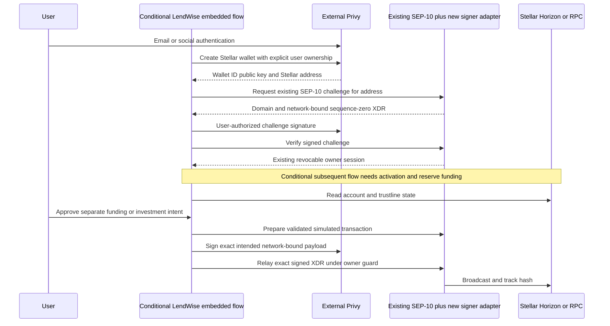
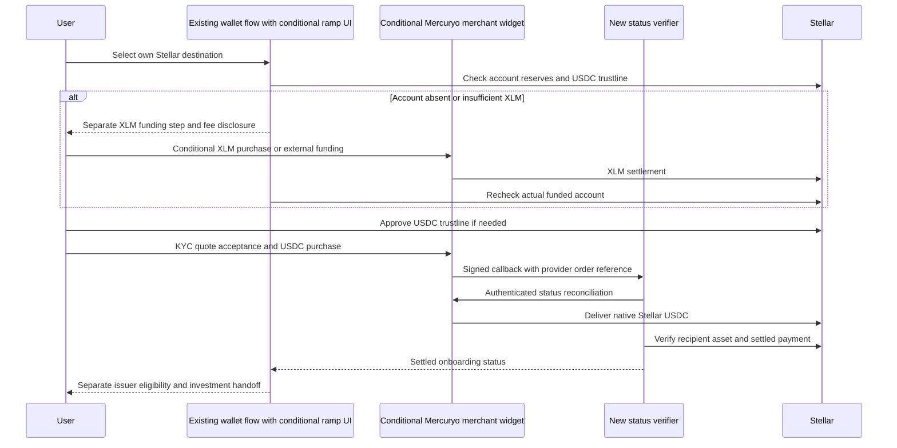

# Wallet and fiat onboarding

Core MVP uses existing Stellar Wallets Kit and SEP-10, plus existing funded wallets/CCTP. Privy and Mercuryo are feasible optional providers; neither is a committed dependency. Their official Stellar support must not be understated, and generic provider support does not prove a tested LendWise flow. References P1–P3, M1–M3 and L1–L2 are in [sources](SOURCES.md).

## Privy feasibility and custody boundary

| Requirement                                      | Conclusion                                                                                                    | Release evidence required                                                                                                                      |
| ------------------------------------------------ | ------------------------------------------------------------------------------------------------------------- | ---------------------------------------------------------------------------------------------------------------------------------------------- |
| Native Stellar creation / Ed25519 key generation | Confirmed in official extended-chain creation and chain support docs                                          | Create a tenant wallet; verify returned `G...` checksum and public key; creation is not account activation                                     |
| Classic transaction signing                      | Documented Stellar Ed25519 hash-signing primitive is compatible; end-to-end integration partially confirmed   | Build a network-bound envelope, sign intended hash, attach decorated signature, verify locally and submit testnet transaction                  |
| Soroban transaction signing                      | Outer transaction signature is compatible in principle; required invocation/auth-entry flows unverified here  | Test simulated `invokeHostFunction`, Soroban resource data, address authorization preimage/signature, expiration and network binding           |
| SEP-10                                           | Technically compatible hypothesis, not tested                                                                 | Sign existing sequence-zero challenge, verify domain/time/server key/client signature, reject replay; do not submit challenge to ledger        |
| Email/social auth                                | Provider feature confirmed generally                                                                          | Correct audience/issuer/JWT validation and secure session-to-wallet linkage in LendWise                                                        |
| Signing authorization                            | Configurable user/authorization-key ownership documented                                                      | Prove the selected user must consent and backend cannot obtain unrestricted signing authority; reject arbitrary wallet IDs/hashes              |
| Recovery                                         | General provider account/wallet recovery features do not establish this tenant/chain's exact guarantees       | Demonstrate recovery after lost device, revoked session, social-account compromise and factor reset; describe any service-controlled authority |
| Export / portability                             | Chain-tier docs include private-key export; not all chains imply HD seed export                               | Test Stellar export through approved user flow; verify imported key/address in independent Stellar wallet; no secret logging                   |
| Policies / managed broadcasting / sponsorship    | Stellar Tier 2 is documented; exact policy fields vary; Tier 3 managed transaction features cannot be assumed | Identify allowed chain/method operations and rejection tests; LendWise handles broadcast/tracking unless explicitly supported                  |
| Coexistence                                      | New optional signer can match existing `signTransaction(xdr,address)` boundary                                | Existing Freighter/Lobstr/xBull/other Wallets Kit flow passes regression and remains selectable                                                |

Do not reuse Solana addresses, derive a Stellar account from an Ethereum wallet, or expose a raw-sign-any-hash endpoint. Stellar account activation is a ledger operation funded by XLM, distinct from generating a keypair. Classic transaction signatures sign the Stellar network-specific signature base hash; avoid accidental double hashing. Soroban address authorization entries have their own signature payload and expiration ledger; an outer envelope signature alone does not prove all required authorizations are satisfied.

An optional adapter implements [SigningProvider](examples/contracts.ts) after verifying expected owner/address/network. Server prepares an intent-bound, simulated transaction; UI decodes operation, asset, amount, destination, fee and timeout. Require approved purpose and fresh user consent. Reject changed envelope/resources/authorization/destination after simulation/signing. Do not mistake a Privy login JWT for SEP-10 address ownership or issuer approval.

No exact-flow test was performed because no Privy tenant/SDK credentials were provided. If any required operation fails, keep the embedded feature disabled and retain existing Wallets Kit + SEP-10. Alternative: use existing external Stellar wallets with user key recovery controlled by that wallet; optional future native Stellar passkey/smart-wallet provider requires a separate security/custody review. Do not generate/store raw user secrets in localStorage as a shortcut.

## Mercuryo feasibility and delivery boundary

Official announcements verify **native Stellar USDC and XLM** purchase offerings, including card/Apple Pay/Google Pay through a partner wallet. Their 2026 September promotional zero-fee limits have expired and are not generic merchant terms. The dynamic currencies/network API and LendWise merchant configuration must determine release-time availability. General Visa/Mastercard support does not establish every card/jurisdiction is eligible.

| Area                           | Verified / unresolved                                                                                            | Required control                                                                                                                              |
| ------------------------------ | ---------------------------------------------------------------------------------------------------------------- | --------------------------------------------------------------------------------------------------------------------------------------------- |
| Network and asset              | Stellar USDC/XLM provider offerings confirmed; LendWise enablement and exact issuer unresolved                   | Merchant-enabled `USDC + Stellar + Circle issuer` tuple; never default to another chain or similarly named asset                              |
| Methods / countries            | Card methods documented; actual geography/method coverage varies                                                 | Quote-time country/currency/method eligibility using provider data; no hardcoded promotional country table                                    |
| KYC / AML                      | Provider handles its user checks; thresholds vary                                                                | Hosted provider flow, minimal local personal data; provider KYC is separate from Etherfuse investor eligibility                               |
| Limits / fees / exchange rates | Currency/API configuration supports limits; current LendWise limits unverified                                   | Show fiat charge, crypto delivery, spreads, fees, expiry and minimum/maximum before acceptance                                                |
| Activation / reserves          | Provider supported XLM purchase; activation/trustline automation for new LendWise wallets unverified             | Observe account existence and spendable XLM before requesting USDC; do not assume XLM+USDC arrive atomically                                  |
| Webhooks                       | API docs describe signature header and shared signing key; exact scheme/serialization needs fixture confirmation | Verify raw body with partner-defined keyed algorithm, constant-time compare, idempotency/event ID and replay window if supplied               |
| Status / settlement            | API statuses and callbacks documented; callbacks may be duplicated or out of order                               | Server-to-server status reconciliation plus actual ledger delivery; browser redirect is not payment proof                                     |
| Failure / refund               | Provider controls fiat refunds; details vary                                                                     | Persist provider order reference; show pending/failed/refunding/refunded separately, support provider escalation; no automatic refund promise |
| Sandbox                        | API docs list limited test networks; Stellar testnet support not established                                     | Agree a supported sandbox plus approved low-value mainnet test plan; do not invent Stellar sandbox support                                    |

## Correct Stellar onboarding sequence

1. Connect existing wallet (core) or optional embedded-wallet login/create after Privy tests.
2. Read account existence. Mainnet activation needs XLM or an explicit funded sponsor; Friendbot is testnet only.
3. Determine reserve and fee budget from current network parameters and actual account state. Minimum balance is `baseReserve * (2 + subentry_count + num_sponsoring - num_sponsored)`, with entry-specific reserve accounting supplied by the ledger. Spendable XLM subtracts minimum balance and selling liabilities; retain fees separately. At currently documented 0.5 XLM/base reserve, a simple new account is 1 XLM and one ordinary trustline adds 0.5 XLM; two trustlines add 1 XLM. These figures exclude fees and other entries.
4. Acquire XLM via an existing wallet/approved provider, then verify settled funding. Sponsor setup is a separately consented operational service; do not imply it already exists in LendWise.
5. User approves a `changeTrust` for exact Circle Stellar USDC asset, with adequate capacity and reserves. Trustline creation does not override issuer authorization. Read both capacity/liabilities and authorization.
6. Conditional merchant widget purchases USDC on Stellar to exact user address; provider handles card data, conversion, KYC and payout. LendWise stores intent/status references and reconciles delivery.
7. Show eligible Etherfuse discovery. An RWA-specific trustline and issuer/customer approval may still be needed. USDC onboarding is not an investment.

Soroban transactions additionally need simulation-based inclusion/resource/rent estimates and possible archival restoration. Do not reuse a Classic 100-stroop minimum as a guarantee of Soroban transaction cost. Reserve values should be refreshed from ledger configuration at runtime; existing CCTP code's fixed constants are an implementation caveat requiring operational review, not a newly proven exploit.

LendWise controls UI intents, destination validation, reserve/trustline preflight, session checks, signed transaction validation and local status projection. Privy controls configured key infrastructure; the user or configured owner controls signing authorization. Mercuryo controls fiat/card/KYC/exchange/refund processing. Etherfuse controls investor approval, quotation and product servicing. The ledger determines final settlement.

Fallback: an already-funded external Stellar wallet or the existing CCTP route. If a future alternative fiat provider is needed, select one only after verifying native Stellar network/asset support, jurisdiction and merchant entitlement; this review does not assert an untested alternative is ready.
