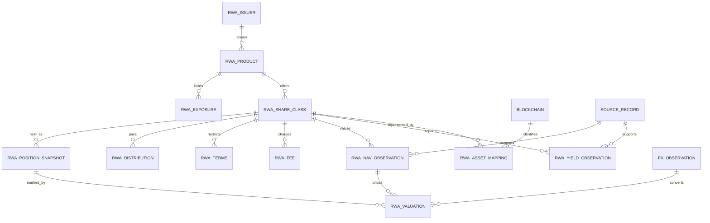
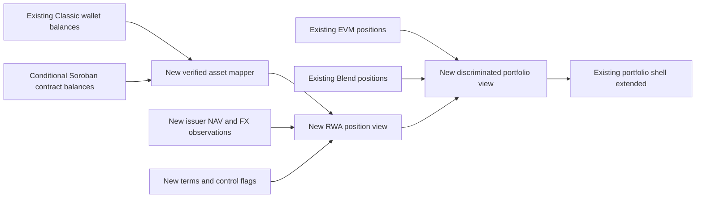

# RWA data and portfolio model

Decision: supplement lending tables with a separate RWA product/share-class/observation model. Shared asset identity, provenance and discovery projections provide reuse where semantics match. Do not insert issuer yield into `apy_hourly`, represent redemption as lending withdrawal, or change the existing `kind = supply | borrow` contract. See ADR-01/05 in [architecture](TECHNICAL_ARCHITECTURE.md).

## Entity relationships

All RWA entities below are new. `products` and lending rate tables remain unchanged.

`BLOCKCHAIN` is a new identity table or validated projection over the existing chain registry, not an assumed existing SQL table. RWA Stellar keys include network, asset code and issuer or native contract ID. The existing sentinel chain ID `-1` stays a compatibility detail at the lending boundary; never treat it as an EVM chain. Product IDs remain opaque and are never parsed for economics.

## Authoritative TypeScript contracts

[examples/contracts.ts](examples/contracts.ts) is the canonical proposed type contract for `AssetId`, `RwaProduct`, `YieldObservation`, `NavObservation`, `RwaPosition`, `Fee` and `Provenance`. Types use decimal strings at API/storage boundaries. Runtime schemas must validate precision, supported units, asset checksums and discriminated unions; a TypeScript string alone cannot establish numeric validity.

Product and share class are distinct: one legal fund may have USD and EUR classes, accumulating and distributing classes, or many chain representations. Returns belong to a share class; balances belong to an asset representation. A Classic asset and its SAC are one economic token, while a wrapper/fund receipt may be a separate claim with an exchange ratio.

## PostgreSQL recommendations

Use Drizzle additions in a future migration; the following is a schema specification, not an executed migration. Prefer explicit columns for query/constraint fields, versioned JSON only for provider-specific supplemental terms. Existing `neon-http` supports stateless operations: use a single database statement or supported batch/transaction facility for atomic revision writes; do not assume interactive transactions across HTTP requests.

| Table                            | Keys and required columns                                                                                                                             | Constraints / indexing                                                                                                                         |
| -------------------------------- | ----------------------------------------------------------------------------------------------------------------------------------------------------- | ---------------------------------------------------------------------------------------------------------------------------------------------- |
| `rwa_issuers`                    | `id`, legal name, provider name, jurisdiction, official domain, disclosures, source record                                                            | Stable issuer ID; official domain is evidence, not sufficient asset authorization                                                              |
| `rwa_products`                   | `id`, issuer FK, legal product ID, asset class, legal terms URL, active dates                                                                         | Index issuer/active; no ticker-only uniqueness                                                                                                 |
| `rwa_share_classes`              | `id`, product FK, currency, accumulation model, minimum, maturity kind/date, calendar                                                                 | Check fixed maturity requires date; null minimum means unknown, not zero                                                                       |
| `rwa_asset_mappings`             | class FK, network, representation, code/issuer or contract, decimals, valid-from/to, verified source                                                  | Partial unique active representation; preserve retired issuers, require non-overlapping validity ranges                                        |
| `rwa_exposures`                  | product FK, underlying class, country, currency, optional weight                                                                                      | Weights between 0 and 1; unknown composition not asserted as 100% sovereign                                                                    |
| `rwa_terms`, `rwa_fees`          | class FK, effective interval, redemption schedule/delay, eligibility restrictions, fee basis/unit and NAV inclusion                                   | Effective-dated; never silently substitute today's terms in historical estimates                                                               |
| `rwa_sources` / `source_records` | source registry, URL, HTTP/result metadata, raw-response hash, collection/availability time, raw archive pointer                                      | Unique content hash/source; immutable record; no API keys or personal KYC payloads                                                             |
| `rwa_yield_observations`         | class FK, metric, original value/unit, decimal value, justified effective annual rate, convention, period, rate/income/fee basis, source FK, revision | `numeric(38,18)` rates; unique logical key + revision; partial index current revision by class/metric/observed time                            |
| `rwa_nav_observations`           | class FK, price type, currency, value, observation/publication/collection times, origin, quality, revision, supersedes FK                             | `numeric(38,18)` price; positive if present; prohibit null value with valid quality; index `(share_class_id, observed_at DESC, revision DESC)` |
| `rwa_distributions`              | class FK, ex/record/pay dates, per-share amount/currency, reinvestment ratio, split factor, source/revision                                           | Stable corporate-action ID; prevent income from being counted both in NAV and as cash                                                          |
| `rwa_ingestion_runs`             | job ID, source/adapter, version, cursor/range, requested/received/rejected counts, attempts, duration/errors                                          | Job idempotency key; operational reporting alongside existing pipeline reports                                                                 |
| `rwa_position_snapshots`         | owner scope, asset mapping FK, atomic units, decimals, ledger/time, control flags, custody/claim type                                                 | `numeric(78,0)` units; dedupe owner/network/economic claim/ledger; explicit owner authorization for private snapshots                          |
| `rwa_valuations`                 | position snapshot FK, NAV/FX observation FKs, gross/net mark, units, liquidity haircut assumptions, timestamp                                         | Immutable derivation ID/method version; null unpriceable value, never zero                                                                     |
| `rwa_redemption_states`          | owner/private account ref, issuer order ID, requested/burned/settled status, remaining claim and settlement evidence                                  | Conditional execution scope only; minimum servicing status must not leak into public market API                                                |

Yield logical key is `(share_class_id, metric, currency, period_start, period_end, observed_at, source_id, method_version)` with explicit handling of nullable periods (use nulls-not-distinct uniqueness or canonical key hash). NAV key adds price type. Append a revision when content changes; do not overwrite old values. Require a unique `(logical_key, revision)` and atomically supersede the previous current pointer. Last-written does not necessarily mean economically latest.

Preserve raw timestamps at full source precision; PostgreSQL timestamps use `timestamptz` and API uses RFC3339 UTC. Store issuer business date/timezone separately. `availableAt` prevents revised/backfilled observations from leaking into a historical backtest before the platform could know them.

## Unified portfolio projection

Keep existing `UserPortfolioResult.positions`, `holdings`, `riskAccounts`, `failures` unchanged. Add `rwaPositions` only in a versioned/additive caller contract, or expose a separate action and merge client-side. Do not turn an RWA into `SupplyPosition` just to fit existing tables.

Direct Classic holdings: read trustline decimal text, balance, limit, buying/selling liabilities, authorization and clawback flags at a recorded ledger. Match by exact code+issuer+network. SAC reads for a `G...` owner represent the same balance: deduplicate. Contract owners `C...` require contract token reads and claim mapping; an investor cannot be assigned the contract's entire balance. Spiko is a contract-token candidate, not automatically a Classic trustline candidate. Custodial/omnibus fund shares require permissioned statements; public token totals cannot allocate beneficial ownership.

Value `q × NAV × FX` only with compatible timestamps and currency direction. An issuer token price may be shown as an **issuer price mark**, not misnamed audited NAV. Distinguish accrued income embedded in NAV from payable cash distributions. Unknown acquisition cost means return/P&L is unknown even if current value is known. Pending redemption after token burn remains a receivable if authoritative servicing evidence supports it; it is not a zero-value disappearance.

Token control flags, eligibility unknown, secondary market restrictions, and redemption terms stay visible beside valuation. A visible balance proves neither investor approval nor unrestricted disposal. “Spendable” ledger quantity and “redeemable” legal entitlement are separate fields.

## Migration and compatibility plan

1. Inventory production DB schema against migrations in a maintenance-approved, read-only deployment session; this review did not access the DB. Backup and record rollback point.
2. Add new tables/indexes/FKs and immutable raw-source storage. No change to existing rate tables, product kinds or GraphQL enums. Use concurrent index creation where appropriate, outside migration transactions that disallow it.
3. Deploy collectors dark; write only new tables. Load explicit approved Etherfuse product map, with a source-derived identity change requiring review.
4. Shadow-read observations against public issuer responses. Validate source units, rates, rounding, timestamps, issuer flags and duplicated SAC representations.
5. Release additive GraphQL/read views behind an RWA feature flag. Run existing lending query/portfolio contract regression tests.
6. Enable UI; rollback by disabling new readers/jobs. Retain append-only evidence; dropping tables is not a routine rollback. No destructive migration or historical rewrite required.

Historical backfill follows [ingestion specification](INTEGRATION_SPECIFICATIONS.md): prospective Etherfuse first; authorized archive if available. Source-native time series remain irregular. No hourly expansion, linear interpolation, cross-issuer donors or present-rate extrapolation becomes truth.

## Quality and performance

Reject invalid amounts, nonpositive prices, malformed assets, duplicate mappings, timestamp inversions and undocumented percent/basis-point conversions. Quarantine abrupt changes rather than deleting negative returns. Require every calculated return to reference input NAV/distribution/FX IDs and method version. Missing, zero and stale are distinct; economics can legitimately be negative.

Index latest/current revision lookups; paginate history by `(observed_at,id)` with a fixed revision snapshot, rather than unbounded offsets. Cap first at 100 for new queries, range at one year per request initially, and owner wallet count at the existing maximum 10. Batch ledger reads, bound concurrent issuer calls and avoid resolver fanout. Separate raw archive retention from query indexes; retain financial observations through operational acceptance and define longer policy with operators. No private position data in shared/public caches. Collect size/latency/query-plan evidence before introducing partitions or another database.
