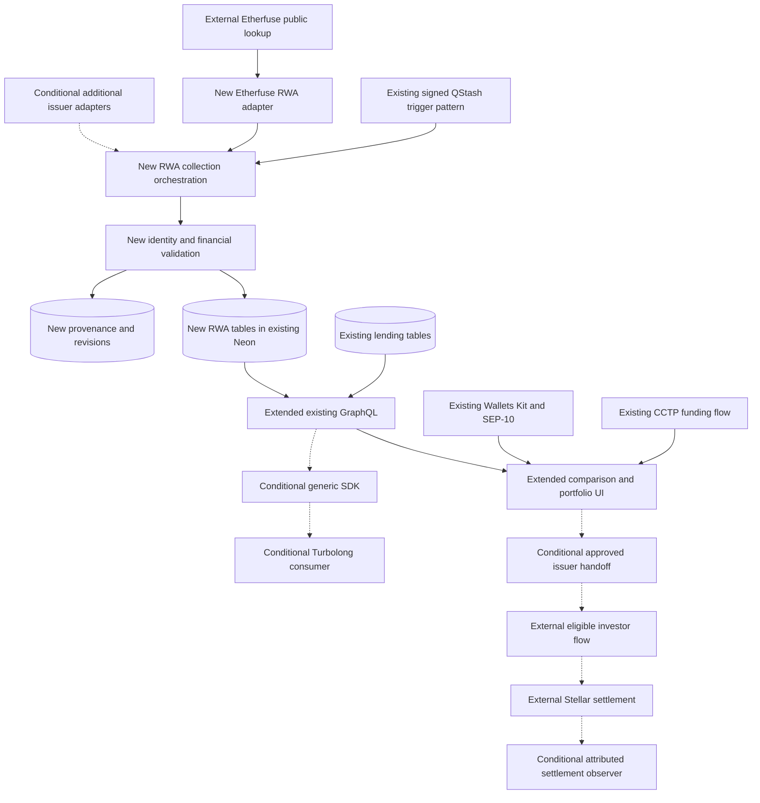
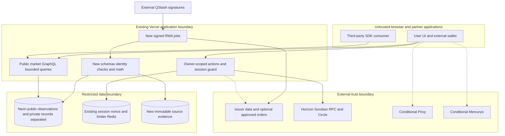
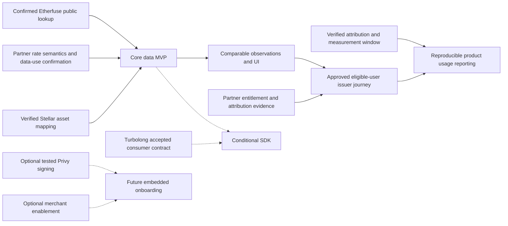

# Technical architecture and decisions

The proposed extension adds issuer financial data to the existing Next/Neon platform. It does not require a new Soroban contract, custodian or trading engine. Decisions follow the [feasibility audit](TECHNICAL_FEASIBILITY_MATRIX.md); public Etherfuse data is available, full trading and account-servicing entitlements are conditional.

## Proposed architecture

Solid arrows describe planned core responsibilities, not completed delivery; dashed arrows are conditional scope. The existing-system diagram lives in [assessment](EXISTING_SYSTEM_ASSESSMENT.md).

## Module and responsibility boundaries

Proposed implementation locations (none created as application code in this assignment):

| Location                        | Responsibility and reuse                                                                                    |
| ------------------------------- | ----------------------------------------------------------------------------------------------------------- |
| `src/lib/rwa/core/`             | Financial contracts, validation, identity, errors, source provenance; no I/O in math                        |
| `src/lib/rwa/etherfuse/`        | Public HTTP source decoding, exact mapping, observations and optional hosted handoff                        |
| `src/config/rwa-server.ts`      | Explicit server-only dynamic loaders parallel to `protocols-server.ts`; no provider credentials in metadata |
| `src/lib/rwa/ingestion/`        | Source cadence, retry/checkpoint/revision orchestration, freshness and reconciliation                       |
| `src/lib/db/repositories/rwa/`  | Query/upsert functions over new tables; no changes to existing APY meanings                                 |
| `src/lib/rwa/portfolio/`        | Balance-to-share mapping and valuation, ledger controls, claim deduplication                                |
| `src/lib/rwa/comparison/`       | Horizon scenarios, eligibility/liquidity gates and comparability reasons                                    |
| `src/app/api/yield/rwa/`        | New signed job endpoints following existing QStash route conventions                                        |
| Existing GraphQL and UI modules | Additive RWA types, comparison tabs, provenance and restricted-position displays                            |
| `packages/sdk/`                 | Conditional browser/Node read client; update workspace only during implementation                           |
| `src/lib/rwa/execution/`        | Future separate issuer order gateway; not loaded by collector/SDK                                           |

Do not add an RWA adapter to existing `YieldAdapter.getApySpot` merely to avoid a migration: its payload requires APYs and the reconciler permits neighboring-hour repair. Reuse networking, pagination, allSettled fanout, codegen and report conventions through small shared helpers after measuring actual duplication.

## Deployment and trust boundaries

The browser and SDK are untrusted even when authenticated. API keys, raw issuer customer records and signing authority remain outside public observation responses. Existing market rate limits fail open on Redis outage; the new public read path may retain that availability decision with edge limits and alerts, but privileged issuer order/signing routes require independent fail-closed protection. A provider outage must degrade its adapter only, not lending ingestion.

Use existing branch convention (`testnet` → `mainnet` → `main`) for future application promotion, while this documentation branch starts from **main at the user's request**. Mainnet credentials must never be available on a testnet preview. New issuer sources get environment-specific allowlists, read-only secrets, schema-version pins and kill switches. Deploy schema before readers. Avoid long collectors exceeding the existing 300-second route budget; checkpoint bounded batches and resume through signed jobs.

## RWA-aware optimization

The local implementation contains a rate sorter and an external optimization proxy. The solver's source and proof of RWA constraints are unavailable. Keep the existing optimizer untouched for lending; introduce a small **informational feasibility filter** before considering a replacement solver.

The five stages are explicit: discovery lists products, comparison groups compatible metrics, recommendations apply user constraints, execution feasibility checks rights/current routes, and investment execution requires a separate approved action and signature. Passing one stage never implies passing the next.

Inputs: horizon H, base currency, capital, investor eligibility evidence, liquidity deadline, maximum issuer/currency/credit exposure, known fees and access routes. For each candidate:

1. Require a verified identity and valid observation. Unknown data means “insufficient evidence,” not zero rate.
2. Check investor eligibility, minimum amount, permitted jurisdiction and current route. Unknown eligibility permits discovery only.
3. Check maturity and realistic settlement: `exitTime + redemptionDelay ≤ cashNeededAt`. A secondary exit requires quoted executable depth, not a DEX listing.
4. Build documented return scenarios in the same investor currency/horizon. Do not compare YTM directly to lending spot APY. Unknown conversion yields `NOT_COMPARABLE`.
5. Filter concentration and risk limits, then rank conservative horizon net-cash outcomes with separately displayed liquidity/credit uncertainty. Do not convert subjective risk scores into guaranteed probabilities.

For a later allocation engine, maximize a defined scenario objective, e.g. `sum_i w_i * scenarioNetReturn_i - lambda * CVaR_alpha(loss(w)) - explicitCosts(w)`, subject to sum(w)=1, w≥0, per-issuer limits, investment minimums (`w_i=0` or `capital*w_i≥min_i`), currency limits and cash-availability constraints. The minimum constraint is non-convex; a general lending allocation endpoint cannot be assumed to enforce it. Do not claim optimized expected return without a defensible forecast/distribution; simple Pareto comparisons may be preferable.

Scenarios: a 30-day cash need excludes a 90-day locked instrument even if its YTM is highest; a USD user sees CETES MXN performance and FX scenarios separately; missing eligibility excludes investable ranking; no live redemption quote makes the outcome informational only. Same product held through multiple chains counts toward one issuer concentration limit.

Required future tests: horizon boundary with holidays, minimum-investment threshold, unknown eligibility, issuer concentration across chains, stale rates/NAV, fees already embedded in NAV, invalid compounding and failed route capability. Verify the existing lending sorter/optimizer receives exactly its prior inputs.

## Architecture decision records

These are recommended, implementation-binding design choices once reviewed by maintainers. External entitlement gates remain open as listed in [questions](OPEN_QUESTIONS.md).

### ADR-01 — Separate RWA and lending models

**Alternatives:** overload `products`/`apy_hourly`; replace all lending schemas with a universal instrument; add separate RWA tables with a shared read projection. **Decision:** separate RWA tables. **Tradeoff:** additional tables/resolvers versus exact semantics and compatibility. **Consequences:** no existing field changes; shared asset/provenance types only; new migration and explicit comparability layer required.

### ADR-02 — Typed financial normalization

**Alternatives:** map every percentage into APY; retain only issuer labels; preserve original convention plus justified derived values. **Decision:** third option, with null effective annual rate when unjustified. **Tradeoff:** UI needs richer labels and some products cannot be ranked together. **Consequences:** versioned equations, fee/income assumptions, input references and horizon currency scenarios become required release controls.

### ADR-03 — Capability-based issuer adapters

**Alternatives:** extend lending `YieldAdapter`; require every issuer to implement trading; separate read adapters with optional capabilities. **Decision:** separate `RwaAdapter`, following existing functional loader/isolation style. **Tradeoff:** second registry, but no false transaction promises. **Consequences:** history/positions/eligibility can be absent; signed orders are a different privileged service; external authors implement the same conformance suite.

### ADR-04 — Source-native immutable history

**Alternatives:** hourly resampling in APY tables; synthesize historic yields from current rate; append source observations and revisions. **Decision:** preserve source-native observations. **Tradeoff:** irregular chart series, backfill may begin only at collection. **Consequences:** no donor-copy RWA repair, source calendars/freshness distinct, point-in-time availability retained for backtests.

### ADR-05 — Distinct RWA position projection

**Alternatives:** reuse lending `SupplyPosition`; treat all tokens as liquid wallet holdings; add an RWA claim projection over verified ledger/account inputs. **Decision:** third option. **Tradeoff:** mapping/deduplication required. **Consequences:** control flags, legal eligibility, custody and redemption receivables remain explicit; Classic/SAC duplicates cannot inflate total assets.

### ADR-06 — Thin generic read SDK

**Alternatives:** publish application internals; build a Turbolong-specific strategy SDK; publish generated operations with validated domain types. **Decision:** thin independent `@lendwise/sdk` with optional safe scenario helpers, no strategy execution. **Tradeoff:** consumers own strategy models. **Consequences:** scoped exports, semantic versioning, no React/Next/server secrets, fixture-based consumer tests and npm ownership gate.

### ADR-07 — Privy feasibility and fallback

**Alternatives:** assume no Stellar support; commit full embedded-wallet flow now; accept documented native support but gate optional delivery on exact-flow tests. **Decision:** documented Stellar creation/hash signing is feasible; integration in a later phase with a test gate. **Tradeoff:** less onboarding scope, fewer signing dependencies. **Consequences:** existing Wallets Kit/SEP-10 remains usable; no promise of Soroban auth-entry, fee sponsorship or recovery semantics before testing.

### ADR-08 — Mercuryo feasibility and fallback

**Alternatives:** infer support from generic USDC listing; commit one-step two-asset funding; require network-specific merchant enablement and staged funding. **Decision:** native Stellar products exist, new merchant journey remains optional. **Tradeoff:** separate XLM/trustline/USDC steps. **Consequences:** CCTP or already-funded wallet suffices for core; merchant limits, signature fixtures, country checks and refunds block release of fiat onboarding.

### ADR-09 — Etherfuse-first delivery scope

**Alternatives:** deliver all twelve workstreams together; build an analytics-only integration; stage an Etherfuse data/comparison release and a separately approved issuer journey. **Decision:** stage delivery, keeping public data and comparison independent from optional execution and onboarding providers. **Tradeoff:** additional issuers, broad optimization and embedded onboarding arrive later. **Consequences:** reuse existing CCTP and wallets; require product-specific entitlement and settlement evidence before enabling the issuer journey; publish usage claims only when attributable.

## Critical dependencies

