# Technical architecture and implementation design

**Status: proposed extension, conditionally implementation-ready.** Repository baseline: `main` at `65072b13db1792eecf3ae5330cf4dbc8ec1cb4bd`. Public provider observations were collected on 2026-11-06, Asia/Dubai. This document specifies implementation work; it does not claim the new modules, tables, routes or integrations are deployed.

The extension adds an Etherfuse financial-data pipeline to the existing Next.js application and Neon PostgreSQL database. It preserves the existing lending pipeline and adds a separate RWA domain, new read models, additive GraphQL fields and optional wallet-position valuation. Issuer transactions remain a separate, permissioned extension. No new custody service, execution contract or Soroban deployment is required for the public-data MVP.

## Navigation

- [System overview](#system-overview)
- [Existing runtime and reuse boundaries](#existing-runtime-and-reuse-boundaries)
- [Module contracts and dependency direction](#module-contracts-and-dependency-direction)
- [Asset identity and Etherfuse source mapping](#asset-identity-and-etherfuse-source-mapping)
- [Ingestion execution and scheduling](#ingestion-execution-and-scheduling)
- [Persistence and transaction boundaries](#persistence-and-transaction-boundaries)
- [Historical data and revisions](#historical-data-and-revisions)
- [Financial computation and comparison](#financial-computation-and-comparison)
- [Portfolio reads and valuation](#portfolio-reads-and-valuation)
- [GraphQL and SDK distribution](#graphql-and-sdk-distribution)
- [Optimization and strategy consumers](#optimization-and-strategy-consumers)
- [Wallet authentication and signing](#wallet-authentication-and-signing)
- [CCTP and optional issuer execution](#cctp-and-optional-issuer-execution)
- [Deployment and operational controls](#deployment-and-operational-controls)
- [Architecture decision records](#architecture-decision-records)
- [Implementation sequence and release gates](#implementation-sequence-and-release-gates)

**Diagram notation:** `E:` means verified existing code, `N:` means new proposed implementation, `C:` means conditional implementation, and `X:` means an external system. Solid arrows describe data flow or runtime calls. Dashed arrows indicate a conditional feature or an explicitly asynchronous connection. Arrows do not establish production deployment or partner entitlement.

## System overview

The system has three independent paths. The **market-data path** collects issuer observations and serves public comparison queries. The **position path** reads wallet balances and joins them to issuer prices under a controlled identity mapping. The **transaction path** authenticates an owner, prepares a specific intent and requests a wallet signature. The public-data service does not obtain signing authority merely because all three paths share a web application.

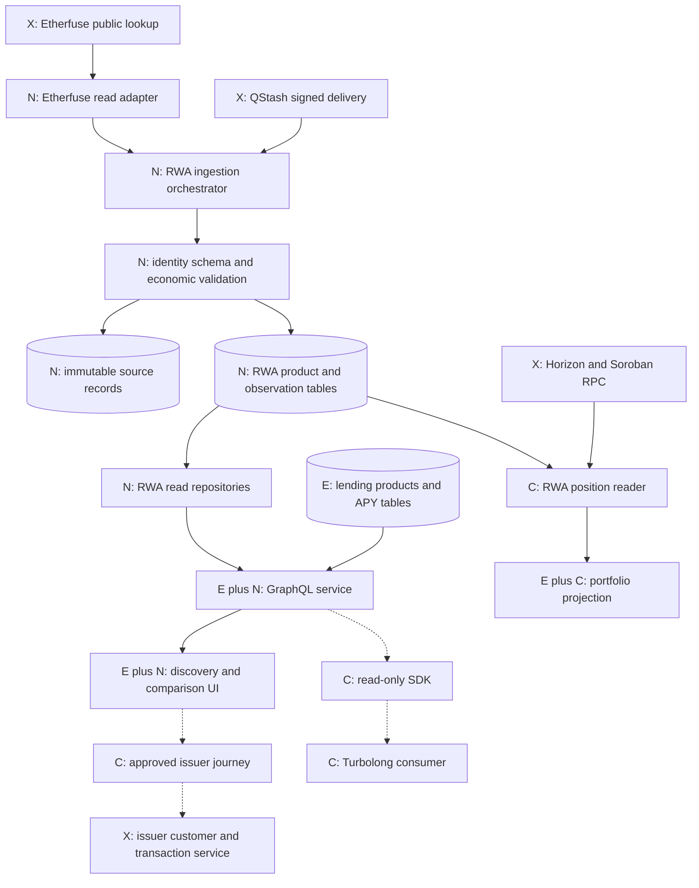

The initial products are USTRY, denominated in USD, and CETES, denominated in MXN. This provides one same-currency comparison case and one explicit FX case. Additional products require identity, financial convention and rights verification; being listed in a provider response is insufficient for an investable UI.

| Path               | Input                                                                   | Output                                                                       | Storage and access boundary                                               |
| ------------------ | ----------------------------------------------------------------------- | ---------------------------------------------------------------------------- | ------------------------------------------------------------------------- |
| Market data        | Public catalogue, price/rate responses and approved product terms       | Typed observations, history, quality and comparison inputs                   | Public financial records; no customer credentials in GraphQL              |
| Position reads     | Network-specific owner address, exact asset mapping and observed ledger | Exact quantity, control flags and time-stamped valuation                     | Public chain reads or separately authorized private servicing records     |
| Transaction intent | Authenticated owner, approved asset/route, explicit amount and quote    | Validated unsigned transaction or hosted handoff, then reconciled settlement | Separate privileged service; user/provider controls signing and execution |

The public-data release can operate while the conditional position, SDK or transaction paths are disabled. This separation prevents uncertain provider permissions from blocking permitted read-only integration.

## Existing runtime and reuse boundaries

The repository is a Next.js application with server routes/actions, a React dashboard and a Neon HTTP/Drizzle persistence layer. The existing code is the starting point; module names below do not imply separate deployed microservices.

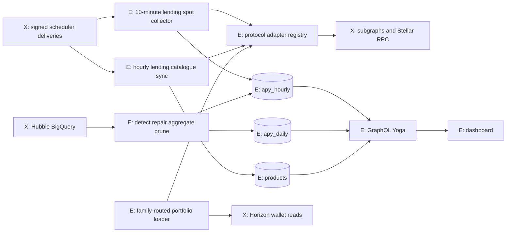

| Existing component         | Verified repository anchor                                                                                                              | Reuse decision                                                                                                          |
| -------------------------- | --------------------------------------------------------------------------------------------------------------------------------------- | ----------------------------------------------------------------------------------------------------------------------- |
| Functional adapter loaders | [protocols-server.ts](../../src/config/protocols-server.ts), [adapter types](../../src/lib/protocols/core/types.ts)                     | Reuse isolation, explicit registration and settled fanout; introduce a parallel RWA registry                            |
| Signed collection routes   | [spot route](../../src/app/api/yield/apy/spot/route.ts), [catalogue route](../../src/app/api/yield/products/route.ts)                   | Reuse signature-verification and bounded job entry pattern; do not write RWA values through lending payloads            |
| Historical convergence     | [runReconcile](../../src/lib/reconcile/index.ts), [gap repository](../../src/lib/db/repositories/gaps.ts)                               | Reuse reporting/checkpoint principles; reject neighbor-copy repair for RWA financial truth                              |
| SQL driver and schema      | [postgres.ts](../../src/lib/db/postgres.ts), [schema.ts](../../src/lib/db/schema.ts)                                                    | Add separate tables/repositories; preserve existing products and APY meanings                                           |
| Public GraphQL             | [route](../../src/app/api/graphql/route.ts), [schema](../../src/lib/graphql/schema.ts), [resolvers](../../src/lib/graphql/resolvers.ts) | Add RWA queries and decimal serialization without changing existing lending fields                                      |
| Portfolio aggregation      | [load.ts](../../src/lib/portfolio/load.ts), [types.ts](../../src/lib/portfolio/types.ts)                                                | Reuse network routing, timeouts and partial failure; add a distinct RWA projection                                      |
| Stellar balance reader     | [wallet-holdings.ts](../../src/lib/stellar/wallet-holdings.ts)                                                                          | Reuse Horizon transport knowledge; new RWA reads retain decimal text and control flags omitted by the legacy projection |
| Wallet authentication      | [StellarWalletContext](../../src/contexts/StellarWalletContext.tsx), [session guard](../../src/lib/auth/session-guard.ts)               | Preserve current wallet/SEP-10 flow; optional embedded signer must meet the same owner/network boundary                 |
| Blend v2.1                 | [adapter](../../src/lib/protocols/blend/v2_1/index.ts), [deployment definitions](../../src/lib/protocols/blend/common/deployments.ts)   | Reuse v2 SDK classes behind the distinct v2.1 deployment; no invented incompatible contract generation                  |
| CCTP orchestration         | [service](../../src/lib/execution/cctp/service.ts), [message checks](../../src/lib/execution/cctp/message.ts)                           | Reuse exact-message validation, owner state and recovery; keep investment separate from USDC transfer                   |

The current lending collector runs nominally every ten minutes and forms hourly aggregates. The nightly reconciler uses a seven-day default window and can repair lending observations from adjacent donor observations. That behavior is explicitly unsuitable for an issuer that publishes one financial value per business day. Shared infrastructure does not imply shared time-series semantics.

## Module contracts and dependency direction

The proposed RWA implementation remains inside this repository. Core financial types and calculations are pure modules. Adapters perform source-specific I/O. Orchestration owns scheduling and persistence; adapters never acquire a database handle or a user signing credential.


The graph describes imports/calls, not an instruction for public types to perform I/O. The pure domain layer must not import Next.js, a database connection, provider credentials or browser wallet code. The SDK consumes public contracts and operations; it does not import server adapters.

| Proposed location              | Responsibility                                                               | Explicit boundary                                                               |
| ------------------------------ | ---------------------------------------------------------------------------- | ------------------------------------------------------------------------------- |
| `src/lib/rwa/core/`            | Domain types, runtime schemas, financial methods, quality/error definitions  | Pure computations; no HTTP/database/signing                                     |
| `src/lib/rwa/etherfuse/`       | Endpoint decoding, public catalogue and observation mapping                  | Provider-specific payloads stop at adapter output                               |
| `src/config/rwa-server.ts`     | Explicit dynamic loaders and enabled capabilities                            | Server only; no filesystem plugin discovery or arbitrary user-provided adapters |
| `src/lib/rwa/ingestion/`       | Due-product planning, leases, retries, checkpoints and revision coordination | Owns orchestration, not provider economics                                      |
| `src/lib/db/repositories/rwa/` | Idempotent observation writes and bounded read queries                       | All SQL access through typed repository methods                                 |
| `src/lib/rwa/comparison/`      | Horizon outcomes and comparability/eligibility constraints                   | Cannot authorize investment execution                                           |
| `src/lib/rwa/portfolio/`       | Ledger-to-share mapping, claim deduplication and marks                       | Cannot infer private beneficial ownership from contract totals                  |
| `src/app/api/yield/rwa/`       | Proposed signed job endpoint family                                          | No unauthenticated public write route                                           |
| Existing GraphQL/UI modules    | Additive public readers and explicit quality/metric rendering                | Keep private servicing and transaction authority outside public schema          |
| `packages/sdk/`                | Conditional independent read client and runtime validation                   | No Next.js/React dependency, issuer secrets or strategy-specific business logic |
| `src/lib/rwa/execution/`       | Conditional issuer quote/order gateway                                       | Separate owner-checked access, provider permission and signing controls         |

The canonical [TypeScript design contracts](examples/contracts.ts) define `RwaAdapter.discovery.list` and `RwaAdapter.observations.fetch`. `history`, `positions`, `eligibility` and `handoff` are optional capabilities. A provider without historical or redemption APIs is still a valid read adapter. Missing adapter capability produces an explicit error; it does not prove that the provider universally lacks that feature.

Do not force `RwaAdapter` into `YieldAdapter.getApySpot`. Lending spot payloads require lending APY fields and enter lending-specific repair/aggregation. An RWA adapter returns observations with original metric, units, convention, source times and quality. Shared HTTP/retry/pagination helpers can be extracted where the code actually overlaps.

## Asset identity and Etherfuse source mapping

An RWA has four different identities: the legal issuer, legal product, share class and blockchain representation. The database must not collapse them into a ticker. The same share class can have multiple blockchain representations; two products can also use the same symbol without representing the same claim.

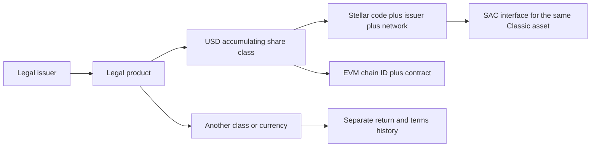

For Stellar Classic assets, identity is `(network, asset code, issuer account)`. For contract tokens, identity is `(network, contract ID)`. For EVM tokens, it is `(chain ID, contract address)`. An opaque LendWise product/share-class ID points to these typed columns; code must not parse an ID to recover economic meaning.

The captured [Etherfuse catalogue](evidence/etherfuse-products.json) includes Stellar representations for USTRY, CETES and additional sovereign products. The approved production map must be established from official provider information and checked against the intended ledger network. The captured issuer address is evidence at collection time, not an automatically trusted permanent constant.

| Source surface                   | Source fields / representation                                         | Adapter output and validation                                                                                                                       |
| -------------------------------- | ---------------------------------------------------------------------- | --------------------------------------------------------------------------------------------------------------------------------------------------- |
| Public `GET /lookup/stablebonds` | `stablebonds`, `symbol`, `bondCurrency`, `blockchains`, `calculatedAt` | Discover Stellar representations, preserve calculation time and bind each product to an approved identity                                           |
| Per-chain catalogue entry        | `blockchain`, `tokenIdentifier`, `decimals`                            | Decode endpoint-specific `CODE-ISSUER`; validate checksum, network, seven-decimal expectation for the observed Classic assets and registry match    |
| Public `GET /lookup/tokens/cost` | `token_cost_in_fiat`, `token_cost_in_usd`, `currency`, `current_time`  | Decimal-string issuer price observations; do not rename them official NAV without confirmed methodology                                             |
| Indicative rate                  | `current_basis_points`                                                 | Preserve original basis-point value; divide by 10,000 for decimal units; retain `ISSUER_INDICATIVE_RATE` until compounding/day count/fees are known |
| FX evidence                      | `fiat_exchange_rate_with_usd`, `sources[].updated_at`                  | Track currency direction and each source's timestamp; USD-to-local rates require inversion for USD-per-local calculations                           |
| Authenticated ramp discovery     | `GET /ramp/assets?blockchain=stellar`, `identifier`                    | Conditional transaction path only; quote identifiers use `CODE:ISSUER` and require approved partner/customer access                                 |

The two public responses need not describe the exact same instant. Join them using the approved identity mapping and record each source time separately. If symbol, currency, identity or timestamp relationships fail validation, quarantine the product update; do not silently select the closest-looking response. A provider timestamp advancing does not prove an official accounting NAV was newly published.

An issuer-address change is a configuration event. Collection can preserve the unexpected raw response for review, but the new identity does not automatically become eligible for comparison, portfolio matching or transaction construction. Keep old mappings effective-dated so a new issuer cannot rewrite historical holdings or returns.

## Ingestion execution and scheduling

Create a source-aware RWA scheduler alongside the lending pipeline. It may wake every ten minutes for Etherfuse current observations, while a daily fund adapter only expects publications according to its calendar. Polling frequency, financial publication frequency and chart resolution remain different concepts.

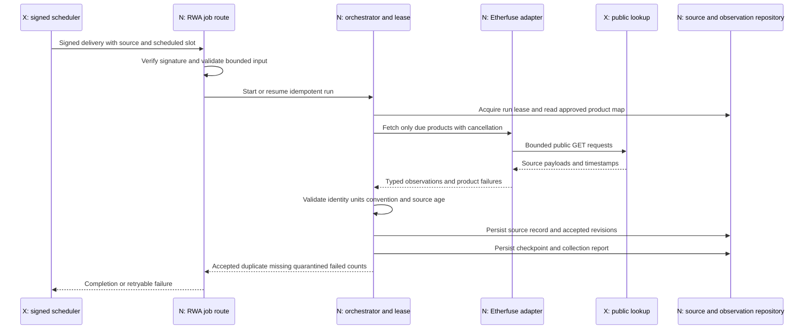

A run is identified by source, environment, scheduled slot and job version. A lease prevents two overlapping scheduler deliveries from simultaneously owning the same run. The lease must have a bounded expiration and an owner token; an expired worker cannot advance a checkpoint after another worker has taken ownership. Database uniqueness still protects observations if the worker crashes or a delivery is replayed.

The ingestion algorithm is:

1. Verify the scheduler signature before accepting job parameters. Resolve the server-side adapter from an allowlisted source ID; callers cannot provide a destination URL or SQL filter.
2. Read the approved asset map and source-specific due schedule. A missing publication is recorded separately from a failed network poll.
3. Acquire the run lease or resume a recorded checkpoint. Bound product count, date range and pages per invocation.
4. Fetch provider responses with cancellation, response-size limits and request timeouts. Parse against a pinned source schema before field access.
5. Preserve the raw public source record and its hash. Validate network, identity, decimals, timestamps, currency and metric semantics.
6. Normalize units and create only justified derived fields. Unknown convention leaves effective annual rate null.
7. Persist accepted observations/revisions through repository-level atomic operations. Record product failures without discarding unrelated success.
8. Commit the page checkpoint after durable writes. If the current page fails, preserve its gap; do not advance beyond it without recording incomplete coverage.
9. Release the lease with its owner token and write run metrics. If the function approaches its runtime budget, schedule a bounded continuation from the checkpoint.

| Control                      | Initial proposed behavior                                                                               | Failure behavior                                                   |
| ---------------------------- | ------------------------------------------------------------------------------------------------------- | ------------------------------------------------------------------ |
| Public Etherfuse poll        | Every ten minutes, subject to verified source terms/cache behavior                                      | Retain prior values with original timestamps; report source age    |
| Per-request budget           | Five-second connection / fifteen-second total target, implemented with supported transport cancellation | Abort and classify timeout; no indefinite promise                  |
| Transient GET retries        | At most three attempts, exponential backoff with jitter and `Retry-After` where supplied                | Record exhaustion and allow a later scheduled recovery             |
| Authentication/schema errors | Do not blindly retry 400/401/403 or incompatible payloads                                               | Alert/configuration review; keep source records when safe          |
| Parallel work                | Bounded per-source queue and settled product results                                                    | A failed issuer/product does not fail lending or unrelated issuers |
| Serverless duration          | Keep work within the existing route pattern's 300-second upper budget                                   | Checkpoint and continue rather than increasing an unbounded batch  |
| Daily publications           | Expected times from issuer timezone/calendar                                                            | A weekend is not automatically a missing-data incident             |

These values are implementation targets to validate against provider behavior and hosting limits, not measured service guarantees. Read retries and order retries are different policies: never reuse the GET retry loop for an irreversible issuer request.

## Persistence and transaction boundaries

Keep the existing `products`, `apy_hourly` and `apy_daily` lending tables intact. Add a separate product/share-class model and immutable RWA observations. PostgreSQL is the query and correctness boundary; raw evidence storage must not become an implicit second authority for which observation is current.

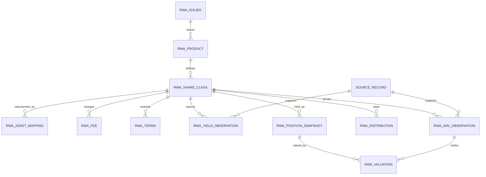

| Record                | Key / storage requirement                                                                               | Reason                                                              |
| --------------------- | ------------------------------------------------------------------------------------------------------- | ------------------------------------------------------------------- |
| Product/share class   | Stable IDs, issuer/product foreign keys, currency and effective-dated terms                             | Returns and rights belong to a particular class, not a symbol       |
| Asset mapping         | Exact network and Classic issuer/code or contract; valid-from/to interval                               | Match balances safely and preserve past identities                  |
| Yield observation     | Class, metric, currency, period, source time, source, method version and revision                       | Different metrics or conventions must not collide                   |
| Price/NAV observation | Class, price type, currency, source time, source, method version and revision                           | Official NAV, issuer price and executable market price are distinct |
| Source record         | Source ID, safe URL, raw-response hash, source/collection/availability times and raw evidence reference | Reproduce the accepted interpretation and trace corrections         |
| Position snapshot     | Owner scope, asset identity, atomic quantity, decimals, ledger/time and control flags                   | Preserve exact balance and authorization context                    |
| Valuation             | Position snapshot plus price/FX observation IDs and calculation version                                 | A mark must be traceable to every input                             |

Use `numeric(38,18)` for rate/price representations where appropriate and `numeric(78,0)` for integer token quantities. Carry decimal strings across the API boundary. Do not convert an atomic amount to a JavaScript `number` merely to reuse the legacy `WalletHolding` shape. Round only at documented display or transaction boundaries; outgoing amounts must not exceed available atomic units.

A yield logical key is `(share_class_id, metric, currency, period_start, period_end, observed_at, source_id, method_version)`. Nullable interval fields need explicit null-equality handling, for example nulls-not-distinct uniqueness where supported or a canonical logical-key hash. Revision uniqueness is `(logical_key, revision)`; a repeated identical source observation is a no-op rather than a new return observation.

A proposed observation write transaction performs four dependent actions: establish source-record linkage, lock/resolve the current logical observation, insert a changed revision when needed, and advance its current pointer only after success. The page checkpoint advances separately after every item on that page has a durable outcome, including any explicitly recorded gaps. A crash between observation commits and checkpoint advancement causes a safe idempotent replay. Concurrent attempts must resolve the same current revision through a lock or atomic conflict operation; `max(revision)+1` without concurrency control is unsafe. The existing Neon HTTP driver must use a supported transaction/batch or single-statement implementation, not an assumed interactive transaction held across HTTP calls.

If large raw responses later move to object storage, there is no automatic atomic transaction across PostgreSQL and that storage. Use content-addressed immutable objects and a database commit record; reference only successfully stored evidence. Retry/clean orphan objects independently. A transactional outbox or equivalent post-commit replay process can deliver cache invalidations without pretending the database and a cache share one transaction. These are proposed repository responsibilities, not currently implemented facilities.

The complete column/constraint inventory is in [RWA data model](RWA_DATA_MODEL.md). The schema must be additive, indexed for current observations and bounded history reads, and reversible through disabled readers/jobs without deleting financial history.

## Historical data and revisions

There are two different time dimensions. `observedAt` describes the economic/source time, while `availableAt` describes when the platform could know that version. `publishedAt` remains null when the provider does not supply a true publication timestamp. `collectedAt` records retrieval and must not make old financial information appear new.

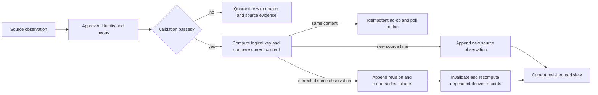

A replayed response produces collection telemetry without fabricating another financial observation. A correction creates a new revision and preserves its predecessor. If a method changes, retain its method version so the system can distinguish a corrected source from a changed interpretation. Derived returns reference exact observation and distribution IDs; recomputation does not destroy prior derivations used by a past report.

| Example                                                                | Required interpretation                                                                                                 |
| ---------------------------------------------------------------------- | ----------------------------------------------------------------------------------------------------------------------- |
| Daily NAV unchanged over a weekend                                     | Source calendar may explain absence of publication; show the original date, not three invented daily NAVs               |
| Current API returns a new retrieval time and an old source time        | Collection succeeded; source information may still be stale                                                             |
| Issuer revises last week's value today                                 | New revision available today; a point-in-time backtest for last week cannot use it as though known then                 |
| Distribution causes the accumulating/distributing price path to differ | Apply the class-specific corporate action; do not automatically classify the NAV decrease as a loss or add income twice |
| Etherfuse historical endpoint unavailable                              | Begin prospective history at first collection; no backward extrapolation from today's rate                              |
| A Stellar transfer exists in ledger history                            | It proves a transfer, not an off-chain NAV, coupon convention or investor entitlement                                   |

Historical backfill is a separate bounded job using the same validators and revision repository. It dry-runs requested products/ranges, retrieves only authorized source history, records actual coverage, writes idempotently and recomputes affected intervals. Existing Hubble reconstruction is reusable only for genuinely ledger-contained state with a supported decoder and bounded query cost. A historical lending-state decoder cannot reconstruct an issuer's off-chain financial ledger.

Carry-forward is a valuation/read-view operation: it references the original price and labels age/origin. It must never append another source-reported price or turn missing days into a zero return series. Missing, stale, quarantined and legitimately zero values remain distinct states.

## Financial computation and comparison

The financial layer has two outputs: **typed source observations** and **derived investor scenarios**. Unit conversion is allowed before every economic convention is known; converting an issuer indication into effective APY is not. All derived results must identify their method version, input observations, horizon, currency and fee assumptions.

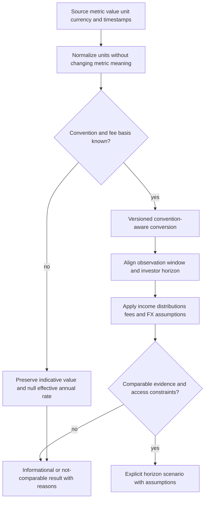

The observation types in [contracts](examples/contracts.ts) preserve `originalValue`, `originalUnit`, `normalizedDecimal`, `effectiveAnnualRate`, `metric`, `direction`, `feeBasis`, `rateType`, `incomeTreatment`, `dayCount`, `compounding`, interval fields, source provenance, quality and revision lineage. A subject is either a fund share class or a lending product. A lending reserve is not a fund share class merely because both have a percentage.

The following JSON is an illustrative field projection, not a complete canonical response and not a live rate quote:

```json
{
  "metric": "ISSUER_INDICATIVE_RATE",
  "originalValue": "369",
  "originalUnit": "basis_points",
  "normalizedDecimal": "0.0369",
  "effectiveAnnualRate": null,
  "currency": "USD",
  "feeBasis": "unknown",
  "dayCount": "unknown",
  "compounding": "unknown"
}
```

For nominal APR `r` with known compounding frequency `m`, `APY = (1 + r/m)^m - 1`. For an already effective annual rate `a`, unchanged-rate horizon growth is `(1+a)^(d/365)` under ACT/365F. For a simple annual rate, the factor is `1+r*d/365`. These equations are not interchangeable conventions. The existing Blend display uses daily conversion, while some other lending code uses per-second conversion; preserve the existing outputs and disclose the method in new comparison views.

The comparison pipeline must perform these steps in order:

1. Resolve exact product/class/asset identities and select source observations by a consistent availability cutoff.
2. Reject quarantined data; identify missing/stale inputs with their original times. A source cache hit does not establish freshness.
3. Classify metric and time direction: historical total return, spot variable lending rate or forward-indicative issuer rate.
4. Establish a justified horizon transformation. If required convention or cash flows are unknown, return an explicit comparability reason rather than a guessed APY.
5. Model net cash outcomes after identifiable fees, including whether costs are already embedded in NAV. Unknown taxes remain outside the estimate, with disclosure.
6. Convert currency with explicit quote direction and scenario assumptions; never assume tomorrow's FX equals today's rate without labeling that assumption.
7. Apply liquidity/maturity/redemption/access constraints. A valid issuer mark does not establish an executable exit price.
8. Return the result with input IDs, method version, quality vector and reasons. Ranking is a downstream decision only for compatible outputs.

| Comparison                                 | Valid calculation                                                               | Required limit                                                    |
| ------------------------------------------ | ------------------------------------------------------------------------------- | ----------------------------------------------------------------- |
| Two lending products                       | Same-currency horizon scenarios using declared spot-rate/fee/reward assumptions | Variable future rates are scenarios, not contracted returns       |
| Fund prices with distributions             | Share-unit or cash-flow total return over matched dates                         | Avoid counting distributed/reinvested income twice                |
| Bond YTM versus lending APY                | Dated cash-flow scenario with maturity or explicitly modeled exit price         | Headline YTM alone is not an arbitrary-horizon return             |
| CETES versus USD lending                   | Local return plus explicit MXN/USD scenario and conversion costs                | Local-currency yield is not USD profit                            |
| Issuer indication with unknown compounding | Preserve the original metric and decimal units                                  | Effective annual rate stays null; no precise total-return ranking |

A checked numerical example: capital 10,000, entry fee 0.2%, exit fee 0.1%, unchanged effective gross rate 5%, 90 days and no additional fixed cost gives `10000 × 0.998 × 1.05^(90/365) × 0.999 ≈ 10090.69`, or about 0.9069% net over the period. If a local investment returns 6% but its currency falls 10% against the investor's currency, the combined return is `1.06 × 0.90 - 1 = -4.6%`, before conversion costs.

The full [yield methodology](YIELD_NORMALIZATION_METHODOLOGY.md) defines cash-flow pricing, fee treatment, reinvestment, variable debt and edge cases. The architecture must preserve these semantics through SQL, GraphQL and UI rather than reducing every observation to a sortable float.

## Portfolio reads and valuation

An RWA portfolio position is a claim on a verified asset/share class with a measured quantity, control state and valuation evidence. It is distinct from the existing lending `SupplyPosition`, and from a generic unpriced wallet holding.

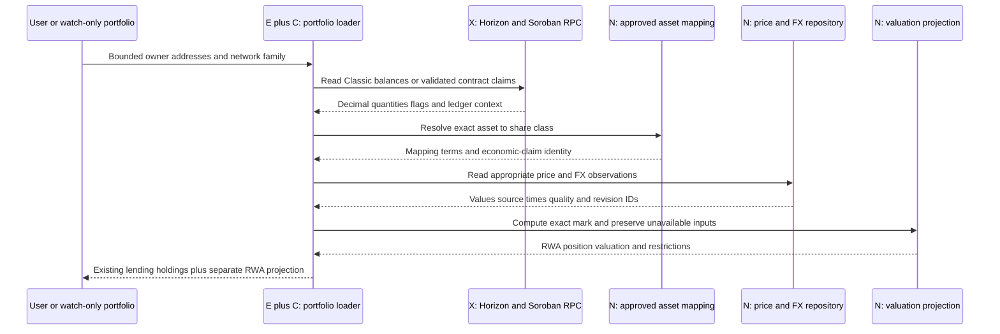

Classic reads retain asset code, issuer, balance text, trustline capacity, buying/selling liabilities, `is_authorized`, maintain-liabilities authorization and clawback flags when available. SAC reads for a `G...` owner refer to the same underlying Classic balance; they must not produce a second economic position. A `C...` owner uses contract balance state and needs proof of the user's actual claim. Owning a receipt token does not mean owning the full treasury balance of its contract.

Capture the network and ledger context of each read. A Horizon account read, a Soroban query and an issuer price response are not automatically an atomic snapshot at one ledger or timestamp. Where compatible ledger-specific reads exist, align them; otherwise preserve their separate as-of values and mark the reconciliation tolerance. Do not pretend a generic current account endpoint can retrieve any arbitrary historical balance.

The processing keys are `(owner scope, network, asset representation, ledger/read context)` for source balances and a mapped economic-claim key for the presentation. A direct Classic balance and its SAC view share that claim key. A wrapped share has its own claim and a separately verified exchange ratio; it cannot be deduplicated merely because the symbols resemble each other.

For quantity `q`, compatible price `P` in local currency and FX `X` in investor-currency units per local unit, the mark is `q × P × X`. Store references to the position snapshot, price observation, FX observation and method version. Quantity, price and FX precision remain decimal/integer values until display rounding. Unknown price or FX yields an unknown mark, not zero and not an assumed price of one.

| Position state                       | Portfolio behavior                                                                             |
| ------------------------------------ | ---------------------------------------------------------------------------------------------- |
| Direct token, current approved price | Show quantity, price type, valuation time and control/eligibility information                  |
| Price carried forward                | Show the original price time and explicit stale/carry-forward state                            |
| Trustline authorization revoked      | Continue showing the observed holding; disable unrestricted-transfer claims                    |
| Investor eligibility unknown         | Permit watch-only discovery; do not imply primary subscription/redemption access               |
| Redemption burns token before payout | Represent a receivable only when authoritative servicing evidence confirms the remaining claim |
| Custodial or omnibus allocation      | Require authorized provider statements; public contract totals are insufficient                |
| One source times out                 | Preserve unaffected lending/holdings and return a source-specific partial failure              |

Preserve `UserPortfolioResult.positions`, `holdings`, `riskAccounts` and `failures` for existing callers. Expose new RWA positions through an additive/versioned result or a separate action merged by the UI. Public watch-only balance inspection and private servicing records have different authorization requirements; watching an address is not proof of ownership.

## GraphQL and SDK distribution

Extend the existing Yoga endpoint instead of creating another public data service. Add RWA types and resolvers alongside existing lending queries. The public schema exposes market observations and published product terms, not customer KYC, private eligibility approvals, issuer account tokens or order-signing authority.

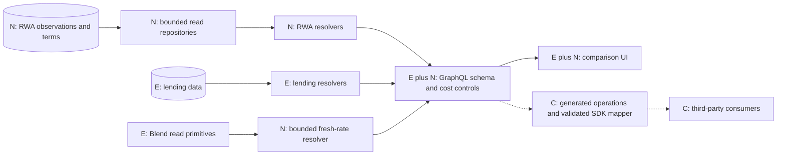

| Proposed query      | Repository/read behavior                                                   | Bounds and result semantics                                                                  |
| ------------------- | -------------------------------------------------------------------------- | -------------------------------------------------------------------------------------------- |
| `rwaProducts`       | Product/class/terms/asset projection                                       | Maximum page 100; public eligibility remains unknown unless it is a public product condition |
| `rwaObservations`   | Current revision per requested class/metric/price type                     | Maximum 50 class IDs; independent data and failure arrays                                    |
| `rwaHistory`        | Source-native observations under a fixed availability/revision snapshot    | Bounded range, initial maximum one year; keyset pagination                                   |
| `blendRateSnapshot` | Reuse direct Blend reads with actual source time, pool state and liquidity | Enforce caller age tolerance within server caps; no substitution of an old hourly mean       |

An example discovery operation, compatible with the proposed [SDL](examples/rwa-extension.graphql):

```graphql
query DiscoverEtherfuse {
  rwaProducts(issuer: "etherfuse", first: 20) {
    items {
      id
      shareClassId
      name
      currency
      maturityKind
      redemptionDelayDays
      liquidity {
        issuerRedemption
        secondaryMarket
      }
      fees {
        kind
        value
        includedInNav
      }
    }
    pageInfo {
      nextCursor
    }
  }
}
```

New `Decimal` values serialize as canonical strings. Existing `DateTime` is reused rather than redefined in the running schema. `FinancialObservation` exposes exactly one subject field: `shareClassId` or `lendingProductId`; runtime XOR validation reconstructs the SDK subject union. Revision lineage is explicit for both yield and price observations. Unsupported precision, invalid time and unknown financial conventions must not silently become floating-point defaults.

History cursors bind class, filters, interval, ordering and availability/revision snapshot. Since history contains separate NAV and yield streams, the cursor tracks each stream's continuation key. Validate every decoded field; opaque encoding alone does not make a cursor trustworthy. Bound rows even if aliases or nested selections multiply the request. Use the same stable snapshot for subsequent pages so a correction arriving between requests does not skip or duplicate observations.

The SDK contract exposes `products.list`, `observations.latest`, `history.list` and `lending.blendRates`. Generated public operations feed a runtime mapper that reconstructs domain provenance, quality, asset and subject types. The conditional package stays independent from Next.js/React, issuer adapters and signing services. Consumer-supplied transport can support Node/browser runtimes; public API keys must not become execution credentials.

### Caching and request isolation

Cache metadata, source observations and fresh Blend snapshots independently. Metadata can live longer than market observations. A cache hit retains the original source time and quality; it never sets `observedAt` to now. Cache keys include environment, issuer/API version, product/class or pool/asset, method version and relevant filters. Private owner data additionally requires owner-scoped isolation and must never enter a shared public cache.

An initial live Blend cache target of at most fifteen seconds can support a thirty-second consumer tolerance, but the server must check actual source age. A provider timeout or lock contention cannot be satisfied with an old result labeled fresh. Source revisions, approved identity changes and effective terms changes invalidate affected projections. The exact cache backing for new data is an implementation choice; the presence of existing Redis session/rate-limit code does not establish an existing RWA cache.

The current public limiter is 60 requests/minute/IP and deliberately fails open on Redis outage. Preserve that documented availability choice for ordinary public reads only with independent edge/body/cost/concurrency controls and alerting. Privileged order/signing routes require fail-closed protection. Read retries use bounded backoff; GraphQL HTTP 200 with an `errors` array still requires partial-data handling by the SDK.

See [SDK/API design](SDK_AND_API_DESIGN.md) for the complete contract, packaging/versioning and consumer release process.

## Optimization and strategy consumers

The repository contains a rate sorter and a proxy/client for an external optimizer. The solver source and evidence of RWA eligibility/maturity constraints are unavailable. Do not send heterogeneous issuer indications into the existing APY sorter and describe the result as investment optimization.

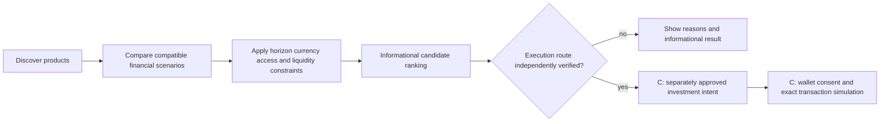

A proposed comparison request contains investor horizon, base currency, capital, minimum/maximum exposure constraints, liquidity deadline and eligibility evidence where authorized. The filter rejects unverified identities, stale/quarantined inputs and inaccessible products before ranking. For a 30-day cash need, a product requiring a 90-day hold cannot be accepted purely because its headline yield is higher. Redemption delay and business calendars count toward the actual cash-availability date.

Concentration limits aggregate a product/issuer across chains. Minimum investments require `allocation=0` or `capital×allocation≥minimum`; this is a discrete/non-convex condition, not an ordinary unconstrained rate-weighting problem. A later scenario-based allocator may optimize net horizon return minus an explicit risk term such as CVaR, subject to currency, concentration, access and cash-timing constraints. It needs a defensible scenario distribution; arbitrary risk scores cannot be relabeled as probabilities.

Turbolong's initial use is a data-consumption flow. It supplies exact share-class, pool and debt-asset IDs and consumes typed observations, current borrow state and quality/error information. Its own strategy layer must supply collateral/liability factors, leverage path, swap costs, redemption/unwind routes and liquidation mechanics.

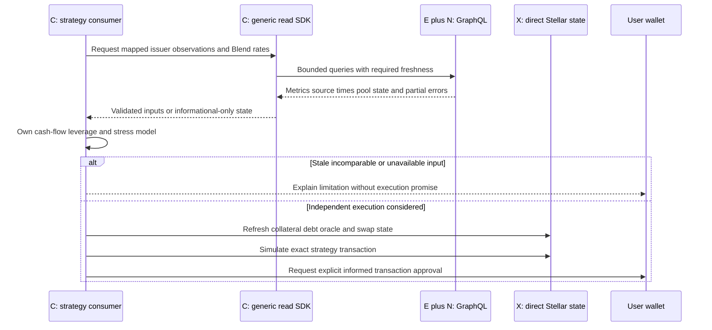

In a simplified same-currency leveraged hold, with initial equity `E`, asset exposure `L×E`, debt `(L-1)×E`, asset/debt growth factors `G_A/G_D` and equity-proportional costs `k`, equity return is `L×G_A - (L-1)×G_D - 1 - k`. It is not the difference between two headline percentages. At leverage three, one-year asset return 5%, debt cost 4% and costs 0.5% of equity, the simplified return is 6.5%; rate changes, price/FX losses and liquidation can make it negative.

The generic SDK does not compute guaranteed strategy profit, sign a transaction, infer private eligibility or act as a liquidation oracle. Its example consumer rejects absent values, stale/future timestamps and mismatched subjects/pools/assets. Passing that check means inputs exist, not that a position can be safely opened. Public delayed financial data remains useful for analysis but does not replace direct pre-execution chain state and executable quotes.

## Wallet authentication and signing

Existing Stellar Wallets Kit connection remains the core signer path. A connected address is not automatically an authenticated application session, and a session is not investor approval. The existing SEP-10 routes establish owner control for supported accounts; every privileged server action must recheck the active session, address, network and revocation status.

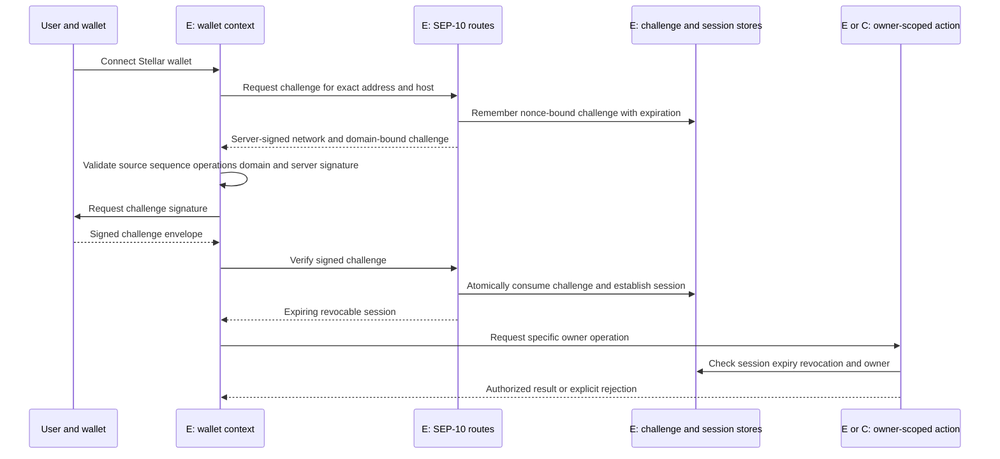

SEP-10 challenges have a special sequence-zero authentication purpose and are not submitted as normal payment transactions. Reuse existing domain/network binding, challenge expiration, expected operation structure, atomic nonce consumption and session revocation. Do not replace them with an email login or a UI-stored address.

A transaction service accepts a structured intent, not an arbitrary browser-provided destination or raw signing hash. It resolves the approved product/asset and route server-side, validates owner/session, checks current account and token permissions, obtains provider terms where required and returns only a bounded, intent-specific payload for user review.

For a Classic transaction, bind source, network passphrase, sequence, allowed operations, destination/memo, exact asset, amount, fee and timeout. For a Soroban transaction, also bind contract/function/arguments, simulated resource data, required authorizations and relevant expiration bounds. Re-simulate/rebuild after state restoration or a stale sequence. Signing a network-specific transaction hash and signing contract address-authorization payloads are separate operations; testing one does not prove the other is supported by an optional signer.

The conditional Privy adapter must create a native Stellar wallet and prove the required Classic, sequence-zero and Soroban flows under the configured user ownership/recovery model. It must not expose a public raw-sign-any-hash endpoint or substitute a login token for address ownership. Optional Mercuryo onboarding must separately prove Stellar XLM/USDC merchant enablement, account activation, trustline requirements and payment-status/refund behavior. Detailed conditional flows and their existing-wallet fallbacks are in [onboarding](ONBOARDING_ARCHITECTURE.md).

### Reserve and authorization preflight

For a simple Classic account, minimum balance follows the network base reserve and ledger entry accounting: `(2 + subentry_count + num_sponsoring - num_sponsored) × baseReserve`. Spendable XLM also subtracts native selling liabilities and retains transaction-fee capacity. Additional trustlines/signers/offers alter reserve requirements. Read current parameters/account state rather than making a permanent assumption that one historical reserve value will always apply.

For a credit trustline, verify the exact code/issuer, authorization state and available receiving capacity; buying liabilities can consume trustline capacity. An account existing with USDC does not necessarily have the RWA trustline or issuer eligibility. Contract-held balances use contract storage and do not automatically require a Classic trustline in the same form. Soroban inclusion/resource/rent requirements are additional to Classic reserve calculations.

The [captured issuer flags](evidence/etherfuse-issuer.json) show revocation and clawback capability for the observed Etherfuse issuer. This is neither proof of a particular holder's flag state nor proof of misuse. The UI must distinguish ledger transfer permission, legal investor eligibility and provider redemption entitlement.

## CCTP and optional issuer execution

CCTP moves native USDC to Stellar. Buying or redeeming an RWA is a subsequent issuer operation with separate terms, permissions, signatures and settlement. The existing bridge must not mark the investor as holding a Stablebond merely because a USDC mint succeeded.

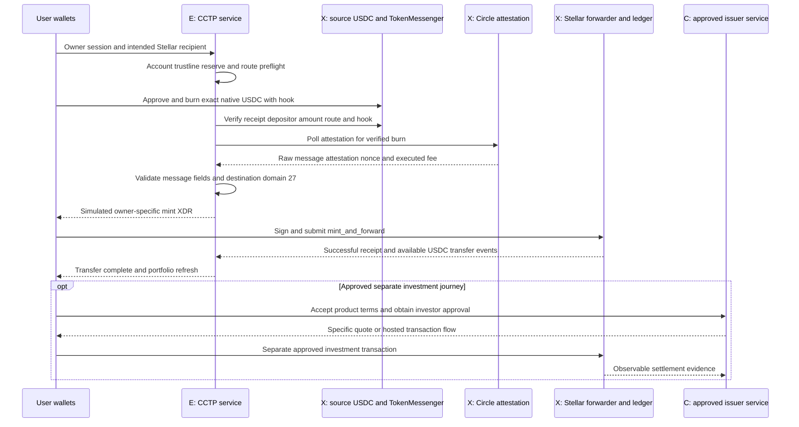

Verified code configuration includes Ethereum, Base, Arbitrum and Optimism mainnet sources; testnet config contains Ethereum/Base/Arbitrum Sepolia sources. Those are configured routes, not proof that every route was exercised end to end. The public evidence includes one independently rechecked [mainnet mint](evidence/cctp-mainnet-mint.json).

The bridge already persists transitions and uses state-aware recovery:

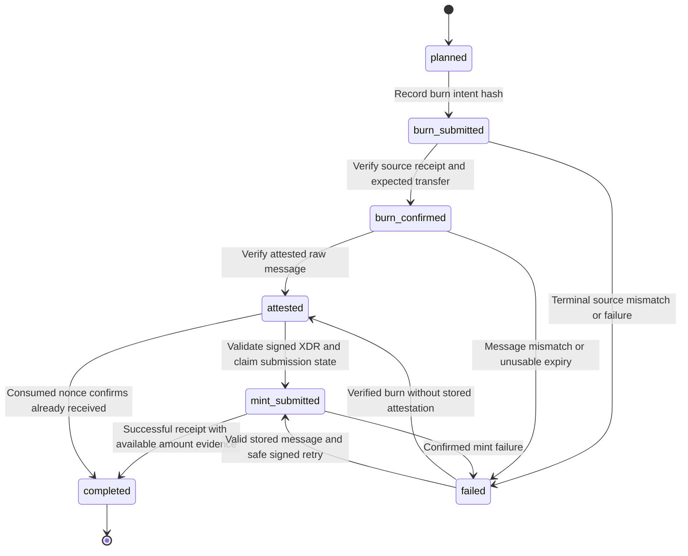

This is a summary of [service behavior](../../src/lib/execution/cctp/service.ts), not permission to reset an arbitrary failure. A source burn failure, message mismatch, expired attestation and temporarily missing mint have different recovery rules. Only stored verified state and current chain/provider evidence determine which transition is allowed.

The [message validator](../../src/lib/execution/cctp/message.ts) checks source/destination context, token, amount, fee bound, depositor and recipient hook before Stellar signing. The [mint validator](../../src/lib/execution/cctp/mint.ts) requires the expected forwarder `mint_and_forward` invocation and exact message/attestation bytes. Reuse these checks for this bridge; they are not a generic validator for arbitrary issuer XDR.

The atomic amount invariant is `minted_stellar = (burn_evm - executed_fee_evm) × 10` because the source USDC uses six decimals and Stellar uses seven. Record EVM approval/burn gas, Circle fee and Stellar inclusion/resource fees separately. The MessageTransmitter's consumed nonce is the protocol replay authority; database uniqueness and owner binding protect the application audit/resume state.

There is an important existing-code limit: `settleMint` can mark a successful transaction `completed` when no recipient amount was extracted, and records a warning rather than rejecting completion when an extracted amount differs from the invariant. `prepareBridgeMint` can also complete an already-consumed message without obtaining its receipt amount. Therefore, the status alone is not proof of a fully reconciled quantity. Any new valuation or attributable-settlement projection must inspect the warning/amount evidence and reconcile the expected recipient and exact amount before accepting an economic outcome. This is a proposed acceptance requirement; no bridge behavior is changed by this document.

After an uncertain RPC submission, query the known transaction hash and message nonce before constructing a fresh intent. Fallback providers resend the same signed bytes when appropriate. An expired envelope may need a new sequence/simulation/signature; an expired CCTP message needs supported re-attestation or operational escalation. The existing code does not provide automatic recovery/refunds for every expired-message case.

### Conditional issuer order state

An issuer order gateway is a separate proposed service. It checks customer eligibility and provider entitlement, creates an expiring quote, binds an idempotency key to the owner/product/amount, and validates any returned transaction or redirect against the stored intent. A provider webhook is authenticated and deduplicated before it updates an order projection; ledger/provider reconciliation remains necessary.

Proposed local servicing states must map to the selected provider API version rather than being sent as invented provider status values. Distinguish awaiting customer approval, quoted, awaiting user signature/payment, submitted, settled, rejected/cancelled, and recovery-required. A token burn during redemption can precede payout; track the remaining receivable only with authoritative evidence. Do not claim a payout occurred from a burn event alone.

Provider quote creation and order execution may have different idempotency rules. Store the provider reference before responding to the client; on an uncertain response, reconcile by that reference/key instead of creating another order. Never blindly retry an irreversible request using a new key because the first HTTP response was lost.

## Deployment and operational controls

Keep the application runtime on the existing deployment pattern. New RWA jobs execute in bounded server requests; new tables live beside lending data in Neon; issuer services, Circle, Horizon/RPC and any optional onboarding provider remain external trust boundaries. The exact new raw-evidence/cache backing is selected during implementation, with correctness rules defined above.

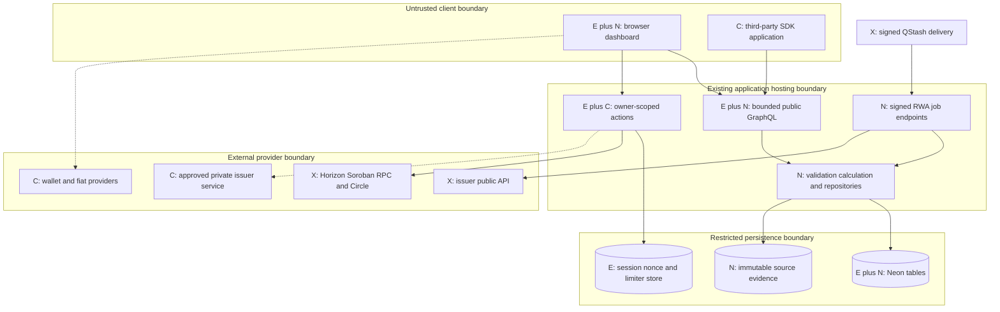

Browser code and SDK callers are untrusted even after login. Server-side issuer credentials, raw customer records and signing authorization never belong in public resolver output, client bundles, package exports or shared observation caches. A service handling public data should use read-only provider access where applicable. A preview environment must not inherit production issuer or signing credentials merely because it has the same route names.

Future application promotion follows the repository's `testnet → mainnet → main` convention. The documentation baseline itself is the selected `main` commit. Deploy additive schema changes before new writers/readers and separate the activation of collection, public reading and conditional transaction paths.

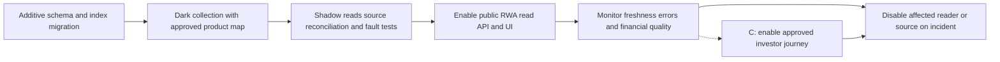

Proposed feature controls are independent: collection enabled, public RWA readers enabled, each issuer enabled, position projection enabled and issuer transaction journey enabled. These describe required controls, not existing environment-variable names. Disabling transactions must not hide already-observed holdings; disabling one issuer should not stop lending collection. Keep an operator-accessible pause for unexpected identity/code/authorization changes.

### Error classification and recovery

| Failure class                           | Detection                                           | User/API behavior                                               | Operator recovery                                                 |
| --------------------------------------- | --------------------------------------------------- | --------------------------------------------------------------- | ----------------------------------------------------------------- |
| Source timeout/429                      | HTTP deadline or provider response                  | Partial failure; preserve old as-of time; no zero rate          | Bounded retry, quota review and circuit-breaker recovery          |
| Source schema/identity mismatch         | Runtime schema and approved mapping                 | Quarantine update and suppress new investable claims            | Review provider change, update versioned map/schema with evidence |
| Stale publication                       | Source time exceeds calendar-aware policy           | Explicit stale/unknown status; block freshness-dependent output | Reconcile source schedule and recover missing observations        |
| Database write conflict                 | Unique/transaction conflict                         | No duplicate observation or false checkpoint                    | Retry idempotently under lock/lease rules                         |
| Formula/precision issue                 | Independent fixtures and invariant checks           | Reject/quarantine derived result                                | Correct method version, recompute traceable derivatives           |
| Owner/session failure                   | Missing/expired/revoked session or address mismatch | Reject privileged action; public reads remain available         | User re-authentication; investigate anomalies                     |
| Ledger/provider transaction uncertainty | Submission response lost or pending hash            | Pending/recovery-required; no completed state from a redirect   | Query stored hash/nonce/order before any new signature            |
| Token rights changed                    | Issuer/trustline flag or terms change               | Continue showing observed balance with restrictions             | Pause affected route and confirm product-specific permissions     |

Use structured run/report fields: source, environment, adapter/method version, run ID, scheduled slot, product count, request count, accepted/duplicate/quarantined/missing/failed counts, source age, publication completeness, checkpoint, duration and safe error codes. Correlate job/API/position derivations through IDs without logging authorization headers, session tokens, raw KYC or signing payload secrets.

The proposed operational acceptance target is at least 99% scheduled collection completion over a fourteen-day observation period, subject to the selected source grace policy. Report **collection completion** separately from **source-publication completeness**; a successful poll can still receive stale data. Require provenance and exact identity for every accepted observation. These are release targets, not evidence of an existing production SLA.

Restore procedures must cover both database observations and their raw evidence links. Rebuild derived projections/caches from immutable inputs and method versions. Rollback ordinarily disables new jobs/readers and retains new history; dropping tables or overwriting corrected observations is not routine rollback. Any incident correction keeps an audit trail and does not repaint history without a revision.

## Architecture decision records

These are recommended, implementation-binding design choices once reviewed by maintainers. External entitlement gates remain open as listed in [questions](OPEN_QUESTIONS.md).

### ADR-01 — Separate RWA and lending models

**Alternatives:** overload `products`/`apy_hourly`; replace all lending schemas with a universal instrument; add separate RWA tables with a shared read projection. **Decision:** separate RWA tables. **Tradeoff:** additional tables/resolvers versus exact semantics and compatibility. **Consequences:** no existing field changes; shared asset/provenance types only; new migration and explicit comparability layer required.

### ADR-02 — Typed financial normalization

**Alternatives:** map every percentage into APY; retain only issuer labels; preserve original convention plus justified derived values. **Decision:** third option, with null effective annual rate when unjustified. **Tradeoff:** UI needs richer labels and some products cannot be ranked together. **Consequences:** versioned equations, fee/income assumptions, input references and horizon currency scenarios become required release controls.

### ADR-03 — Capability-based issuer adapters

**Alternatives:** extend lending `YieldAdapter`; require every issuer to implement trading; separate read adapters with optional capabilities. **Decision:** separate `RwaAdapter`, following existing functional loader/isolation style. **Tradeoff:** second registry, but no false transaction promises. **Consequences:** history/positions/eligibility can be absent; signed orders are a different privileged service; external authors implement the same conformance suite.

### ADR-04 — Source-native immutable history

**Alternatives:** hourly resampling in APY tables; synthesize historic yields from current rate; append source observations and revisions. **Decision:** preserve source-native observations. **Tradeoff:** irregular chart series, backfill may begin only at collection. **Consequences:** no donor-copy RWA repair, source calendars/freshness distinct, point-in-time availability retained for backtests.

### ADR-05 — Distinct RWA position projection

**Alternatives:** reuse lending `SupplyPosition`; treat all tokens as liquid wallet holdings; add an RWA claim projection over verified ledger/account inputs. **Decision:** third option. **Tradeoff:** mapping/deduplication required. **Consequences:** control flags, legal eligibility, custody and redemption receivables remain explicit; Classic/SAC duplicates cannot inflate total assets.

### ADR-06 — Thin generic read SDK

**Alternatives:** publish application internals; build a Turbolong-specific strategy SDK; publish generated operations with validated domain types. **Decision:** thin independent `@lendwise/sdk` with optional safe scenario helpers, no strategy execution. **Tradeoff:** consumers own strategy models. **Consequences:** scoped exports, semantic versioning, no React/Next/server secrets, fixture-based consumer tests and npm ownership gate.

### ADR-07 — Privy feasibility and fallback

**Alternatives:** assume no Stellar support; commit full embedded-wallet flow now; accept documented native support but gate optional delivery on exact-flow tests. **Decision:** documented Stellar creation/hash signing is feasible; integration in a later phase with a test gate. **Tradeoff:** less onboarding scope, fewer signing dependencies. **Consequences:** existing Wallets Kit/SEP-10 remains usable; no promise of Soroban auth-entry, fee sponsorship or recovery semantics before testing.

### ADR-08 — Mercuryo feasibility and fallback

**Alternatives:** infer support from generic USDC listing; commit one-step two-asset funding; require network-specific merchant enablement and staged funding. **Decision:** native Stellar products exist, new merchant journey remains optional. **Tradeoff:** separate XLM/trustline/USDC steps. **Consequences:** CCTP or already-funded wallet suffices for core; merchant limits, signature fixtures, country checks and refunds block release of fiat onboarding.

### ADR-09 — Etherfuse-first delivery scope

**Alternatives:** deliver all twelve workstreams together; build an analytics-only integration; stage an Etherfuse data/comparison release and a separately approved issuer journey. **Decision:** stage delivery, keeping public data and comparison independent from optional execution and onboarding providers. **Tradeoff:** additional issuers, broad optimization and embedded onboarding arrive later. **Consequences:** reuse existing CCTP and wallets; require product-specific entitlement and settlement evidence before enabling the issuer journey; publish usage claims only when attributable.

## Implementation sequence and release gates

Implement the extension in dependency order, with a demonstrable output at each step. These stages are engineering scope boundaries; conditional provider features require their own acceptance evidence.

| Stage                         | Concrete implementation                                                                    | Verification and exit gate                                                                                       |
| ----------------------------- | ------------------------------------------------------------------------------------------ | ---------------------------------------------------------------------------------------------------------------- |
| 1. Domain and schema          | Runtime financial/identity contracts, additive RWA tables, keys and revision repository    | Exact decimals, null/unknown semantics, concurrent idempotent writes, migration/disable-read rollback            |
| 2. Etherfuse read adapter     | Approved USTRY/CETES mapping, source decoders, price/rate/provenance output                | Pinned source fixtures, wrong-issuer/network tests, original metric retention, no unjustified APY                |
| 3. Collection and history     | Signed jobs, due schedule, lease, bounded retries, checkpoints and source-native revisions | Duplicate delivery, source outage, partial page, revised history, stale calendar and checkpoint recovery tests   |
| 4. API and comparison         | Additive GraphQL, bounded queries, typed metric UI and horizon comparison                  | Existing lending queries preserved; source timestamps/fees/FX and non-comparable cases visible                   |
| 5. Operational release        | Shadow collection, reports, alerts, feature controls and rollback owner                    | Source reconciliation, fault isolation, fourteen-day quality observation and independent numerical fixtures      |
| 6. Conditional portfolio/SDK  | Exact claim projection, public balance marks and accepted consumer interface               | SAC duplicate prevention, restricted/unknown holdings, stale inputs, tarball/runtime validation where applicable |
| 7. Conditional issuer journey | Approved access, exact owner intent, quote/order reconciliation and settlement evidence    | Provider entitlement, correct asset/destination, signature/expiry/replay and interrupted transaction tests       |

The architecture has a clear critical path and optional branches:

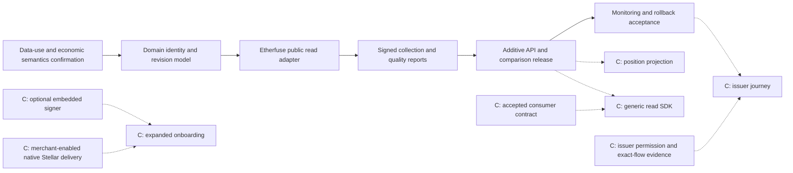

Read-only release is gated by data-use permission, correct identity, truthful metric conventions and operational validation. It is not gated by Privy, Mercuryo or a signed Turbolong integration. Native issuer trading, private servicing, optional onboarding and attributed investment claims require additional evidence; they cannot be inferred from a functioning public API.

Before implementation acceptance, verify all existing query/portfolio contracts remain backward compatible; new data cannot bypass existing sessions or issuer restrictions; every monetary result is reproducible from exact inputs; stale/missing values remain explicit; malformed or changed identities stop affected actions; and source failures leave unrelated lending functionality available.

The [implementation roadmap](IMPLEMENTATION_ROADMAP.md) supplies effort ranges and phase acceptance; [delivery readiness](DELIVERY_READINESS.md) defines settlement evidence; [security assessment](SECURITY_AND_RISK_ASSESSMENT.md) lists threat-specific tests; [open questions](OPEN_QUESTIONS.md) tracks unresolved provider/operating gates. No production deployment, completed issuer transaction integration or unconditional execution readiness is implied by this design.
