# Technical Architecture

This document describes the complete RWA integration architecture for Lendwise: the financial-data model, Stellar wallet and transaction stack, funding connectors, Etherfuse investment flow, portfolio and optimizer integration, public API, SDK, security and operations. It covers the technical work in the submitted scope through system responsibilities and end-to-end flows.

**Existing** identifies code already present in the repository; **new** identifies required implementation. Provider qualification and security checks control activation. A target-design component is not a claim that its integration is already deployed.

Etherfuse is the primary RWA data and investment integration. Spiko and Ondo USDY extend the data catalogue. Privy supplies embedded-wallet signing; Lendwise supplies account/reserve/fee sponsorship; Mercuryo and the existing CCTP route supply alternative funding paths. A Stablebond purchase requires its own investor checks, consent, transaction validation and receiving-leg verification.

## Navigation

- [System overview](#system-overview)
- [Existing runtime and implementation boundaries](#existing-runtime-and-implementation-boundaries)
- [Stellar stack and identity foundations](#stellar-stack-and-identity-foundations)
- [RWA domain and adapter architecture](#rwa-domain-and-adapter-architecture)
- [Issuer data integrations](#issuer-data-integrations)
- [Collection, persistence and historical data](#collection-persistence-and-historical-data)
- [Financial computation and return methodologies](#financial-computation-and-return-methodologies)
- [Portfolio, comparison and optimizer](#portfolio-comparison-and-optimizer)
- [Wallet identity and authentication](#wallet-identity-and-authentication)
- [Reserve and fee sponsorship](#reserve-and-fee-sponsorship)
- [Funding connectors](#funding-connectors)
- [Onboarding orchestration](#onboarding-orchestration)
- [Etherfuse investment execution](#etherfuse-investment-execution)
- [Public GraphQL API](#public-graphql-api)
- [SDK and developer integration](#sdk-and-developer-integration)
- [Security model and monitoring design](#security-model-and-monitoring-design)
- [Deployment, recovery and operational documentation](#deployment-recovery-and-operational-documentation)
- [Onchain attribution and outcome accounting](#onchain-attribution-and-outcome-accounting)
- [Verification and integration testing](#verification-and-integration-testing)
- [Architecture decisions and scope boundaries](#architecture-decisions-and-scope-boundaries)

## System overview

The user journey is **discover → compare → authenticate → prepare wallet → fund → authorize an Etherfuse purchase → verify receipt → refresh portfolio**. Monitoring and reporting consume the resulting evidence; they do not create evidence of investment from a page view or API request.

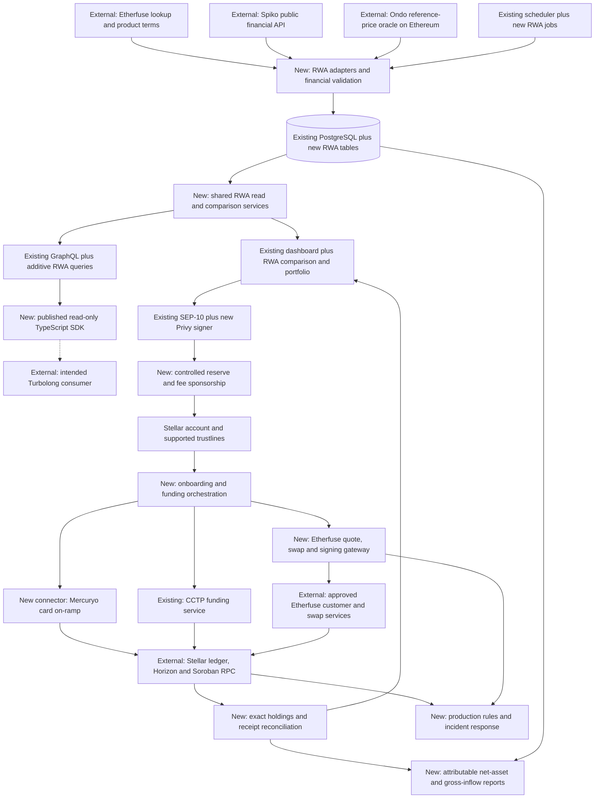

Solid arrows indicate required integration paths. The dashed external-consumer connection identifies a pilot that is not required for SDK acceptance. The diagram describes the target architecture, not a claim that every new box is already deployed. In compact diagram labels, **E** means existing, **N** means new implementation, and **X** means an external system.

| System boundary                | Technical responsibilities                                                                                       |
| ------------------------------ | ---------------------------------------------------------------------------------------------------------------- |
| Financial data                 | Source adapters, product/asset identities, collection, immutable revisions and source-backed return calculations |
| User and transaction authority | Privy, existing wallets, SEP-10 sessions, reserve sponsorship and controlled fee bumps                           |
| Funding and investment         | Mercuryo and CCTP destination reconciliation; a separate consent-bound Etherfuse purchase gateway                |
| Portfolio and comparison       | Exact economic claims, source-linked valuations and condition-aware optimizer screening                          |
| Developer access               | Shared read services, additive public GraphQL, independent SDK and versioned consumer examples                   |
| Security and operations        | Threat model, linked monitors, deployment/recovery controls, private runbooks and public documentation           |
| Outcome accounting             | Versioned eligible accounts, daily net-asset snapshots and deduplicated gross-USDC receipt reports               |

Public-data, position-reading and transaction services remain separate so that a source outage or paused purchase route does not disable unrelated functions. The application shares identities and evidence across these boundaries while keeping signing authority out of public data services.

## Existing runtime and implementation boundaries

Lendwise is a Next.js/React application with server routes/actions, GraphQL Yoga and Neon PostgreSQL through Drizzle. Existing adapters cover Aave, Morpho, Compound and Blend. Existing Stellar authentication, wallet connectivity, portfolio routing and CCTP form the reuse boundary. New source adapters and orchestration are application modules, not a requirement to deploy a microservice for each conceptual box.

| Existing component         | Verified repository anchor                                                                                                              | Reuse decision                                                                                                          |
| -------------------------- | --------------------------------------------------------------------------------------------------------------------------------------- | ----------------------------------------------------------------------------------------------------------------------- |
| Functional adapter loaders | [protocols-server.ts](../../src/config/protocols-server.ts), [adapter types](../../src/lib/protocols/core/types.ts)                     | Reuse isolation, explicit registration and settled fanout; introduce a parallel RWA registry                            |
| Signed collection routes   | [spot route](../../src/app/api/yield/apy/spot/route.ts), [catalogue route](../../src/app/api/yield/products/route.ts)                   | Reuse signature-verification and bounded job entry pattern; do not write RWA values through lending payloads            |
| Historical convergence     | [runReconcile](../../src/lib/reconcile/index.ts), [gap repository](../../src/lib/db/repositories/gaps.ts)                               | Reuse reporting/checkpoint principles; reject neighbor-copy repair for RWA financial truth                              |
| SQL driver and schema      | [postgres.ts](../../src/lib/db/postgres.ts), [schema.ts](../../src/lib/db/schema.ts)                                                    | Add separate tables/repositories; preserve existing products and APY meanings                                           |
| Public GraphQL             | [route](../../src/app/api/graphql/route.ts), [schema](../../src/lib/graphql/schema.ts), [resolvers](../../src/lib/graphql/resolvers.ts) | Add RWA queries and decimal serialization without changing existing lending fields                                      |
| Portfolio aggregation      | [load.ts](../../src/lib/portfolio/load.ts), [types.ts](../../src/lib/portfolio/types.ts)                                                | Reuse network routing, timeouts and partial failure; add a distinct RWA projection                                      |
| Stellar balance reader     | [wallet-holdings.ts](../../src/lib/stellar/wallet-holdings.ts)                                                                          | Reuse Horizon transport knowledge; new RWA reads retain decimal text and control flags omitted by the legacy projection |
| Wallet authentication      | [StellarWalletContext](../../src/contexts/StellarWalletContext.tsx), [session guard](../../src/lib/auth/session-guard.ts)               | Preserve current wallet/SEP-10 flow; new Privy signer must meet the same owner/network boundary                         |
| Blend v2.1                 | [adapter](../../src/lib/protocols/blend/v2_1/index.ts), [deployment definitions](../../src/lib/protocols/blend/common/deployments.ts)   | Reuse v2 SDK classes behind the distinct v2.1 deployment; no invented incompatible contract generation                  |
| CCTP orchestration         | [service](../../src/lib/execution/cctp/service.ts), [message checks](../../src/lib/execution/cctp/message.ts)                           | Reuse exact-message validation, owner state and recovery; keep investment separate from USDC transfer                   |

### New module ownership

The following are proposed implementation locations. Their presence in this table does not claim that the corresponding files already exist.

| Proposed location                           | Responsibility                                                       | Dependency rule                                                        |
| ------------------------------------------- | -------------------------------------------------------------------- | ---------------------------------------------------------------------- |
| `src/lib/rwa/core/`                         | Identity, runtime schemas, decimal types, return/quality definitions | Pure domain code; no HTTP, wallet or database imports                  |
| `src/lib/rwa/etherfuse/`, `spiko/`, `ondo/` | Public source clients, decoding and issuer-specific mapping          | Provider payloads stop at the adapter interface                        |
| `src/config/rwa-server.ts`                  | Explicit enabled-source registry and capability configuration        | Server-only allowlist; no arbitrary browser-supplied source URLs       |
| `src/lib/rwa/ingestion/`                    | Scheduling, leases, bounded retries, revisions and checkpoints       | Owns I/O orchestration; calculations remain independently testable     |
| `src/lib/db/repositories/rwa/`              | Product/observation, terms, balance and valuation persistence        | Decimal-safe, bounded queries and idempotent writes                    |
| `src/lib/rwa/portfolio/`, `comparison/`     | Exact economic claims, source-backed valuation and comparability     | Cannot sign orders or infer investor approval                          |
| `src/lib/wallet/privy/`                     | Privy identity binding and Stellar signer adapter                    | No sponsor key or issuer API credentials in browser code               |
| `src/lib/stellar/sponsorship/`              | Policy, reserve/fee budgets, transaction intents and reconciliation  | Signs only validated sponsor-authorized operations                     |
| `src/lib/funding/mercuryo/`                 | Merchant configuration, widget signing and provider events           | Provider-specific signing and status rules                             |
| `src/lib/onboarding/`                       | Resume-capable coordination of authentication, setup and funding     | References independent persisted component states                      |
| `src/lib/rwa/execution/etherfuse/`          | Customer links, quote/swap intent, XDR checks and settlement         | Explicit owner consent; separate from read adapters and CCTP validator |
| `src/lib/metrics/stellar/`                  | Account eligibility, exact snapshots, receipts and report manifests  | Reproducible read projections; no transaction authority                |
| `packages/sdk/`                             | Public typed client, runtime validation and released examples        | No Next.js/React, private credentials or server code                   |

Signed job routes, owner-scoped browser actions and provider callbacks have different authentication. Public GraphQL performs bounded reads. A scheduler delivery requires scheduler verification; an owner action requires an active owner/network session; a provider callback requires that provider's signature and tenant/reference checks. A valid callback is not authorization to spend user or sponsor funds.

## Stellar stack and identity foundations

| Layer                    | Integration responsibility                                                   | Important distinction                                                             |
| ------------------------ | ---------------------------------------------------------------------------- | --------------------------------------------------------------------------------- |
| Stellar Classic accounts | `G...` identities, sequence numbers, signers, native XLM and credit balances | A generated keypair is not yet a funded ledger account                            |
| Classic assets           | `(network, asset code, issuer account)` for USDC and supported Stablebonds   | A ticker alone cannot identify an asset or network                                |
| Stellar Asset Contract   | Contract interface to an underlying Classic asset                            | The same account's Classic balance and SAC view are one economic holding          |
| Native Soroban tokens    | `(network, contract ID)`, issuer-defined decimals and balance interface      | They are not automatically Classic trustlines or SAC representations              |
| Horizon                  | Account/trustline state, Classic transactions and operations                 | Current account endpoints do not provide arbitrary historical snapshots           |
| Soroban RPC              | Contract state/events, simulation, submission and transaction results        | Retention, storage archival and read context must be handled explicitly           |
| SEP-10                   | Domain/network-bound challenge signing and application sessions              | Wallet ownership is separate from email login, issuer KYC and trading eligibility |
| CAP-33                   | Sponsorship of ledger reserves for approved accounts/trustlines              | Reserve obligations are not transaction fees or permission to control user assets |
| CAP-15                   | Fee-bump outer envelope pays an inner transaction's fee                      | The inner source still supplies its sequence and required authorizations          |
| Hubble                   | Historical ledger data when the required records/decoder exist               | It cannot manufacture off-chain NAV, FX history or income records                 |
| Existing CCTP            | Verified source USDC burn, attestation and Stellar mint/forward              | USDC arrival funds a wallet; it is not a Stablebond purchase                      |

Asset representations are network-specific. Testnet and Mainnet addresses, contract mappings, provider environments and signing passphrases are stored together and checked at every write/signing boundary. Never infer the network from a `G...` or `C...` string alone. Discover provider-specific identifiers from the configured catalogue rather than treating example issuer addresses as permanent constants.

Source observation time, retrieval time, ledger close time, quote expiry and measurement cutoff are necessary financial/protocol data. They remain explicit throughout the model.

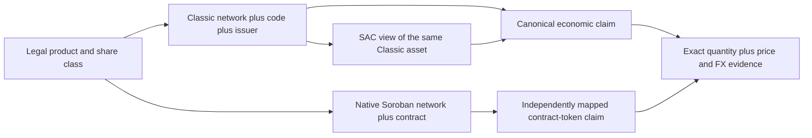

## RWA domain and adapter architecture

### Adapter contract and dependency direction

The proposed RWA implementation remains inside this repository. Core financial types and calculations are pure modules. Adapters perform source-specific I/O. Orchestration owns scheduling and persistence; adapters never acquire a database handle or a user signing credential.

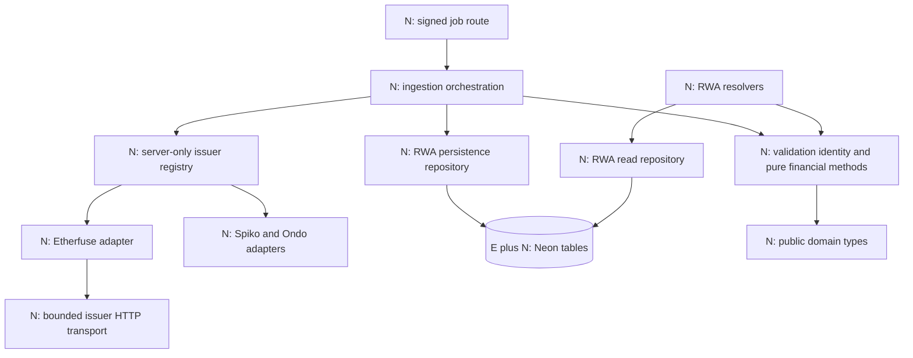

The graph describes imports/calls, not an instruction for public types to perform I/O. The pure domain layer must not import Next.js, a database connection, provider credentials or browser wallet code. The SDK consumes public contracts and operations; it does not import server adapters.

The canonical [TypeScript design contracts](examples/contracts.ts) define `RwaAdapter.discovery.list` and `RwaAdapter.observations.fetch`. `history`, `positions`, `eligibility` and `handoff` are capability-specific methods. A missing provider method is recorded explicitly; it does not remove required application behavior. A provider without historical or redemption APIs is still a valid read adapter. Missing adapter capability produces an explicit error; it does not prove that the provider universally lacks that feature.

Do not force `RwaAdapter` into `YieldAdapter.getApySpot`. Lending spot payloads require lending APY fields and enter lending-specific repair/aggregation. An RWA adapter returns observations with original metric, units, convention, source times and quality. Shared HTTP/retry/pagination helpers can be extracted where the code actually overlaps.

### Product and asset identity

An RWA has four different identities: the legal issuer, legal product, share class and blockchain representation. The database must not collapse them into a ticker. The same share class can have multiple blockchain representations; two products can also use the same symbol without representing the same claim.

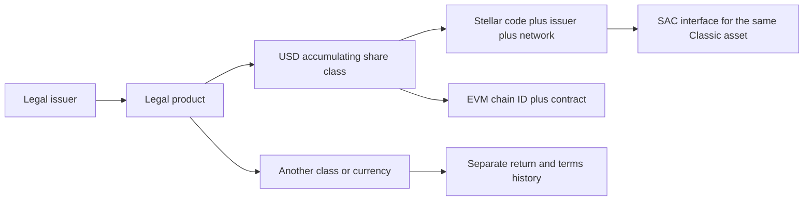

For Stellar Classic assets, identity is `(network, asset code, issuer account)`. For contract tokens, identity is `(network, contract ID)`. For EVM tokens, it is `(chain ID, contract address)`. An opaque LendWise product/share-class ID points to these typed columns; code must not parse an ID to recover economic meaning.

## Issuer data integrations

Etherfuse is the primary data and investment integration. Spiko and Ondo USDY extend the financial-data catalogue through the same adapter contract, storage and quality services. The Spiko and Ondo integrations are read-only; no subscription or redemption gateway is added for either issuer.

### Etherfuse Stablebond source mapping

CETES and USTRY are the initial Etherfuse products. TESOURO, EUROB, GILTS and KTB are enabled only when the live catalogue establishes a yield-bearing Stellar representation and usable source data. A principal token with a zero rate must not become a yield product merely because its ticker resembles a Stablebond.

The captured [Etherfuse catalogue](evidence/etherfuse-products.json) includes Stellar representations for USTRY, CETES and additional sovereign products. The approved production map must be established from official provider information and checked against the intended ledger network. The captured issuer address is evidence at collection time, not an automatically trusted permanent constant.

| Source surface                   | Source fields / representation                                              | Adapter output and validation                                                                                                                       |
| -------------------------------- | --------------------------------------------------------------------------- | --------------------------------------------------------------------------------------------------------------------------------------------------- |
| Public `GET /lookup/stablebonds` | `stablebonds`, `symbol`, `bondCurrency`, `blockchains`, `calculatedAt`      | Discover Stellar representations, preserve calculation time and bind each product to an approved identity                                           |
| Per-chain catalogue entry        | `blockchain`, `tokenIdentifier`, `decimals`                                 | Decode endpoint-specific `CODE-ISSUER`; validate checksum, network, seven-decimal expectation for the observed Classic assets and registry match    |
| Public `GET /lookup/tokens/cost` | `token_cost_in_fiat`, `token_cost_in_usd`, `currency`, supplied source time | Decimal-string issuer price observations; do not rename them official NAV without confirmed methodology                                             |
| Indicative rate                  | `current_basis_points`                                                      | Preserve original basis-point value; divide by 10,000 for decimal units; retain `ISSUER_INDICATIVE_RATE` until compounding/day count/fees are known |
| FX evidence                      | `fiat_exchange_rate_with_usd`, `sources[].updated_at`                       | Track currency direction and each source's timestamp; USD-to-local rates require inversion for USD-per-local calculations                           |
| Authenticated ramp discovery     | `GET /ramp/assets?blockchain=stellar`, `identifier`                         | Separate investment-execution path; quote identifiers use `CODE:ISSUER` and require approved partner/customer access                                |

The two public responses need not describe the exact same instant. Join them using the approved identity mapping and record each source time separately. If symbol, currency, identity or timestamp relationships fail validation, quarantine the product update; do not silently select the closest-looking response. A provider timestamp advancing does not prove an official accounting NAV was newly published.

An issuer-address change is a configuration event. Collection can preserve the unexpected raw response for review, but the new identity does not automatically become eligible for comparison, portfolio matching or transaction construction. Keep old mappings effective-dated so a new issuer cannot rewrite historical holdings or returns.

The source decoder also preserves issuer-reported per-chain supply when provided: raw quantity, documented decimals, exact token representation, source time and basis (`issuer_reported_stellar_supply`). Global token supply, circulating supply, treasury inventory and tokens held by users are different measures. A missing per-chain figure remains unavailable; it is not inferred from a Solana mint, a global total or the portfolio of observed users. A separate ledger-derived supply measure is permitted only with a verified asset-specific method and a different basis label. Supply is not evidence of a user's investment or ownership.

Source schemas and API versions are pinned in the adapter, including whether a timestamp describes the calculation, price, publication or HTTP response. If an economic timestamp required by the observation contract is unavailable, return that observation as unavailable with a reason rather than assigning retrieval time as `observedAt`. Product metadata and other valid observations can still be returned. The adapter exposes source permissions, supported fields and collection limits through its capability/configuration record.

### Spiko fund and Stellar share-class mapping

Use the [Spiko public financial API](https://docs.spiko.io/developers/public_api/getting_started/) for fund/share-class metadata, current NAV and available NAV history. Join the chosen legal fund and share class to the corresponding token in Spiko's [published Stellar deployment list](https://support.spiko.io/hc/nl/articles/45293663366673-Adressen-van-de-Spiko-tokens). Preserve share-class currency and identifier; a token symbol alone cannot select the right class, hedging exposure or NAV series.

The adapter performs discovery, schema/decimal decoding, approved contract mapping, current observations and bounded historical pagination. Store financial as-of time separately from collection time, and apply the source's publication calendar to freshness. Backfill passes through the same immutable observation/revision repository as ongoing collection. Missing sessions or pages produce a recorded gap, not a repeated adjacent NAV.

Spiko tokens use the verified Stellar contract representation and its declared decimal scale. Balance reads belong to the portfolio reader through Soroban RPC, not to a private investor API or an assumption that every token is a Classic trustline. Legal transfer/redemption conditions remain product metadata. Public NAV access is not investor permission to transact.

### Ondo USDY reference price and Stellar representation

Resolve the Classic Stellar USDY code/issuer from [Ondo's official address registry](https://docs.ondo.finance/addresses). Separately resolve the canonical Ethereum `USDYOracleWrapper` used as the adapter's issuer-reference-price source. An Ethereum RPC read is an off-chain Lendwise data input associated with the verified Stellar product; it neither deploys an oracle on Stellar nor produces an executable market quote.

The implementation reads the documented current-price interface, decodes its specified units using exact integers/decimals and records Ethereum chain ID, wrapper address, block number/time, source method and retrieval time. Pin the ABI and verify contract identity/code at the configured network. The [USDY oracle](https://docs.ondo.finance/general-access-products/usdy/usdy-price-oracle) computes an accrued current price; a stored rate checkpoint and the time of that computation are different fields. A longstanding rate checkpoint is not by itself proof that a newly computed reference price is stale. Independently check RPC/block freshness and source validity.

The current wrapper/oracle interface does not establish a historical-price query. Collect future observations, and import older records only when a compatible source and actual coverage are verified. Never extrapolate a complete 1Y series from the current price/rate. Existing Stellar price-feed support can be qualified as an additional source, but does not silently replace the reference-price method defined here.

### Shared contract and failures

| Concern            | Required adapter behavior                                                                                            |
| ------------------ | -------------------------------------------------------------------------------------------------------------------- |
| Identity           | Resolve the exact legal product/class and Stellar representation before publishing an observation                    |
| Price meaning      | Spiko NAV and Ondo issuer reference price keep their distinct price-type labels                                      |
| Precision          | Decode source scales without JavaScript floating-point conversion                                                    |
| History            | Report the real available interval and incomplete pages; unsupported fields remain unavailable                       |
| Product conditions | Preserve published currency, method, restrictions, maturity/dealing and redemption conditions with source provenance |
| Isolation          | A failed issuer, changed payload or wrong contract quarantines that source while Etherfuse/lending continue          |
| Validation         | Reuse common identity, decimal, revision, source-age and missing-data checks rather than implement another pipeline  |

No adapter gains database or signing credentials merely because it can fetch a source. Capability-based methods describe what a source can supply; the portfolio and execution services remain separately authorized responsibilities.

## Collection, persistence and historical data

### Ingestion execution and scheduling

Create a source-aware RWA scheduler alongside the lending pipeline. It may wake every ten minutes for Etherfuse current observations, while a daily fund adapter only expects publications according to its calendar. Polling frequency, financial publication frequency and chart resolution remain different concepts.

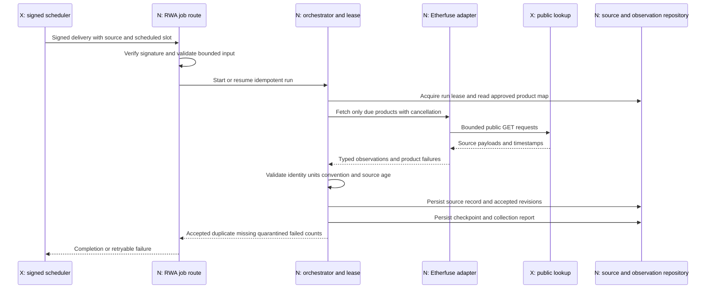

A run is identified by source, environment, scheduled slot and job version. A lease prevents two overlapping scheduler deliveries from simultaneously owning the same run. The lease must have a bounded expiration and an owner token; an expired worker cannot advance a checkpoint after another worker has taken ownership. Database uniqueness still protects observations if the worker crashes or a delivery is replayed.

The ingestion algorithm is:

1. Verify the scheduler signature before accepting job parameters. Resolve the server-side adapter from an allowlisted source ID; callers cannot provide a destination URL or SQL filter.
2. Read the approved asset map and source-specific due schedule. A missing publication is recorded separately from a failed network poll.
3. Acquire the run lease or resume a recorded checkpoint. Bound product count, date range and pages per invocation.
4. Fetch provider responses with cancellation, response-size limits and request timeouts. Parse against a pinned source schema before field access.
5. Preserve the raw public source record and its hash. Validate network, identity, decimals, timestamps, currency and metric semantics.
6. Normalize units and create only justified derived fields. Unknown convention leaves effective annual rate null.
7. Persist accepted observations/revisions through repository-level atomic operations. Record product failures without discarding unrelated success.
8. Commit the page checkpoint after durable writes. If the current page fails, preserve its gap; do not advance beyond it without recording incomplete coverage.
9. Release the lease with its owner token and write run metrics. If the function approaches its runtime budget, schedule a bounded continuation from the checkpoint.

| Control                      | Initial proposed behavior                                                                               | Failure behavior                                                   |
| ---------------------------- | ------------------------------------------------------------------------------------------------------- | ------------------------------------------------------------------ |
| Public Etherfuse poll        | Every ten minutes, subject to verified source terms/cache behavior                                      | Retain prior values with original timestamps; report source age    |
| Per-request budget           | Five-second connection / fifteen-second total target, implemented with supported transport cancellation | Abort and classify timeout; no indefinite promise                  |
| Transient GET retries        | At most three attempts, exponential backoff with jitter and `Retry-After` where supplied                | Record exhaustion and allow a later scheduled recovery             |
| Authentication/schema errors | Do not blindly retry 400/401/403 or incompatible payloads                                               | Alert/configuration review; keep source records when safe          |
| Parallel work                | Bounded per-source queue and settled product results                                                    | A failed issuer/product does not fail lending or unrelated issuers |
| Serverless duration          | Keep work within the existing route pattern's 300-second upper budget                                   | Checkpoint and continue rather than increasing an unbounded batch  |
| Daily publications           | Expected times from issuer timezone/calendar                                                            | A weekend is not automatically a missing-data incident             |

These values are implementation targets to validate against provider behavior and hosting limits, not measured service guarantees. Read retries and order retries are different policies: never reuse the GET retry loop for an irreversible issuer request.

### Persistence and transaction boundaries

Keep the existing `products`, `apy_hourly` and `apy_daily` lending tables intact. Add a separate product/share-class model and immutable RWA observations. PostgreSQL is the query and correctness boundary; raw evidence storage must not become an implicit second authority for which observation is current.

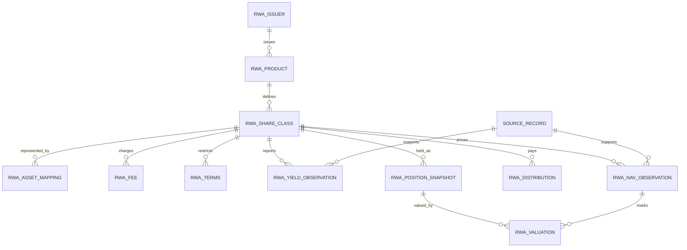

| Record                | Key / storage requirement                                                                               | Reason                                                              |
| --------------------- | ------------------------------------------------------------------------------------------------------- | ------------------------------------------------------------------- |
| Product/share class   | Stable IDs, issuer/product foreign keys, currency and effective-dated terms                             | Returns and rights belong to a particular class, not a symbol       |
| Asset mapping         | Exact network and Classic issuer/code or contract; valid-from/to interval                               | Match balances safely and preserve past identities                  |
| Yield observation     | Class, metric, currency, period, source time, source, method version and revision                       | Different metrics or conventions must not collide                   |
| Price/NAV observation | Class, price type, currency, source time, source, method version and revision                           | Official NAV, issuer price and executable market price are distinct |
| Source record         | Source ID, safe URL, raw-response hash, source/collection/availability times and raw evidence reference | Reproduce the accepted interpretation and trace corrections         |
| Position snapshot     | Owner scope, asset identity, atomic quantity, decimals, ledger/time and control flags                   | Preserve exact balance and authorization context                    |
| Valuation             | Position snapshot plus price/FX observation IDs and calculation version                                 | A mark must be traceable to every input                             |

Use `numeric(38,18)` for rate/price representations where appropriate and `numeric(78,0)` for integer token quantities. Carry decimal strings across the API boundary. Do not convert an atomic amount to a JavaScript `number` merely to reuse the legacy `WalletHolding` shape. Round only at documented display or transaction boundaries; outgoing amounts must not exceed available atomic units.

A yield logical key is `(share_class_id, metric, currency, period_start, period_end, observed_at, source_id, method_version)`. Nullable interval fields need explicit null-equality handling, for example nulls-not-distinct uniqueness where supported or a canonical logical-key hash. Revision uniqueness is `(logical_key, revision)`; a repeated identical source observation is a no-op rather than a new return observation.

A proposed observation write transaction performs four dependent actions: establish source-record linkage, lock/resolve the current logical observation, insert a changed revision when needed, and advance its current pointer only after success. The page checkpoint advances separately after every item on that page has a durable outcome, including any explicitly recorded gaps. A crash between observation commits and checkpoint advancement causes a safe idempotent replay. Concurrent attempts must resolve the same current revision through a lock or atomic conflict operation; `max(revision)+1` without concurrency control is unsafe. The existing Neon HTTP driver must use a supported transaction/batch or single-statement implementation, not an assumed interactive transaction held across HTTP calls.

If large raw responses later move to object storage, there is no automatic atomic transaction across PostgreSQL and that storage. Use content-addressed immutable objects and a database commit record; reference only successfully stored evidence. Retry/clean orphan objects independently. A transactional outbox or equivalent post-commit replay process can deliver cache invalidations without pretending the database and a cache share one transaction. These are proposed repository responsibilities, not currently implemented facilities.

The complete column/constraint inventory is in [RWA data model](RWA_DATA_MODEL.md). The schema must be additive, indexed for current observations and bounded history reads, and reversible through disabled readers/jobs without deleting financial history.

### Historical data and revisions

There are two different time dimensions. `observedAt` describes the economic/source time, while `availableAt` describes when the platform could know that version. `publishedAt` remains null when the provider does not supply a true publication timestamp. `collectedAt` records retrieval and must not make old financial information appear new.

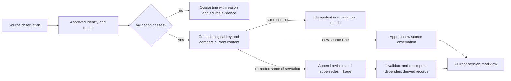

A replayed response produces collection telemetry without fabricating another financial observation. A correction creates a new revision and preserves its predecessor. If a method changes, retain its method version so the system can distinguish a corrected source from a changed interpretation. Derived returns reference exact observation and distribution IDs; recomputation does not destroy prior derivations used by a past report.

| Example                                                                | Required interpretation                                                                                                 |
| ---------------------------------------------------------------------- | ----------------------------------------------------------------------------------------------------------------------- |
| Daily NAV unchanged over a weekend                                     | Source calendar may explain absence of publication; show the original date, not three invented daily NAVs               |
| Current API returns a new retrieval time and an old source time        | Collection succeeded; source information may still be stale                                                             |
| Issuer revises last week's value today                                 | New revision available today; a point-in-time backtest for last week cannot use it as though known then                 |
| Distribution causes the accumulating/distributing price path to differ | Apply the class-specific corporate action; do not automatically classify the NAV decrease as a loss or add income twice |
| Etherfuse historical endpoint unavailable                              | Begin prospective history at first collection; no backward extrapolation from today's rate                              |
| A Stellar transfer exists in ledger history                            | It proves a transfer, not an off-chain NAV, coupon convention or investor entitlement                                   |

Historical backfill is a separate bounded job using the same validators and revision repository. It dry-runs requested products/ranges, retrieves only authorized source history, records actual coverage, writes idempotently and recomputes affected intervals. Existing Hubble reconstruction is reusable only for genuinely ledger-contained state with a supported decoder and bounded query cost. A historical lending-state decoder cannot reconstruct an issuer's off-chain financial ledger.

Carry-forward is a valuation/read-view operation: it references the original price and labels age/origin. It must never append another source-reported price or turn missing days into a zero return series. Missing, stale, quarantined and legitimately zero values remain distinct states.

The `1D`, `7D`, `1M` and `1Y` presets resolve to explicit calendar-aware `from`/`to` bounds and an availability cutoff. Responses include actual first/last observations, gaps and coverage status. A young product cannot expose a full-year return without the required records. Historical USD returns additionally need contemporaneous FX; a current FX mark can value a current holding but cannot reconstruct a past USD return.

RedStone's Stellar feeds may be evaluated as an additional historical source, not assumed to provide a complete history. Before a backfill, verify the exact feed, product identity, deployment start, signed/ledger records, publication timestamps, decoder and permitted access. Hubble is usable only for those genuine recorded on-chain values. Neither infrastructure can recreate an issuer price that was never recorded. Otherwise the source-backed series starts with scheduled collection.

## Financial computation and return methodologies

The financial layer has two outputs: **typed source observations** and **derived investor scenarios**. Unit conversion is allowed before every economic convention is known; converting an issuer indication into effective APY is not. All derived results must identify their method version, input observations, horizon, currency and fee assumptions.

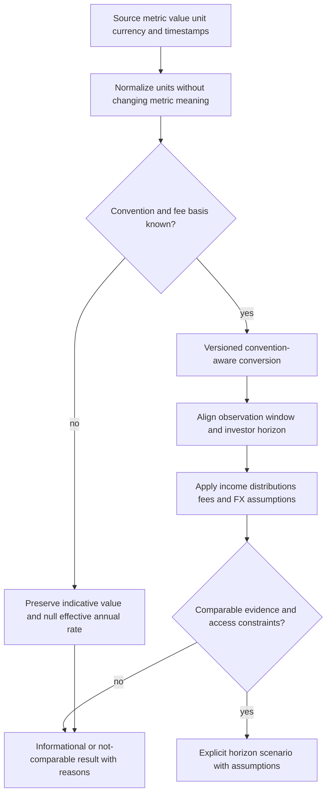

The observation types in [contracts](examples/contracts.ts) preserve `originalValue`, `originalUnit`, `normalizedDecimal`, `effectiveAnnualRate`, `metric`, `direction`, `feeBasis`, `rateType`, `incomeTreatment`, `dayCount`, `compounding`, interval fields, source provenance, quality and revision lineage. A subject is either a fund share class or a lending product. A lending reserve is not a fund share class merely because both have a percentage.

The following JSON is an illustrative field projection, not a complete canonical response and not a live rate quote:

```json
{
  "metric": "ISSUER_INDICATIVE_RATE",
  "originalValue": "369",
  "originalUnit": "basis_points",
  "normalizedDecimal": "0.0369",
  "effectiveAnnualRate": null,
  "currency": "USD",
  "feeBasis": "unknown",
  "dayCount": "unknown",
  "compounding": "unknown"
}
```

For nominal APR `r` with known compounding frequency `m`, `APY = (1 + r/m)^m - 1`. For an already effective annual rate `a`, unchanged-rate horizon growth is `(1+a)^(d/365)` under ACT/365F. For a simple annual rate, the factor is `1+r*d/365`. These equations are not interchangeable conventions. The existing Blend display uses daily conversion, while some other lending code uses per-second conversion; preserve the existing outputs and disclose the method in new comparison views.

The comparison pipeline must perform these steps in order:

1. Resolve exact product/class/asset identities and select source observations by a consistent availability cutoff.
2. Reject quarantined data; identify missing/stale inputs with their original times. A source cache hit does not establish freshness.
3. Classify metric and time direction: historical total return, spot variable lending rate or forward-indicative issuer rate.
4. Establish a justified horizon transformation. If required convention or cash flows are unknown, return an explicit comparability reason rather than a guessed APY.
5. Model net cash outcomes after identifiable fees, including whether costs are already embedded in NAV. Unknown taxes remain outside the estimate, with disclosure.
6. Convert currency with explicit quote direction and scenario assumptions; never assume tomorrow's FX equals today's rate without labeling that assumption.
7. Apply liquidity/maturity/redemption/access constraints. A valid issuer mark does not establish an executable exit price.
8. Return the result with input IDs, method version, quality vector and reasons. Ranking is a downstream decision only for compatible outputs.

| Comparison                                 | Valid calculation                                                               | Required limit                                                    |
| ------------------------------------------ | ------------------------------------------------------------------------------- | ----------------------------------------------------------------- |
| Two lending products                       | Same-currency horizon scenarios using declared spot-rate/fee/reward assumptions | Variable future rates are scenarios, not contracted returns       |
| Fund prices with distributions             | Share-unit or cash-flow total return over matched dates                         | Avoid counting distributed/reinvested income twice                |
| Bond YTM versus lending APY                | Dated cash-flow scenario with maturity or explicitly modeled exit price         | Headline YTM alone is not an arbitrary-horizon return             |
| CETES versus USD lending                   | Local return plus explicit MXN/USD scenario and conversion costs                | Local-currency yield is not USD profit                            |
| Issuer indication with unknown compounding | Preserve the original metric and decimal units                                  | Effective annual rate stays null; no precise total-return ranking |

A checked numerical example: capital 10,000, entry fee 0.2%, exit fee 0.1%, unchanged effective gross rate 5%, 90 days and no additional fixed cost gives `10000 × 0.998 × 1.05^(90/365) × 0.999 ≈ 10090.69`, or about 0.9069% net over the period. If a local investment returns 6% but its currency falls 10% against the investor's currency, the combined return is `1.06 × 0.90 - 1 = -4.6%`, before conversion costs.

The full [yield methodology](YIELD_NORMALIZATION_METHODOLOGY.md) defines cash-flow pricing, fee treatment, reinvestment, variable debt and edge cases. The architecture must preserve these semantics through SQL, GraphQL and UI rather than reducing every observation to a sortable float.

### Value growth, paid income and coverage

For an accumulating class with compatible unit prices `P0` and `P1`, observed native-currency price growth is `P1 / P0 - 1`. For a fixed number of unchanged units in a distributing class, a simple period total return is `(P1 - P0 + sum(D_i)) / P0`, where each `D_i` is an authoritative paid-income amount per unit for that same period and class. This formula is not a reinvested return; a reinvestment method must instead apply the actual reinvestment convention and prices. Validate positive denominator, dates, currency, split/rebase adjustments and income completeness before either calculation.

Record cash payments, token distributions and rebasing separately when the issuer confirms the model. Token income requires the entitled unit basis, event/servicing evidence and valuation convention; a rebase requires the verified unit/index transformation so unit growth and price growth are not counted twice. Deposits, subscriptions, withdrawals, ordinary minting and transfers are capital flows, not yield. If an investor changes units during the window, use an explicitly supported cash-flow-aware method or return unavailable; do not apply the constant-unit formula to that account.

Unit tests cover accumulating growth, separately paid income, reinvestment, no-income transfers, rebasing where supported, fees, FX, missing inputs and zero/negative invalid denominators. Source integration tests compare decoded decimal values and timestamps with recorded provider responses. A display can show an issuer's annualized indication alongside observed history, but cannot relabel that indication as an observed return.

## Portfolio, comparison and optimizer

An RWA portfolio position is a claim on a verified asset/share class with a measured quantity, control state and valuation evidence. It is distinct from the existing lending `SupplyPosition`, and from a generic unpriced wallet holding.


Classic reads retain asset code, issuer, balance text, trustline capacity, buying/selling liabilities, `is_authorized`, maintain-liabilities authorization and clawback flags when available. SAC reads for a `G...` owner refer to the same underlying Classic balance; they must not produce a second economic position. A `C...` owner uses contract balance state and needs proof of the user's actual claim. Owning a receipt token does not mean owning the full treasury balance of its contract.

Capture the network and ledger context of each read. A Horizon account read, a Soroban query and an issuer price response are not automatically an atomic snapshot at one ledger or timestamp. Where compatible ledger-specific reads exist, align them; otherwise preserve their separate as-of values and mark the reconciliation tolerance. Do not pretend a generic current account endpoint can retrieve any arbitrary historical balance.

The processing keys are `(owner scope, network, asset representation, ledger/read context)` for source balances and a mapped economic-claim key for the presentation. A direct Classic balance and its SAC view share that claim key. A wrapped share has its own claim and a separately verified exchange ratio; it cannot be deduplicated merely because the symbols resemble each other.

For quantity `q`, compatible price `P` in local currency and FX `X` in investor-currency units per local unit, the mark is `q × P × X`. Store references to the position snapshot, price observation, FX observation and method version. Quantity, price and FX precision remain decimal/integer values until display rounding. Unknown price or FX yields an unknown mark, not zero and not an assumed price of one.

| Position state                       | Portfolio behavior                                                                             |
| ------------------------------------ | ---------------------------------------------------------------------------------------------- |
| Direct token, current approved price | Show quantity, price type, valuation time and control/eligibility information                  |
| Price carried forward                | Show the original price time and explicit stale/carry-forward state                            |
| Trustline authorization revoked      | Continue showing the observed holding; disable unrestricted-transfer claims                    |
| Investor eligibility unknown         | Permit watch-only discovery; do not imply primary subscription/redemption access               |
| Redemption burns token before payout | Represent a receivable only when authoritative servicing evidence confirms the remaining claim |
| Custodial or omnibus allocation      | Require authorized provider statements; public contract totals are insufficient                |
| One source times out                 | Preserve unaffected lending/holdings and return a source-specific partial failure              |

Preserve `UserPortfolioResult.positions`, `holdings`, `riskAccounts` and `failures` for existing callers. Expose new RWA positions through an additive/versioned result or a separate action merged by the UI. Public watch-only balance inspection and private servicing records have different authorization requirements; watching an address is not proof of ownership.

### Dashboard composition and optimizer screening

The dashboard consumes the shared RWA read/comparison services; public GraphQL exposes the same stored observations and meanings. A product row displays the issuer, legal share class, exact network/asset, currency, rate/return type, available observation window, source age, price type, investment period or maturity where applicable, liquidity/redemption conditions and investor restrictions. Product discovery is distinct from a permission to buy.

Compare Etherfuse data with existing lending markets through explicit financial categories. A source percentage is not enough to place a product into the existing finite-APY sorter. Resolve compatible currency, period, metric, compounding/fee conventions and freshness first. Historical price return, indicative issuer rate and current variable lending APY remain labeled even when shown side by side. Missing FX/history or unknown eligibility produces an explanation, not an apparently precise rank.

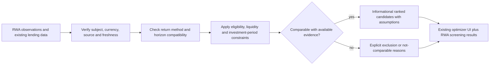

Implement this as a new local comparison/screening layer around the existing optimizer inputs and UI. The current [optimizer client](../../src/lib/api/optimizer.ts) and [proxy](../../src/app/api/optimizer/route.ts) call an external solver whose RWA constraint support is not established here. Do not send new financial types into that API by pretending they are ordinary lending APYs. The screening layer applies currency, eligibility, investment-period and liquidity constraints locally and return accepted/excluded candidates with reasons. A new automated allocator or trade executor is not required.

The screening request contains base currency, intended investment period, relevant liquidity deadline, supported product set and any authorized eligibility evidence. Unknown eligibility cannot become `eligible=true`. Unknown maturity, redemption timing, price quality or FX must be explicit, and any affected comparison is restricted accordingly. Published product restrictions are public metadata; user-specific approval remains private and is rechecked by the investment gateway.

Existing multichain holdings and lending positions remain available if an issuer source fails. RWA projections are merged additively rather than changing all existing consumers of `UserPortfolioResult`. Watch-only address inspection is useful for display but does not grant signing or metric enrollment. The exact, reproducible Stellar outcome projection is separate from the current UI's floating-point totals.

## Wallet identity and authentication

This integration has three cooperating parts: Privy identifies an application user and supplies a Stellar wallet signer; existing SEP-10 establishes control of that wallet for a Lendwise session; the new sponsor service authorizes bounded reserve/fee expenditure. None of those steps replaces issuer eligibility checks.

### Privy identity and Stellar signer

The browser integration enables the configured Privy email-login method and creates or retrieves the user's native Stellar wallet. The server validates the Privy token's signature, issuer/application audience, expiry and user identity before associating a provider user/wallet ID with a Lendwise owner record. A browser-supplied wallet ID is not sufficient evidence that the user owns it. The stored association includes provider application, user ID, wallet ID, public address and network context, with no private key.

The Privy adapter implements Lendwise's Stellar signer boundary: obtain the verified address, sign the validated SEP-10 challenge, and sign the supported transaction envelope while preserving existing signatures. Exact provider method names and supported serialization are pinned to the installed SDK. [Privy documents Stellar transaction signing](https://docs.privy.io/wallets/overview/chains) and the [Tier 2 construction/sign/broadcast pattern](https://docs.privy.io/recipes/tier-2-wallet-integration); Lendwise still constructs or validates transactions, broadcasts them and reconciles results. Do not reuse EVM wallet abstractions as though they encode Stellar network or signing rules.

Signing a Classic transaction, a sequence-zero SEP-10 challenge and a Soroban transaction are distinct cases. Required flows are qualified with the actual tenant/SDK: challenge signing, multi-source sponsored setup, fee-bump inner envelopes, supported CCTP mint transactions and the selected Etherfuse payload. Soroban address-authorization entries require separate qualification only when a supported flow actually uses them. Public Spiko balance reads do not require the user to sign a contract authorization.

### SEP-10 bootstrap, sessions and recovery

Reuse the existing [challenge route](../../src/app/api/auth/stellar/challenge/route.ts), [verify route](../../src/app/api/auth/stellar/verify/route.ts), [SEP-10 implementation](../../src/lib/auth/stellar-sep10.ts) and [session guard](../../src/lib/auth/session-guard.ts). The flow is:

1. Create/retrieve the Privy wallet and bind its verified public address to the authenticated provider user.
2. Request a server-signed, short-lived SEP-10 challenge for the exact address, application domain and network.
3. Validate the challenge purpose, server signature, expected operations and time bounds before the wallet signs it. Its sequence-zero envelope is for authentication and is never broadcast as a payment.
4. Verify the signed challenge against the wallet's actual signers. The existing verifier supports a not-yet-funded account by requiring server and wallet signatures; an existing account uses its signer weights and threshold.
5. Atomically consume the stored challenge using the existing one-time challenge store and create a revocable Lendwise session.
6. Recheck session expiry, revocation, owner address and network on each sponsorship, funding and investment action.

Email login alone cannot authorize a Stellar action. Re-login must resolve the same linked wallet instead of accidentally provisioning another account. Sign-out invalidates the Lendwise session; it does not claim to destroy the user's wallet or revoke signatures already submitted. Account recovery follows the configured provider ownership model and is followed by fresh wallet-control authentication. Existing Wallets Kit users continue through the same owner/session guards.

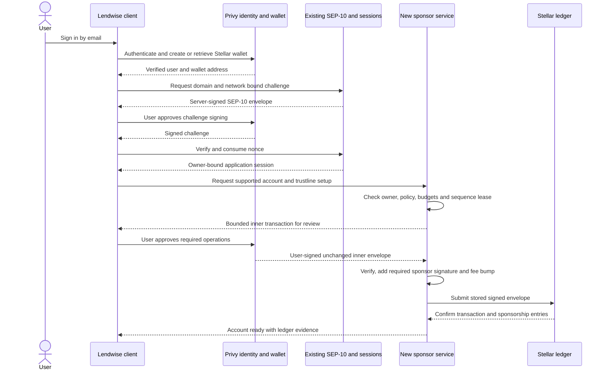

## Reserve and fee sponsorship

### Reserve sponsorship and operation sources

The sponsor is a funded account controlled by Lendwise's restricted signing service. A newly generated account cannot be the transaction source before it exists. Use an existing sponsor or authorized channel account as the inner transaction source, and serialize that source's sequence allocation. The sponsored setup is one atomic transaction:

```text
inner transaction source = existing sponsor/channel account
  BeginSponsoringFutureReserves(source = sponsor, sponsoredId = new wallet)
  CreateAccount(source = funded account, destination = new wallet,
                startingBalance = 0 when fully sponsored and permitted)
  ChangeTrust(source = new wallet, asset = approved code/issuer, limit = approved limit)
  EndSponsoringFutureReserves(source = new wallet)
required signatures = inner source + sponsor/funding sources + new wallet
```

This is an operation plan, not a complete SDK example. Apply [CAP-33](https://github.com/stellar/stellar-protocol/blob/master/core/cap-0033.md) authorization and ledger rules to the actual envelope. Already-funded accounts use an appropriate supported trustline-sponsorship flow rather than a duplicate CreateAccount. Native XLM has no trustline. Adding a trustline does not authorize a regulated asset when its issuer requires approval.

Keep current network reserve parameters separate from product configuration. For ordinary Classic reserve accounting, use `(2 + subentry_count + num_sponsoring - num_sponsored) × baseReserve`, together with the account's actual balance, liabilities and required fee headroom. Read network/account state instead of hardcoding a reserve price as a permanent rule. Contract storage/resource requirements are assessed separately for Soroban transactions.

### Fee bumps, policy and concurrency

A [fee bump](https://developers.stellar.org/docs/build/guides/transactions/fee-bump-transactions) wraps the already signed inner transaction with a fee-paying account's signature. It pays inclusion fees; it does not sponsor ledger reserves, add operation authority or require a separate sequence for the outer fee source. Validate the inner operation list and maximum fee before signing either layer. Store both inner and outer hashes because providers and ledger lookups may refer to different envelopes.

| New sponsor record | Persisted correctness requirement                                                                          |
| ------------------ | ---------------------------------------------------------------------------------------------------------- |
| Policy             | Allowed networks/assets/operations, reserve and fee ceilings, per-owner limits and pause state             |
| Intent             | Owner, request/idempotency key, exact operations/body hash, approved exposure and expiry                   |
| Budget reservation | Pending reserve exposure and maximum fee commitment, acquired atomically before signing                    |
| Sequence lease     | Inner source, allocated sequence, owner token and expiry; prevents concurrent envelopes reusing a sequence |
| Submission         | Signed inner/outer hashes, submission state and ledger result; sensitive bytes access-controlled           |
| Reserve obligation | Sponsored account/entry, actual reserve units and sponsor, updated from confirmed ledger state             |

User-supplied XDR is not an unrestricted signing request. The service rejects extra transfers, unexpected signers, unauthorized SetOptions/AccountMerge operations, wrong network/asset and excessive fees. The user's private key stays with the configured wallet provider, and sponsor signing authority never becomes authority over user holdings.

On a submission timeout, retain the pending budget reservation and query the stored hashes and resulting account state. Do not assume failure and issue a fresh signed setup: the first transaction may already have landed. Reconcile actual fees, including fees on failed transactions, separately from reserve obligations. Release reservations only after a resolved outcome. A pause prevents new sponsorship; it does not cancel confirmed obligations. Removal requires the resulting reserve payer to meet its minimum balance and the necessary authorization, and must not strand an under-reserved user account.

Lease expiry alone never releases a sequence already assigned to a signed or in-flight transaction. A worker rechecks its fencing token before signing or submitting; a replacement worker resolves stored hashes, envelope expiry and confirmed source-account sequence before any reuse. An expired worker cannot submit newly signed work under an old lease. Persist the sequence reservation separately from the worker lease so a stalled worker cannot race its replacement into issuing conflicting transactions.

Sponsorship capital and fees must be funded independently of engineering estimates. The user-facing promise is bounded to approved, funded actions. Privy integration alone neither provides XLM nor guarantees that Etherfuse accepts a fee-bumped transaction.

## Funding connectors

### Mercuryo card on-ramp

Mercuryo converts a permitted card/fiat payment into the merchant-enabled Stellar asset sent to the connected wallet. Lendwise integrates the widget and tracks the funding intent; Mercuryo controls checkout, payment checks and its own customer verification. Lendwise verifies the resulting Stellar receipt before marking funds available. This connector does not implement fiat withdrawals or Stablebond purchases.

#### Merchant configuration and server interfaces

Keep production and sandbox widget IDs, API origins, approved domains, credentials and callback keys in separate server configuration. Public widget parameters may reach the browser; widget secrets and callback Sign Keys may not. A proposed `src/lib/funding/mercuryo/` service owns these responsibilities:

| Service operation         | Input                                                               | Required result                                                                     |
| ------------------------- | ------------------------------------------------------------------- | ----------------------------------------------------------------------------------- |
| Resolve available route   | Server-recognized country, asset and network                        | Merchant-enabled Stellar route and current limits, or a specific unavailable reason |
| Check receiving readiness | Session-bound Stellar address, selected asset                       | Existing account, exact USDC trustline/authorization/capacity where applicable      |
| Create funding intent     | Owner, route, requested amount and request key                      | Stored local intent and unique merchant transaction reference                       |
| Generate widget URL       | Stored intent, server-derived address and trusted client-IP context | Versioned provider-signed URL bound to the intended destination                     |
| Accept callback           | Provider header and untouched body bytes                            | Authenticated durable event, scoped to configured merchant and known intent         |
| Reconcile status/receipt  | Merchant/provider references and Stellar evidence                   | Independent provider status and confirmed destination-receipt status                |

Use Mercuryo's [on-ramp availability interfaces](https://widget.docs.mercuryo.io/guide/flows/on-ramp) to inspect currency/network options, country restrictions and transaction limits. A generic `USDC` option is insufficient: select its Stellar network representation. The configured endpoint must return the enabled asset/network combination; checkout restrictions remain provider decisions. XLM requires an existing receiving account but no credit trustline. USDC requires the network-specific Circle issuer, sufficient receiving capacity and required authorization. A missing account/trustline triggers the qualified setup flow or a clear correction step before payment starts.

Persist the local intent before opening checkout so that fast callbacks can be correlated. Bind owner/address/asset/environment to that record, not to editable query parameters returned by the browser. An example widget request uses `widget_id`, `type=buy`, `address`, `merchant_transaction_id`, the merchant's exact currency/network selection and the configured signature. Lock supported selections where the provider allows it, and revalidate the actual returned asset/network regardless of UI locks.

#### Widget URL signing and notification verification

The [provider signature guide](https://widget.docs.mercuryo.io/guide/integration/security) distinguishes URL protection from callback verification. In its v2 URL scheme, Lendwise signs the configured address, widget secret, trusted client IP and merchant transaction ID in the required order, using SHA-512 with the `v2:` prefix. Generate this on the backend; take client IP only from trusted hosting/proxy metadata. An IP change requires the provider-supported recovery or configured signature version, not disabling validation. Pin the selected signature version and use its official fixtures; do not copy an older address-only formula into a newer configuration.

For callbacks, verify `X-Signature` using HMAC-SHA256 over the **complete raw body bytes** with the widget Sign Key, then compare in constant time. Do not parse and reserialize the body before authentication. Bound request size and reject malformed/signature-invalid requests. After verification, validate the payload schema, merchant context and local reference; store a safe event hash and provider status before acknowledging durable receipt. Callback processing has no user session and cannot bypass the owner binding established by the intent.

Repeated callback deliveries are expected. Deduplicate by a documented provider event identifier, or a scoped deterministic event fingerprint when no event ID exists, while retaining delivery attempts separately. Apply state transitions transactionally; delayed `pending` events cannot undo a confirmed receipt. A browser redirect or checkout completion message is a navigation signal, not settlement evidence.

#### Provider status and ledger status

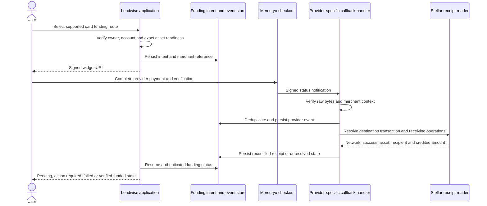

Store `providerStatus` separately from a local `receiptStatus` such as `not_seen`, `pending`, `verified` or `mismatch`. Those local labels are application design, not invented Mercuryo status values. A provider-success event with no verifiable destination receipt remains reconciliation-pending. Use the [documented merchant transaction query](https://widget.docs.mercuryo.io/guide/flows/on-ramp) to recover missed status updates where supported; poll with bounded backoff. Provider payment/refund status does not establish an automatic Lendwise refund policy.

#### Qualification and production boundary

The published [widget sandbox](https://widget.docs.mercuryo.io/guide/getting-started/sandbox) documents BTC Testnet and Ethereum Sepolia. Qualification proves the provider-supported sandbox checkout/status flow and independently tests Stellar account, asset and trustline handling with labeled staging fixtures. It does not claim a Stellar token was delivered by that sandbox.

Qualification records the actual merchant-enabled Stellar assets/countries and production setup. Production onboarding demonstrates the permitted live Stellar receipt. Sandbox state, keys and test tokens never enter production balances or outcome reports. The fiat off-ramp remains outside the submitted scope; neither a successful on-ramp nor a generic sell widget proves support for the selected Stellar asset and jurisdiction.

### CCTP funding and receipt verification

CCTP moves native USDC from a configured EVM source to Stellar through the existing burn/attestation/mint flow. Reuse [service.ts](../../src/lib/execution/cctp/service.ts), [message checks](../../src/lib/execution/cctp/message.ts), [mint validation](../../src/lib/execution/cctp/mint.ts), [trustline helpers](../../src/lib/execution/cctp/trustline.ts) and [transfer persistence](../../src/lib/db/repositories/bridge-transfers.ts). Source-chain configuration remains in [config.ts](../../src/lib/execution/cctp/config.ts); configured routes are not evidence that every route has been exercised.

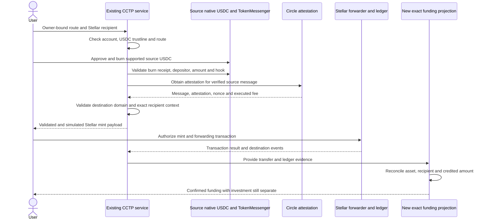

Keep the existing verified-message and `mint_and_forward` restrictions. The CCTP mint validator accepts the expected forwarder invocation and exact message/attestation; it is not a validator for arbitrary issuer transactions. On the inspected path, source USDC units have six decimals and Stellar units have seven, so the expected destination atomic amount is `(source_atomic_amount - executed_source_fee) × 10`. Verify the actual route's units and received amount, and report EVM gas, Circle fee and Stellar fees separately.

The existing completion status is not sufficient for new financial projections. `settleMint` can record completion with no extracted amount and can retain a mismatch warning; already-consumed-message recovery can also lack a receipt amount. The new receipt projection requires independently resolved destination success, exact Circle-USDC identity, owner/recipient and net credited amount. An unresolved amount remains pending reconciliation for funding attribution and metric inclusion.

Recovery queries known transaction hashes and message nonce state before resubmitting. Reusing identical signed bytes and constructing a new transaction are different actions. A consumed nonce prevents another protocol mint but does not by itself supply quantity evidence. Stale sequences/resource data require the supported rebuild and new authorization; expired-message handling follows the bridge's supported recovery/escalation path rather than an invented automatic refund.

## Onboarding orchestration

The onboarding coordinator composes the existing authentication/CCTP code with the new Privy signer, sponsor service and Mercuryo connector described above. It calls those components rather than duplicating their implementation. The coordinator owns user guidance, resumable progress and cross-component reconciliation. Privy sign-in, sponsorship, provider payment, USDC funding and Stablebond investment each have separate evidence and status.

### Journey state and production readiness

Persist a private journey keyed by owner and network with linked wallet, setup intent, sponsorship submission, funding intent/bridge reference and reconciled receipts. Its derived stages are `wallet_authenticated`, `setup_pending`, `account_ready`, `funding_pending`, `funded` or `action_required`. These are application states, not provider status names. Recompute progress from authoritative component records after a page reload; never trust a browser's last displayed step.

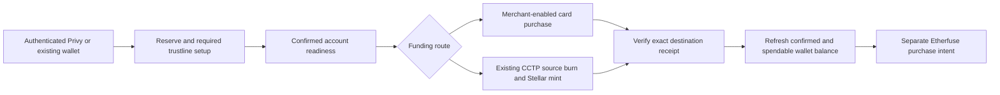

Enable production credentials only in the intended deployment. Confirm the Stellar asset/network, merchant countries and account/trustline authorization, and fund the controlled sponsor's reserve/fee budget. Both production funding routes must demonstrate their own permitted Mainnet receipt; an existing bridge result or sandbox widget alone cannot satisfy the complete onboarding integration.

The displayed balance reconciles with the wallet's confirmed Stellar state, not merely the sum of receipts: users may already hold assets or transact elsewhere. Pending or failed payments cannot create credited funds. A receipt already consumed by one projection cannot be credited again after a callback retry or page refresh. Before investment, re-read spendable USDC, trustline capacity, account authorization and required XLM/fee readiness instead of relying on an earlier funding screen.

### Account enrollment and user-visible failures

Confirmed onboarding creates an eligibility-candidate record with the authenticated owner link, account/network, setup/sponsorship transaction references and effective ledger/time. It does not automatically enroll every connected or sponsor-associated account in an outcome metric. The outcome service applies the agreed cohort policy and preserves its evidence.

Payment rejection, geographic restriction, lost session, delayed funding and missing receipt are distinguishable UI states. The coordinator can resume after re-authentication and references stored provider/bridge intents, without repeating an irreversible payment. Losing a funding session does not delete an already-confirmed balance or authorize another purchase.

## Etherfuse investment execution

This is the committed application-side gateway for one approved Stellar USDC-to-Stablebond route. It is separate from the Etherfuse read adapter, Mercuryo card funding and CCTP minting. The investor must be permitted by Etherfuse for the specific product, wallet and jurisdiction; the displayed issuer price or a valid SEP-10 session does not establish that permission. Additional issuer trading and redemptions are outside this purchase route.

### Customer, wallet and quote context

Maintain a private mapping from authenticated Lendwise owner/network/wallet to the appropriate Etherfuse customer and registered wallet references. Follow the approved customer verification and wallet-registration flow; retain provider approvals and terms state with a refresh policy. Do not claim a user's wallet is organization-owned merely to inherit the integrator's KYB approval. Expired/revoked approval or changed route terms block a new purchase and require the provider's permitted action.

Pin the provider API contract and environment. The following describes the documented [Stellar swap flow](https://docs.etherfuse.com/guides/testing-swaps); its `/ramp/...` interfaces must not be mixed with another API generation's customer, authorization or status contract.

| Provider interface                         | Lendwise responsibility                                                                                                                               |
| ------------------------------------------ | ----------------------------------------------------------------------------------------------------------------------------------------------------- |
| `GET /ramp/assets?blockchain=stellar`      | Resolve the exact permitted source/target identifiers for this environment; enforce approved mappings                                                 |
| `POST /ramp/quote`                         | Bind a generated quote ID, permitted customer, `blockchain=stellar`, swap type, exact source/target assets, source amount and wallet context          |
| `POST /ramp/swap`                          | Submit the persisted swap ID as `orderId`, accepted quote ID, intended wallet `publicKey` and blockchain; do not interpret empty HTTP 200 as delivery |
| Authenticated `swap_updated` event         | Receive the signing payload and provider state under the known swap/customer context                                                                  |
| `POST /ramp/swap/{order_id}/regenerate_tx` | Request a fresh provider transaction after supported expiry recovery; receive it through a new event                                                  |

Use decimal/atomic bounds to validate source amount, net target amount, exchange rate, fees, maximum slippage or other actual quote bounds, customer/wallet, asset pair and expiry. Preserve the exact provider quote and schema version used for consent. If the provider contract does not supply a needed execution bound, resolve that gap during route qualification rather than invent a value from the public issuer mark.

Before quoting/submitting, check confirmed spendable USDC, exact receiving trustline, receiving capacity, account/asset authorization and required XLM/fee headroom. A Privy wallet is a third-party wallet to Etherfuse, not an Etherfuse-managed embedded wallet. CAP-33 sponsorship does not imply that the provider's wallet-readiness logic accepts a zero-XLM account or that its payload can be fee-bumped. Qualify those cases; where necessary prepare the required XLM and supported trustlines through the approved setup/funding route before purchase.

### Persisted swap intent and asynchronous lifecycle

Store the local purchase intent **before** any side-effecting provider request. It includes owner, network, wallet, product/share class, USDC-out/Stablebond-in identity, amount limits, fees, customer reference, quote ID/expiry, swap ID, provider version, consent and request/body hashes. Stable identifiers correlate an early callback even if it arrives before the HTTP response.

The [swap endpoint](https://docs.etherfuse.com/api-reference/swaps/swap-assets) acknowledges asynchronously. Its signing payload arrives in `swap_updated`; after the send leg it supplies transaction references such as `sendTransactionHash` and `receiveTransactionHash`. The provider statuses and Lendwise's financial reconciliation are stored separately.

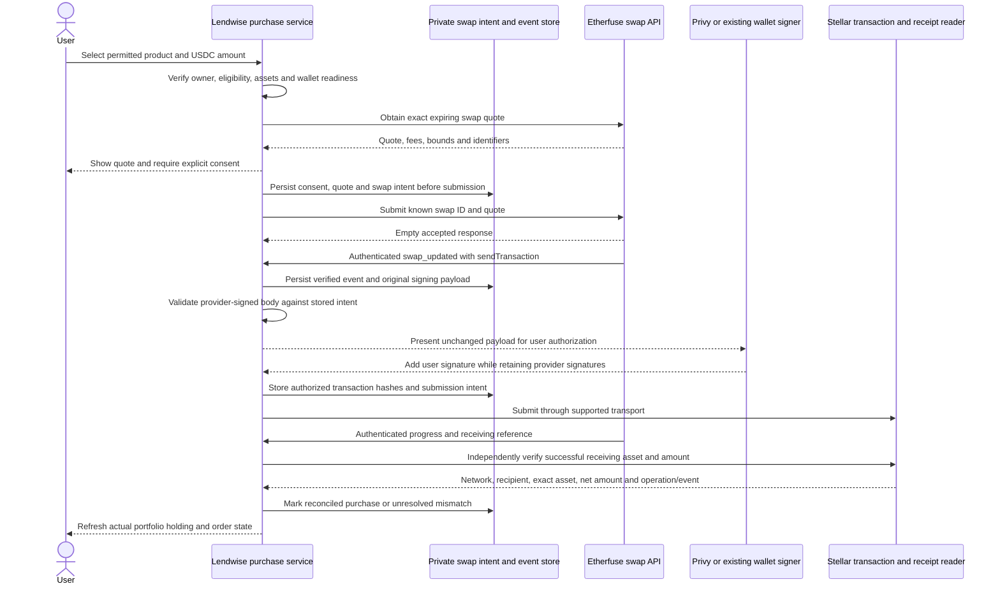

### Transaction validation and signatures

The documented route returns an Etherfuse-partially-signed `sendTransaction`. **Use the provider-built envelope; do not construct a local replacement or edit its transaction body.** Changing operations, source, fee or time bounds would invalidate existing signatures. Validate the body against the stored intent, preserve all required provider signatures, and add only the user's required authorization through the qualified wallet interface.

Checks include network passphrase, source accounts, sequence/preconditions, asset pair, amount bounds, fee/expiry, memo, allowed operation types and destinations. The outgoing payment/burn destination may be an approved provider account, while the receiving Stablebond destination is the user; validate each leg against its own stored expectation. Reject unexpected SetOptions, AccountMerge, new signers, unrelated transfers or unapproved contract calls. For an actual Soroban payload, also validate contract/function/arguments, simulation/resource data and required authorizations. The CCTP forwarder validator cannot perform this issuer-specific job.

If fee-bump support is qualified for this provider route, wrap the unchanged signed inner envelope under the sponsor policy; retain inner and outer hashes and map provider references to the correct envelope. Do not promise sponsorship by modifying a provider-signed inner fee. A changed/expired payload requires a fresh provider envelope and renewed user approval where its terms change.

### Etherfuse callback authentication

Use the [Etherfuse-specific verification contract](https://docs.etherfuse.com/guides/verifying-webhooks): parse a bounded valid JSON payload, canonicalize it using RFC 8785 JCS, decode the subscription's base64 secret, compute HMAC-SHA256 and compare the expected `sha256={hex}` header in constant time. Reject malformed or ambiguously parsed payloads and wrong environment/subscription contexts. This is deliberately different from Mercuryo's raw-body callback HMAC; a shared crypto primitive does not make the signing inputs interchangeable.

Deduplicate authenticated events and preserve delivery history, provider state and event/body hash. Bind every event to the stored customer/swap/wallet context. Store a durable accepted event before acknowledging it, then process projection updates idempotently. A delayed notification cannot move a reconciled state backward; contradictory evidence becomes an explicit reconciliation incident rather than a silently rewritten order.

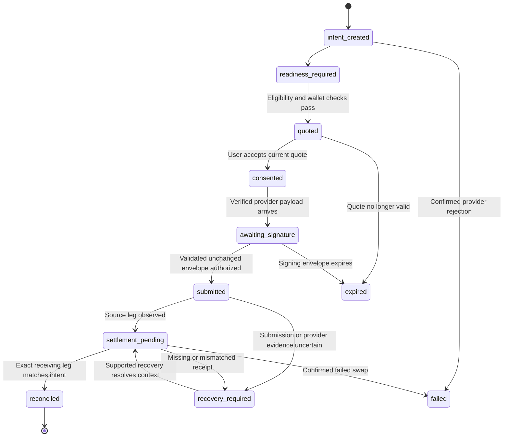

These are local states. The adapter maps the selected provider's `pending`, `funds_received`, `completed` and `failed` evidence into them; it does not submit those local names to the provider.

### Receiving-leg reconciliation and recovery

A completed investment requires a successful receiving transaction/event on the intended network with the exact Stablebond identity, recipient and net amount matched to the accepted quote/order. An outgoing USDC payment or provider-completed label is insufficient. A claimable delivery is tracked separately until claimed under the agreed holding policy. The portfolio reader continues showing actual ledger holdings independently; unresolved order attribution cannot invent an additional holding.

The documented swap service has no general status-polling endpoint, and `/ramp/order/{swapId}` is not a valid swap lookup. Recover using durable `swap_updated` events, known ledger hashes, provider-supported webhook recovery and operational escalation. Do not build a polling loop around a nonexistent order endpoint. For an expired unsigned envelope, use the [swap regeneration interface](https://docs.etherfuse.com/api-reference/swaps/regenerate-swap-tx) and wait for the new authenticated payload; do not submit the stale one or create a second economic purchase.

Every changed transaction body, including a regenerated payload with unchanged quote economics, requires fresh validation and a fresh wallet signature. Old signatures cannot be copied onto the replacement body. If price, fees, amount bounds, expiry of economic consent or other agreed terms change, obtain renewed purchase consent as well; retaining the swap reference is not authorization for different terms.

After an uncertain POST/submission, preserve the intent and reconcile existing identifiers/evidence before another irreversible request. Replay the identical logical request only when the selected provider contract explicitly guarantees the relevant idempotency behavior. A replacement quote creates a new consent context. Failed/refund states reflect what the provider actually confirms; automatic refunds or reversible burns are not promised.

## Public GraphQL API

Extend the existing Yoga endpoint instead of creating another public data service. Add RWA types and resolvers alongside existing lending queries. The public schema exposes market observations and published product terms, not customer KYC, private eligibility approvals, issuer account tokens or order-signing authority.

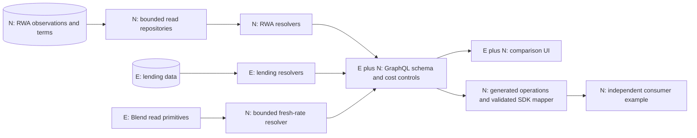

| Proposed query      | Repository/read behavior                                                   | Bounds and result semantics                                                                  |
| ------------------- | -------------------------------------------------------------------------- | -------------------------------------------------------------------------------------------- |
| `rwaProducts`       | Product/class/terms/asset projection                                       | Maximum page 100; public eligibility remains unknown unless it is a public product condition |
| `rwaObservations`   | Current revision per requested class/metric/price type                     | Maximum 50 class IDs; independent data and failure arrays                                    |
| `rwaHistory`        | Source-native observations under a fixed availability/revision snapshot    | Bounded range, initial maximum one year; keyset pagination                                   |
| `blendRateSnapshot` | Reuse direct Blend reads with actual source time, pool state and liquidity | Enforce caller age tolerance within server caps; no substitution of an old hourly mean       |

An example discovery operation, compatible with the proposed [SDL](examples/rwa-extension.graphql):

```graphql
query DiscoverEtherfuse {
  rwaProducts(issuer: "etherfuse", first: 20) {
    items {
      id
      shareClassId
      name
      currency
      maturityKind
      redemptionDelayDays
      liquidity {
        issuerRedemption
        secondaryMarket
      }
      fees {
        kind
        value
        includedInNav
      }
    }
    pageInfo {
      nextCursor
    }
  }
}
```

New `Decimal` values serialize as canonical strings. Existing `DateTime` is reused rather than redefined in the running schema. `FinancialObservation` exposes exactly one subject field: `shareClassId` or `lendingProductId`; runtime XOR validation reconstructs the SDK subject union. Revision lineage is explicit for both yield and price observations. Unsupported precision, invalid time and unknown financial conventions must not silently become floating-point defaults.

History cursors bind class, filters, interval, ordering and availability/revision snapshot. Since history contains separate NAV and yield streams, the cursor tracks each stream's continuation key. Validate every decoded field; opaque encoding alone does not make a cursor trustworthy. Bound rows even if aliases or nested selections multiply the request. Use the same stable snapshot for subsequent pages so a correction arriving between requests does not skip or duplicate observations.

### Caching and request isolation

Cache metadata, source observations and fresh Blend snapshots independently. Metadata can live longer than market observations. A cache hit retains the original source time and quality; it never sets `observedAt` to now. Cache keys include environment, issuer/API version, product/class or pool/asset, method version and relevant filters. Private owner data additionally requires owner-scoped isolation and must never enter a shared public cache.

An initial live Blend cache target of at most fifteen seconds can support a thirty-second consumer tolerance, but the server must check actual source age. A provider timeout or lock contention cannot be satisfied with an old result labeled fresh. Source revisions, approved identity changes and effective terms changes invalidate affected projections. The exact cache backing for new data is an implementation choice; the presence of existing Redis session/rate-limit code does not establish an existing RWA cache.

The current public limiter is 60 requests/minute/IP and deliberately fails open on Redis outage. Preserve that documented availability choice for ordinary public reads only with independent edge/body/cost/concurrency controls and alerting. Privileged order/signing routes require fail-closed protection. Read retries use bounded backoff; GraphQL HTTP 200 with an `errors` array still requires partial-data handling by the SDK.

The SDK section defines the packaging and consumer release boundary. The [SDK/API design](SDK_AND_API_DESIGN.md) supplies supporting interface examples; the integration contracts in this document govern the implementation.

## SDK and developer integration

`@lendwise/sdk` is the public read client for the GraphQL API. It must preserve the data's financial meaning and precision, not merely generate HTTP calls. It is independently installable and contains no browser wallet, private customer data, issuer credentials, signing service or strategy executor. Turbolong is the intended external pilot; a working independent consumer is the acceptance path without requiring another team's deployment.

### Package and dependency boundary

Create the proposed `packages/sdk/` package and add it to the workspace configuration during implementation. Export public client creation, validated data/error types and supported operations. The application can consume shared public contracts, but the published package cannot import `src/app`, Next.js/React, server adapters, database code or environment secrets. Explicit package exports and a packaged-file allowlist prevent implementation files or credentials from leaking into the npm tarball.

The package declares supported runtimes/module formats and verifies the built artifact in those runtimes; do not imply universal runtime support from TypeScript compilation. Allow a caller-supplied fetch/transport and API URL without making arbitrary URLs a server-side request-forgery surface in Lendwise's own endpoints. Bound requests, accept cancellation and implement controlled retries only for idempotent reads. Respect HTTP 429/Retry-After and distinguish transport errors from GraphQL partial errors.

### Public query surface and runtime validation

| SDK operation         | API integration                                         | Data preserved                                                                                 |
| --------------------- | ------------------------------------------------------- | ---------------------------------------------------------------------------------------------- |
| `products.list`       | `rwaProducts`                                           | Legal class/product, exact asset mappings, currency, terms and pagination                      |
| `observations.latest` | `rwaObservations`                                       | Price/rate type, original units, source times, quality, failures and revision identity         |
| `history.list`        | `rwaHistory`                                            | Real interval coverage, separate price/yield records and stable continuation cursor            |
| `lending.blendRates`  | `blendRateSnapshot` and the existing lending interfaces | Exact pool/asset subject, supply/borrow direction, method, source time and available liquidity |

Generated GraphQL operations/types are inputs to the client, not substitutes for runtime validation. Decode responses into the [public design contracts](examples/contracts.ts), validate exact asset/network shape, decimal strings, timestamps, quality/status and subject identity. `FinancialObservation` has a fund-share-class subject or a lending-product subject, never an ambiguous mixture. The GraphQL representation's nullable subject fields are validated as an exclusive union when mapping to public SDK types.

Keep monetary amounts and rates as canonical decimal strings or the documented exact representation. Do not pass them through `Number()` to simplify consumer code. Display rounding is a consumer concern and cannot change stored API values. Preserve the same API response's observations and timestamps; comparing against a later live oracle read is not a valid precision test.

### Errors and unavailable results

The client distinguishes transport/timeout/cancellation, HTTP rate limiting, malformed/schema-incompatible data, GraphQL operation errors and per-product unavailability. Missing history, unsupported fields and a legitimate zero remain different states. A useful partial batch preserves successful products and their source-specific failures; it does not quietly drop a failed product or replace it with a zero-valued observation.

The SDK never relabels an issuer indication, money-market yield, realized price return and Blend borrowing APY as the same metric. It exposes their methods, periods and comparability information so a consumer can decide whether a calculation is meaningful. No helper infers investor approval, executable liquidity or guaranteed strategy profit.

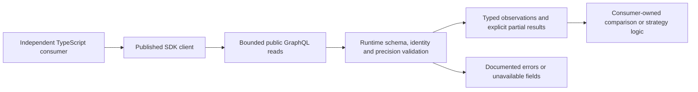

### Consumer example, tests and publication

The standalone example installs the released package into a separate TypeScript project, retrieves Etherfuse observations and Blend lending data, and checks subject/currency/method/freshness before using the values. It demonstrates real API consumption without importing Lendwise frontend code or pretending incompatible returns share a common basis. Any Turbolong-specific leverage, liquidation, swap or execution logic remains outside the package.

Release verification includes pure response/precision/error fixtures, query-contract tests, a consumer run against the packaged artifact, package-content inspection and supported-runtime checks. Test malformed responses, HTTP/GraphQL failures, unavailable history, stale inputs and cancellation without requiring private provider credentials for the core suite. Keep optional live API smoke checks distinct from deterministic CI.

Publish a versioned npm artifact with reproducible build metadata and restricted publication rights. Semantic versioning and a changelog describe contract changes; generated types alone do not guarantee backward compatibility. The SDK usage guide covers installation, configuration, supported queries, pagination, decimal/method semantics, partial errors, unavailable data and upgrades. API resolvers own server behavior; the SDK owns transport, validation and package/consumer documentation. The operational documentation connects those contracts to source configuration and recovery procedures.

## Security model and monitoring design

The threat model describes the actual integration trust boundaries, not a claim that using a wallet or payment provider makes the application secure. Use Stellar's [STRIDE template](https://developers.stellar.org/docs/build/security-docs/threat-modeling/STRIDE-template) and [builder monitoring template](https://developers.stellar.org/docs/build/security-docs/monitoring/monitoring-template-builders). The completed model and linked operational plan are controlled documents, with a safe public summary. This section specifies their implementation responsibilities without exposing live response secrets.

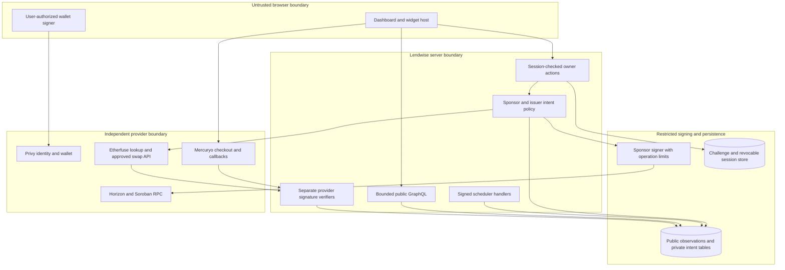

### Threat-to-control mapping

Assign stable threat IDs to concrete flows, then reference those IDs from controls, monitors and tracked findings. The table describes the required threat categories; the completed model expands each against the actual data-flow diagram and component inventory.

| STRIDE concern         | Integration threat                                                            | Prevention/detection boundary                                                                    | Response authority                                                                     |
| ---------------------- | ----------------------------------------------------------------------------- | ------------------------------------------------------------------------------------------------ | -------------------------------------------------------------------------------------- |
| Spoofing               | Email identity or a forged callback substituted for wallet/provider authority | Validated Privy token plus SEP-10; provider-specific signatures and tenant/intent matching       | Reject request, revoke affected application sessions, pause affected connector         |
| Tampering              | Wrong issuer/asset, altered XDR or changed source values                      | Approved mapping, immutable source evidence, exact intent/XDR checks and preserved signatures    | Quarantine observations or signing payload; retain evidence                            |
| Repudiation            | Claimed payment/consent cannot be tied to an action                           | Owner-bound intent, consent record, body hash and ledger/provider references                     | Investigate immutable event/transaction chain without publishing private customer data |
| Information disclosure | KYC, tokens or signing credentials reach public API, SDK or logs              | Server-only secrets, private-table authorization, scoped logging and export review               | Restrict access, rotate affected secrets and follow incident process                   |
| Denial of service      | Provider outages, replay floods or unbounded queries exhaust services         | Deadlines, quotas, pagination/cost limits, leases, deduplication and source isolation            | Pause expensive paths; preserve unaffected reads and lending                           |
| Elevation of privilege | Signer or sponsor service executes unauthorized operations                    | Fail-closed owner/policy checks, operation allowlist, budget reservations and restricted signing | Stop new signing/sponsorship; reconcile outstanding signed intents                     |

The monitoring plan inventories Mainnet/Testnet accounts, contracts, asset representations and the services responsible for their interpretation. A missing future production address is explicitly `planned`, not `active`; activation checks populate and verify the final address before live use.

### Monitoring rule contract

Each rule contains `monitorId`, referenced `threatIds`, network/component/address, observed signal, baseline, trigger condition, severity, operator, notification channel, response, implementation status and verification evidence. Examples of required rule families are reserve/fee exposure, unexpected account/signing changes, callback-authentication failures, source schema/identity changes, stale or missing observations, missing receipt reconciliation and stalled funding/swap states.

Onchain effects are monitored from the actual ledger/account/contract footprint. Source outages, compromised browser behavior, email/session abuse and upstream NAV integrity also need off-chain controls. Record any detection gap and compensating action; do not pretend all threats emit a useful onchain event. A failed monitor or stale telemetry is itself an observable health condition.

Security design specifies and reviews these rules through a documented incident walkthrough for unauthorized sponsor expenditure and missing Etherfuse delivery. Operational implementation activates rule execution, alert routing and recovery exercises. Findings have an owner and resolution deadline; release-blocking findings are resolved before activation. Containment is limited to Lendwise-controlled actions and services: the team cannot assume it can freeze a third-party issuer, reverse settled transfers or automatically refund a swap.

## Deployment, recovery and operational documentation

### Production migrations and compatible rollout

The database change is additive: RWA/reference, sponsorship, provider-event, purchase and reporting records do not replace lending tables. Apply indexes/constraints and compatible readers before activating new writers. The Neon HTTP driver uses its supported batch/transaction or atomic-statement facilities; do not hold a fictional interactive transaction open across external HTTP calls. Deploy network/environment configuration separately from source code and never give preview/test deployments production signing credentials.

```mermaid
flowchart LR
  Schema["Additive schema and indexes"] --> Internal["Validate collection and internal read projections"]
  Internal --> Staging["Staging UI, provider flows and security review"]
  Staging --> Public["Activate compatible production GraphQL and UI"]
  Public --> Operations["Verify monitoring and recovery controls"]
  Operations --> Funding["Activate qualified production onboarding routes"]
  Funding --> Purchase["Activate approved Etherfuse purchase route"]
  Purchase --> Reports["Collect confirmed receipts and metric snapshots"]
```

Promote the validated comparison, portfolio and screening implementation to production through the public resolvers and compatible deployment; avoid maintaining a separate financial implementation for the production UI. Keep independent controls for source collection, per-issuer public reads, position projections, new sponsorship, each funding connector and new purchase intents. Feature controls provide incident isolation; disabled committed features are not accepted as completed integrations.

Rehearse migrations and recovery in staging with existing lending rows and transaction/order records. If a production release must be backed out, restore a compatible application and disable affected new paths while preserving financial records; roll-forward a corrected schema where reversal would lose data. Never erase a submitted intent or receipt by restoring an older database snapshot as a routine code rollback. Verify the actual public query/UI response for the same stored observation, not independent live reads that may have changed between requests.

The existing repository promotion/deployment convention remains the starting point. Each environment records the deployed code/schema and provider configurations. Passing a repository check or naming a branch `mainnet` does not prove the corresponding deployment or provider route is active.

### Operational implementation and documentation

Deploy production rules against the actual accounts, contracts, source versions and provider configurations. Track per-source collection completion separately from source-publication completeness. Start the fourteen-day collection-reliability record when scheduled RWA collection begins and retain every scheduled run outcome, failure, retry, gap and correction. The report describes actual completeness and recovery results rather than omitting failed runs.

Monitor source age/schema/identity failures, RPC/block age, collection leases/checkpoints, sponsor reserves/fees/pending exposure, authenticated callback failures, stalled funding/swap states and missing destination reconciliation. Test alert routing to assigned operators and monitor the monitoring process itself. A pause must stop new affected actions without hiding confirmed holdings, deleting evidence or disabling unrelated lending. Update the final production inventory before activating a rule marked `active`.

Publish the RWA adapter/source-authoring guide, supported source methods and history limits, server GraphQL reference, operationally safe integration examples, and metric calculation/export instructions. The SDK guide covers installation, queries and upgrades. Keep full threat models, signing procedures, secret inventories and sensitive incident response details in controlled storage. The public documentation site is a separately deployed/proxied project; repository Markdown alone does not prove a public URL has been published. Release validation checks the actual public documentation and example outputs.

Recovery restores a compatible application and data projection from immutable evidence and additive schema state. Preserve lending rows, submitted order/transaction records and accepted observation revisions. Rebuild caches/derived values; do not restore an old database over newer financial transactions as routine rollback. A source correction or incident revaluation receives a new version and report lineage rather than silently repainting an issued report.

## Onchain attribution and outcome accounting

The reporting service derives auditable outcomes from the eligible account registry, exact financial snapshots and confirmed funding receipts. Its inputs and calculations remain separate from application display totals.

### Account eligibility and attribution

The outcome scope is **Stellar accounts onboarded through Lendwise**, established from application onboarding records plus verified onchain setup/sponsorship evidence. An arbitrary connected address, current sponsor filter or shared issuer account does not establish membership. Keep an effective-dated, versioned account register containing network/address, authenticated owner/consent link, local onboarding reference, setup/sponsorship transaction and operation references, eligibility reason and policy version.

Horizon sponsorship data supports that register; it is not the whole cohort definition. Sponsorship can later change or be removed. Historical eligibility and past daily totals must not change merely because the current sponsor field changes. Record additions/revocations and the agreed effective times; do not quietly remove emptied accounts from previous denominators. Existing-wallet inclusion or unusual onboarding cases require the accepted enrollment policy instead of being inferred from a page visit.

Keep private identity/KYC/provider records separate from public addresses and ledger evidence. Register the accepted attribution footprint and account-set rules before measurement. Both proposed targets remain subject to the review panel's confirmation or adjustment; the ratified rule version, periods and thresholds are inputs to the report manifest.

### Target 1: average net assets held on Stellar

The submitted target is **at least $100,000 average USD-denominated net assets over 30 consecutive days** across eligible Stellar accounts. It includes native Circle USDC, supported Etherfuse/other approved RWA holdings and attributable supported Stellar lending positions, with actual outstanding borrowing liabilities deducted and duplicate exposures excluded. This is broader than RWA-only holdings and different from a token's per-unit NAV. EVM portfolio positions are not part of this Stellar metric.

For each agreed daily cutoff `d`, derive a versioned set of eligible accounts `E(d)` and their approved asset/position claims from compatible confirmed ledger contexts. For account `a`:

```text
wallet_assets(a,d) = sum(exact wallet quantities × approved USD price/FX)
lending_assets(a,d) = sum(exact underlying supply/collateral claims × USD price/FX)
borrowing_debt(a,d) = sum(exact outstanding borrowing liabilities including accrued interest × USD price/FX)

net_assets(a,d) = wallet_assets(a,d) + lending_assets(a,d) - borrowing_debt(a,d)
daily_total(d) = sum(net_assets(a,d) for a in E(d))
average_net_assets = sum(daily_total(d) for all 30 agreed cutoffs) / 30
```

The calculation requires the following accounting rules:

| Input                                   | Required interpretation                                                                                                           |
| --------------------------------------- | --------------------------------------------------------------------------------------------------------------------------------- |
| Native Stellar USDC                     | Verify the exact Circle issuer/network; value with the agreed USD valuation policy, not ticker equality                           |
| RWA wallet quantities                   | Use exact Classic/native-contract quantities, one economic claim per balance, approved dated price and contemporaneous FX         |
| Stellar lending positions               | Resolve each user's underlying supply and collateral claim using the actual protocol share/exchange-rate accounting at the cutoff |
| Borrowing liabilities                   | Deduct nominal economic debt including accrued interest once; do not substitute collateral/risk weights or a health-factor score  |
| Trustline buying/selling liabilities    | Use for spendability/capacity checks; outstanding offer encumbrances are not automatically protocol borrowing debt                |
| Classic/SAC or receipt/underlying views | Count the beneficial economic claim once; do not add both a receipt/share token and its attributed underlying claim               |
| Sponsor obligations/capital             | Sponsor-owned XLM reserve/fee capital is not user USDC/RWA/lending value and cannot inflate the metric                            |
| Missing asset or debt read              | Mark the snapshot incomplete; never assume a missing debt is zero or silently remove an account/day                               |

Existing UI projections are not an exact metric store. The [wallet projection](../../src/lib/stellar/wallet-holdings.ts) uses JavaScript numbers, and the [Blend position adapter](../../src/lib/protocols/blend/v2_1/positions.ts) uses floating-point SDK projections. Build a distinct exact accounting projection from the protocol's integer balances/indexes and documented decimal scales. For each Blend `(network, pool, user, reserve)` count the underlying supplied-plus-collateral claim once and its nominal debt once. The current presentation can repeat a collateral list on multiple borrow positions; summing those UI rows would overcount.

Read prices, FX, ledger balances, share conversion rates and accrued debt under an agreed cutoff and freshness policy. Live current endpoints are not arbitrary historical APIs. Collect snapshots prospectively and use verified history/indexer records where needed; preserve each read's ledger/block/time and disclose any allowed as-of tolerance. Do not silently floor a negative account net value to zero. The full 30-cutoff denominator remains fixed; missing data requires repair or an explicitly agreed valuation treatment before success is claimed.

```mermaid
flowchart TB
  Register["Versioned eligible Stellar account register"] --> Cutoff["Agreed daily cutoff and ledger contexts"]
  Cutoff --> Wallet["Exact native USDC and supported RWA wallet balances"]
  Cutoff --> Supply["Underlying Stellar lending supply and collateral claims"]
  Cutoff --> Debt["Accrued borrowing liabilities"]
  Prices["Versioned approved price and FX observations"] --> Mark["Deduplicated USD asset and debt valuation"]
  Wallet --> Mark
  Supply --> Mark
  Debt --> Mark
  Mark --> Coverage{Inputs complete and compatible?}
  Coverage -->|no| Incomplete["Incomplete snapshot with explicit gaps"]
  Coverage -->|yes| Daily["Sum net assets across eligible accounts"]
  Daily --> Window["Average all 30 agreed daily totals"]
  Window --> Report["Reproducible report and full input manifest"]
```

### Target 2: gross qualifying USDC inflows

The submitted target is **at least $30,000 cumulative qualifying USDC inflows over a continuous 60-day period**, received into eligible Lendwise-onboarded Stellar accounts through CCTP or Mercuryo. It measures gross receipts rather than receipts net of subsequent withdrawals.

```text
qualifying_inflows = sum(actual destination USDC credited by each distinct qualifying receipt
                         within the full 60-day confirmation-time window)
```

Use successful Stellar destination evidence and the associated CCTP transfer or Mercuryo order. Include exact Circle-USDC identity, eligible recipient at receipt time, network, transaction hash, operation/event identity, confirmation ledger/time and net credited token amount. Gross here means withdrawals do not reduce inflows; it does not mean substituting a larger source burn or pre-fee quote for the amount actually received.

Canonical receipt identity is scoped by network, transaction, operation/event, asset and recipient. A transaction can contain multiple real transfers, so transaction hash alone is insufficient; conversely, an event and its corresponding operation/provider callback must not become two economic receipts. Store the mapping to the same canonical credit. Exclude failed, pending, duplicate and eligible-account internal transfers. If a provider settles through an intermediate contract, resolve the actual delivery trace rather than counting intermediate bookkeeping as customer inflow.

Withdrawals are reported separately and are not silently netted from this submitted gross measure. Flag suspected wash activity, self-generated round trips or related-party funding for the agreed anti-abuse review; apply additional exclusion rules only through the ratified policy and disclose them. Do not label all account-to-account transfers as Mercuryo/CCTP inflows merely because a wallet was originally funded through one of those routes.

### Metric persistence and reproducible report

All records below are new proposed reporting structures. They reference immutable input versions rather than depend on mutable UI/API totals.

| Proposed record              | Required fields and invariant                                                                                                       |
| ---------------------------- | ----------------------------------------------------------------------------------------------------------------------------------- |
| `stellar_onboarded_accounts` | Account/network, onboarding and sponsorship evidence, effective membership, owner-link/consent reference and policy version         |
| `stellar_snapshot_runs`      | Cutoff, account-set version, source ledger/block contexts, method version, completeness and gap summary                             |
| `stellar_position_legs`      | Owner/claim identity, wallet/lending/debt category, exact atomic/decimal quantity, protocol conversion inputs and deduplication key |
| `stellar_valuation_inputs`   | Exact price/FX observation IDs, source/units, quality, age policy, revision and calculation version                                 |
| `stellar_funding_receipts`   | Canonical credit identity, provider/bridge link, exact asset/recipient/amount, confirmed time and inclusion/exclusion reason        |
| `stellar_metric_runs`        | Full window, target/policy version, account/snapshot/receipt IDs, executable query/code version, totals, hashes and report status   |

Create daily runs and receipt projections idempotently. Updating an eligibility policy, price revision or decoder creates a new reproducible run; it does not alter the source transactions or erase a previously published result. Derived report caches may be rebuilt, but accepted historical inputs and lineage remain auditable.

The report/export package contains the eligible addresses and onboarding references, all 30 daily totals split into USDC/RWA/lending/debt legs, source price/FX and conversion references, explicit missing-data coverage, and the full 60-day receipt list with included/excluded reasons. Include safe provider/CCTP references, exact units, the method/policy version and runnable calculation/query instructions. Keep KYC, session tokens, secrets and private provider credentials out of public exports.

Engineering completion and the observation/usage windows are different milestones. Reports show whether each complete ratified window and target has actually been met; release configuration, synthetic transactions or dashboard traffic cannot replace that outcome.

## Verification and integration testing

Testing follows the system boundaries and expected integration outcomes. Pure source/financial/SDK checks run without private provider credentials; separate approved sandbox/Testnet and Mainnet acceptance checks verify real provider and ledger behavior. Labeled fixtures never count as production receipts or user adoption. The matrix defines required verification and documentation for each subsystem; it does not claim that the new implementations have already passed.

| Subsystem                            | Important verification                                                                                                                                                                | Required implementation/documentation output                                                          |
| ------------------------------------ | ------------------------------------------------------------------------------------------------------------------------------------------------------------------------------------- | ----------------------------------------------------------------------------------------------------- |
| Etherfuse and collection             | Etherfuse exact identity/decimals, both return models, absent history, duplicate/revised observations, checkpoint recovery and historical FX                                          | Adapter contract, source-field/method mappings, collection/history setup and limitations              |
| Wallet authority and sponsorship     | Real Privy challenge/transaction signing, unfunded-account SEP-10, session revocation, multi-source CAP-33 signatures, fee bumps, reserve/fee caps, sequence races and pause/recovery | Wallet/sponsor configuration, supported operations, key boundary and incident/removal procedures      |
| Mercuryo connector                   | Supported Mercuryo sandbox flow, separate Stellar readiness fixtures, URL signature, raw-body callback fixtures, duplicates, out-of-order events and receipt mismatch                 | Enabled merchant assets/countries, environment/signature contract and production qualification record |
| Spiko and Ondo sources               | Spiko class/contract/NAV mapping, Ondo Ethereum reference price and block context, precision, gaps and independent source failures                                                    | Source capabilities, identity mappings, history limits and common conformance reports                 |
| Portfolio and comparison             | Classic/SAC deduplication, native contract holdings, exact quantities, stale/unknown marks, restrictions and compatible screening                                                     | Product/portfolio field meanings and comparison/exclusion rules                                       |
| Security model and monitoring design | Architecture/trust-boundary coverage, all STRIDE categories, threat-to-control/rule linkage and incident walkthrough                                                                  | Private complete model/monitoring plan, owned findings and safe public summary                        |
| Public API and migrations            | Additive GraphQL compatibility, bounded cursor/range/cost behavior, precision/null semantics, migration and lossless recovery                                                         | Public schema/resolver changes, release checks and recovery instructions                              |
| SDK and independent consumer         | Installed npm artifact, same-response precision, subject validation, partial errors, unsupported history, cancellation and versioned independent consumer                             | Published package, tested exports and runnable SDK usage/upgrade guide                                |
| Onboarding and funding receipts      | Permitted live Privy/sponsored setup and both funding routes, exact destination receipts, reload/retry and no double credit                                                           | Production journey/configuration and operator/user recovery guidance                                  |
| Etherfuse execution                  | Eligibility/readiness, quote consent, provider-signed XDR preservation, wrong asset/destination/amount rejection, canonical-JSON callbacks, expiry and receiving-leg evidence         | Qualified purchase gateway, state/receipt audit trail and purchase/failure guide                      |
| Operations and outcome reports       | Active alert delivery, missing telemetry, fourteen-day completeness reporting, staging restore, account eligibility and independent metric reproduction                               | Public adapter/server docs, controlled runbooks and complete-window reproducible outcome reports      |

Report tests against the implemented code/package/deployment and its actual inputs. Reviewers must be able to follow a result from an observation, session, intent or transaction to its responsible module and expected outcome. Financial tests use independent known-value cases and invariants; transaction tests cover rejected as well as successful paths. The existing lending, wallet and CCTP regressions remain part of release acceptance.

The [design contracts](examples/contracts.ts), [GraphQL extension](examples/rwa-extension.graphql), [query examples](examples/queries.graphql), [financial checks](examples/financial-checks.mjs) and [consumer checks](examples/consumer-checks.mjs) are supporting design artifacts. They are not a deployed adapter, sponsor service or published npm package. The implementation must preserve or explicitly version those public contracts rather than assume documentation examples execute production work.

## Architecture decisions and scope boundaries

| Decision                                         | Technical reason                                                                             | Consequence                                                                                    |
| ------------------------------------------------ | -------------------------------------------------------------------------------------------- | ---------------------------------------------------------------------------------------------- |
| Separate RWA and lending financial models        | Issuer price/income/maturity semantics differ from lending APY                               | Reuse infrastructure; keep separate observations and explicit comparability                    |
| Exact identities and decimal values              | Symbols and floating-point totals cannot establish claims or financial evidence              | Network-qualified mappings, integer quantities and source-linked decimal prices                |
| Source-native history with revisions             | Collection time and data availability do not recreate past source values                     | No invented history, donor-copy repair or unversioned corrections                              |
| Privy plus existing SEP-10 owner boundary        | Email identification and wallet-control proof solve different problems                       | Required signer integration and session/recovery tests; no issuer-eligibility inference        |
| Distinct reserve/fee sponsorship                 | CAP-33 and fee-bump operations have different authorization and accounting                   | Controlled obligations, budgets, sequence management and explicit signatures                   |
| Separate provider adapters and callbacks         | Etherfuse and Mercuryo authenticate different signing inputs and expose different lifecycles | No generic webhook verifier or invented cross-provider polling endpoint                        |
| Data reads separated from purchase authority     | Public observations do not grant access to regulated transactions                            | Committed gateway with provider approval, user consent and exact settlement checks             |
| Complete independent read SDK                    | Consumers need stable values, errors and package behavior, not application internals         | Typed/validated/versioned client; no strategy execution, wallet custody or frontend dependency |
| Exact outcome projection separate from UI totals | Financial report needs debt, duplicate-claim and evidence controls absent from legacy floats | Full-cohort snapshots, gross receipt ledger and reproducible method/policy versions            |

The target system includes the complete data, wallet, funding, investment, developer and operational paths described here. Public data can be released independently for fault isolation; the complete integration also requires production wallet, funding, purchase and outcome capabilities. The qualification gates establish whether a route is permitted and working; a provider denial requires resolution of the delivery scope rather than a feature flag presented as completion.

Spiko/Ondo trading, fiat off-ramp, BENJI/WisdomTree/Centrifuge adapters, an MCP server, unattended investment execution, generalized strategy/leveraged allocation and guaranteed third-party consumer deployment are outside the submitted scope. The architecture nevertheless preserves reusable source, identity and read-client boundaries for future separately approved work.
