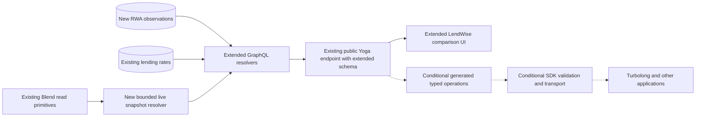
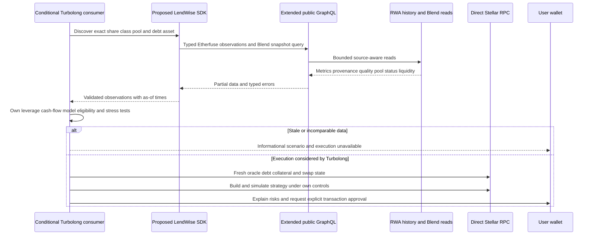

# GraphQL and `@lendwise/sdk`

The existing public read-only Yoga API and generated GraphQL workflow are reusable. There is no verified published SDK in this repository. This is the design for a **conditional**, small generic read client; Turbolong-specific leveraged strategy logic stays with Turbolong.

## Public GraphQL extension

[rwa-extension.graphql](examples/rwa-extension.graphql) is a parseable additive SDL contract. Reuse existing `DateTime` rather than defining it twice when merging into the real schema; register new `Decimal` with canonical string serialization and bounded input validation. The validator extracts the actual existing SDL without executing application modules, composes the extension with it, checks that existing query fields remain, and validates the three example operations. This is not proof that resolvers exist.

New queries: `rwaProducts`, `rwaObservations`, `rwaHistory`, `blendRateSnapshot`. Existing `products`, APY queries, ProtocolName enum and pagination semantics remain unchanged. New RWA resolvers project the canonical types in [contracts](examples/contracts.ts): financial provenance/quality is flattened in GraphQL, converted back to the nested SDK type by a validated mapper. A financial observation has exactly one subject: GraphQL exposes either `shareClassId` or `lendingProductId`, and the SDK maps that pair to its discriminated `subject`. Enforce this exclusive-or rule at runtime; lending reserves are not fund share classes. Product response is intentionally a public share-class projection, excluding private investor approvals and raw KYC. Generic eligibility in public data is **unknown**, not user-specific approval.

History uses keyset cursors bound to class, range, revision snapshot and ordering `(observed_at,id)`; reject a cursor reused with other filters. Separate NAV/yield arrays in a history page share the same stable snapshot; cursor payload tracks the last key per stream, preventing skipped entries. Page maximum 100; maximum IDs per observation batch 50; one-year initial range maximum; explicit UTC endpoints with `from<to`. Return revisions/current version metadata. Future larger exports use asynchronous authenticated quotas, not an unlimited public query.

`FinancialObservation` exposes original metric/value/unit; decimal/effective rates; fee/rate/income basis; compounding/day count; method and assumptions; timestamps/provenance/quality. Missing effective annual rate is legitimate data, not a GraphQL error. Failed products are reported in `ObservationBatch.failures` while unaffected products return normally. A critical malformed query is a GraphQL validation error, not a successful empty list.

`blendRateSnapshot` is a **new** bounded read capability: use the existing Blend loading/SDK math but capture an exact source time, pool status, liquidity and source APR if available. Do not satisfy `maxAgeSeconds:30` from an hour-old APY table. Runtime implementation must cap parameter ranges, concurrency and cost; client requests cannot force unlimited cache bypasses. Failure to meet freshness returns `STALE_DATA`, without silently substituting historical averages.



## SDK API and packaging

Canonical API: `products.list`, `observations.latest`, `history.list`, `lending.blendRates`; input/return types are in [contracts](examples/contracts.ts). A future factory `createLendWiseClient({endpoint, fetch, timeoutMs, signal, cache})` implements that interface. No default endpoint is embedded until hosting/version policy is agreed. Consumers may inject fetch for Node/browser/test runtimes. No React dependency, no wallet provider and no issuer credential in this SDK.

Proposed package layout:

```text
packages/sdk/
  package.json                  # @lendwise/sdk, explicit exports and files
  src/client.ts                 # transport, cancellation, bounded GET retries
  src/generated/                # committed typed public operations
  src/types.ts                  # canonical domain contracts
  src/validation.ts             # runtime decimal/metric/time validation
  src/errors.ts                 # stable discriminated error codes
  src/cache.ts                  # source-aware TTL, no private data caching
  test/                         # fixtures, transport and consumer contracts
  README.md                     # supported API versions and examples
```

Start as `0.1.x` experimental and publish `1.0.0` only after a stable public contract and at least one consumer acceptance. ESM plus type declarations initially; add CJS only with an actual consumer requirement. Explicit exports exclude server internals and raw GraphQL transport secrets. Workspace expansion/build configuration is future implementation work, not included here.

Use semantic versioning for field/type/method changes and metric semantics. A changed mathematical interpretation needs a new method version and release note even if the TS shape is unchanged; it can be a breaking change. Deprecate documented fields before removal. Pin generated operations and GraphQL schema checksum in release artifacts.

## Consumer flow and errors

Working-style TS consumer `loadStrategyInputs` in [contracts](examples/contracts.ts) accepts an injected SDK and returns data plus an informational state. It intentionally returns no profit figure. A prospective consumer creates the client, discovers the exact Etherfuse share-class and Blend reserve IDs, then calls that function. Opaque IDs must be obtained from API responses/configuration; do not hardcode a sample contract copied from marketing.

Errors use discriminated data, following the repository's functional conventions: `INVALID_SOURCE`, `SOURCE_UNAVAILABLE`, `STALE_DATA`, `ASSET_MISMATCH`, `NOT_COMPARABLE`, `UNSUPPORTED_CAPABILITY`, `RATE_LIMITED`, plus transport `INVALID_INPUT`, `TIMEOUT`, `UNAUTHORIZED` and `API_VERSION_MISMATCH` in the implemented SDK. Include safe message, product/field where applicable, retryable flag, request ID and Retry-After. Never expose upstream authorization headers or raw private customer errors.

Transport retries apply only to safe reads: at most three attempts, jitter and Retry-After, request abort propagated. HTTP 200 with GraphQL `errors` is not automatically success; preserve data/errors and reject if required fields failed. Decimal parsing rejects exponent/precision forms outside the documented domain, NaN/Infinity and excessive input length. Unknown metric/convention causes safe rejection or explicit unknown status, not fallback to APY.

## Authentication, caching and rate limits

Public market reads require no authentication under current API policy. Private issuer account holdings, order states and signing are excluded from public SDL and require a separate owner-scoped session/consent service. If partner API keys are later offered for higher read quotas, keep them server-side; browser clients use public quotas. A market API key must not grant order execution.

Reuse existing GraphQL Armor limits and IP limiter, with a revised tested cost model for new fields. Existing policy is 60 requests/minute/IP and fails open on Redis loss; add edge/body/concurrency protections and alerts before exposing expensive live reads. Avoid assuming `first` alone bounds `shareClassIds` or nested fields. No arbitrary source URLs or SQL fragments in filters. Test introspection remains usable because current codegen depends on it.

Cache public issuer source responses by issuer/version/product/network, bounded by source TTL; keep observation as-of timestamps even on hits. Product metadata can use a longer TTL than prices. Proposed Blend live cache ≤15 seconds for a 30-second consumer tolerance, with server-measured source age. Invalidate on revisions/terms/control changes. Never share owner-scoped data across users. A TTL is not evidence a source observation is fresh.

## Turbolong sequence and responsibilities



Historical/delayed issuer data is suitable for comparison with explicit age. Leveraged interfaces must use current borrowing state and executable swap/redemption assumptions. Proposed 30-second borrow tolerance is a starting engineering constraint, not a provider guarantee; NAV may legitimately publish daily. If a strategy requires a real-time executable valuation that the issuer cannot provide, disable execution-oriented output. SDK observations are not collateral or liquidation oracles.

Partner interest is not an agreement. Release gate: Turbolong supplies a named owner, accepted schema/IDs, freshness requirements, strategy model and a fixture-based integration acceptance record. No partner contact was sent during this assignment.

## Tests, CI and npm publication

Future tests cover generated-operation/schema compatibility, all metric nullability, source timestamp mapping, precision, history cursor stability/revisions, partial failures, cancellation, 429/retry, graph errors with partial data, cold/expired cache, consumer snapshots and browser package secret exclusion. SDK CI runs without Graph API/issuer secrets; existing repo CI skips tests/typecheck without Graph credentials, so add a separate unconditional pure-check job when implementing.

Before publishing, confirm npm `@lendwise` organization ownership, package name availability, licence and dependency policy. Use protected trusted publishing/OIDC, maintainer approval, provenance attestations, MFA and explicit package contents (`npm pack --dry-run`). Test installed tarball in a minimal Node/browser consumer. Do not embed or publish sample `.env`, issuer keys or runtime evidence containing private user data. Publication is future work and was not performed here.
